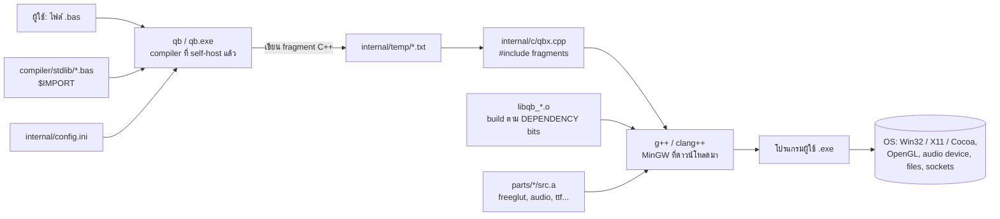
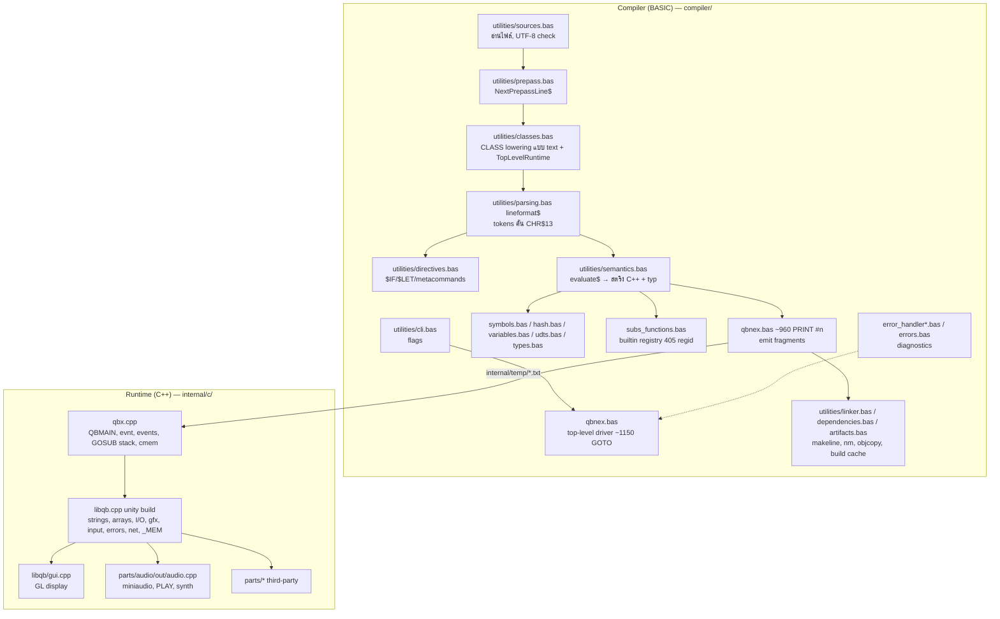
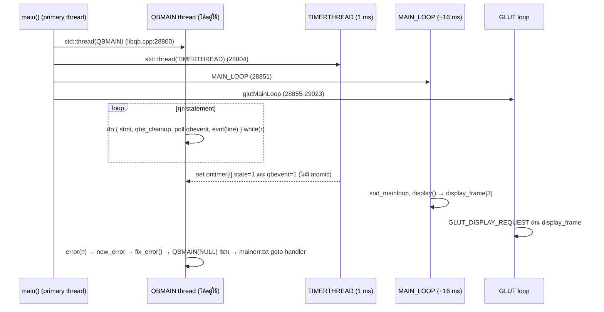

# QBNex → Rust: ภาพรวมสถาปัตยกรรมปัจจุบัน (Current-State Architecture)

> สถานะ: เอกสารวิเคราะห์ (analysis) — ยังไม่มีโค้ด Rust ใดๆ ในรีโป
> วันที่ตรวจ: 2026-11-09 · ตรวจจาก commit `545b859` (branch `main`, worktree clean)
> Pass level: **Full Mode** — trigger: ขอ port ทั้งระบบ + ต้องการ handoff ให้คน/agent ทำต่อ, ระบบมี >3 โมดูลที่ผูกกันแน่น (compiler, codegen ABI, runtime, build/bootstrap)

> **Project layout:** งาน port ทั้งหมดอยู่ใน `D:\QBNex-Rust` (branch `rust-port`) แยกจาก `D:\QBNex` ซึ่งไม่ถูกแก้ไข · สถานะล่าสุดและวิธีรัน: [`progress.md`](progress.md)

ชุดเอกสารนี้:

| ไฟล์ | เนื้อหา |
| --- | --- |
| `README.md` (ไฟล์นี้) | ระบบปัจจุบันคืออะไร, boundary, module map, flow หลัก, file responsibility |
| [`port-plan.md`](port-plan.md) | สถาปัตยกรรมเป้าหมาย (Rust), กลยุทธ์ migration, phase + exit gate, ตาราง mapping C/BASIC → crate |
| [`semantics-catalog.md`](semantics-catalog.md) | พฤติกรรมเฉพาะของ QB/QB64 ที่ port ต้องรักษา (สเปกที่ "ซ่อน" อยู่ในโค้ดเดิม) |
| [`debt-and-risks.md`](debt-and-risks.md) | Debt register ของระบบเดิม + risk register ของการ port |
| [`open-questions.md`](open-questions.md) | คำถาม, decision ที่ต้องอนุมัติ, AI agent notes |

ป้ายความน่าเชื่อถือ: `Direct` = เห็นจากไฟล์ตรงๆ · `Inferred` = อนุมานจากหลักฐาน · `Assumed` = สมมติฐานทำงาน · `Verify first: Yes` = ต้องตรวจก่อนลงมือ

---

## 1. ระบบนี้คืออะไร

QBNex คือ **BASIC compiler แบบ CLI** ที่ fork จาก QB64 (ตัด IDE ออก — README.md:138). มันไม่ได้เป็นโปรแกรม C ล้วน แต่เป็น 3 ชั้นที่ผูกกัน:

| ชั้น | ภาษา | ขนาด (first-party) | หลักฐาน |
| --- | --- | --- | --- |
| Compiler (front/middle/back end) | **QB64 BASIC** (self-hosted) | ~39.6k บรรทัด `.bas` (qbnex.bas 13.8k) | `compiler/**` — Direct |
| Runtime ที่ลิงก์กับโปรแกรมผู้ใช้ | **C++** | libqb.cpp 31.2k + qbx.cpp 2.2k + gui.cpp 2.2k + audio.cpp 2.8k + อื่นๆ ≈ 40k | `internal/c/**` — Direct |
| Third-party vendored | C/C++ | ≈ 600k+ บรรทัด (freeglut, GLEW, FreeType amalgam, miniaudio, stb_*, libxmp-lite, tinysoundfont, minimp3, zlib) | `internal/c/parts/**` — Direct |
| Bootstrap snapshot | C++ ที่ generate ไว้แล้ว | 818 ไฟล์, 6.9 MB | `internal/source/*.txt` — Direct |
| Stdlib สำหรับผู้ใช้ | BASIC | 18 โมดูล | `compiler/stdlib/**` — Direct |

ดังนั้น "port C → Rust ทั้งหมด" ในทางปฏิบัติหมายถึง **เขียนใหม่ 2 ระบบ**: (1) compiler ที่ตอนนี้เขียนด้วย BASIC และ (2) runtime C++ — พร้อมเลือก backend ใหม่แทนการ emit C++ แล้วเรียก g++

## 2. System Boundary

- ผู้ใช้ปลายทาง **ต้องมี C++ compiler ตอน compile** (README.md:2184-2197; linker.bas:208-215 อ่าน `makeline_*.txt`) — Direct
- Windows: MinGW (WinLibs GCC 15.2.0) ดาวน์โหลดโดย `scripts/setup_win.cmd:71-105` ไม่ได้ commit — Direct
- ไม่มี backend/DB/network service ภายนอก. Network มีแค่ TCP API ให้โปรแกรมผู้ใช้ (libqb.cpp ~22680-23365) — Direct
- `$IMPORT:'url'` **ไม่ใช่** remote import — เป็นแค่โมดูล parse URL (imports.bas:47-75, tests/fixtures/url_import_success.bas) — Direct

## 3. Classification

| พื้นที่ | สถานะ | หมายเหตุ |
| --- | --- | --- |
| Frontend (UI) | ไม่มี IDE; CLI only | runtime มีหน้าต่าง GLUT สำหรับโปรแกรมผู้ใช้ |
| Compiler | มี | BASIC, text-rewriting, 2-pass + recompile loop |
| Runtime | มี | C++ unity build + generated code ABI |
| Database | not observed | — |
| Background processes | มี (ภายใน runtime) | threads: QBMAIN, TIMERTHREAD, MAIN_LOOP, GLUT |
| External services | not observed | vwatch ต่อ IDE ผ่าน TCP แต่ไม่มีฝั่ง IDE (dormant) |
| Infrastructure | CI GitHub Actions 3 OS, Docker, Inno Setup | CI build อย่างเดียว ไม่รันเทสต์ |
| Tests | smoke scripts 8 ชุด (`tests/*.sh|cmd`) | grep stdout, ไม่มี golden output, ไม่อยู่ใน CI |

## 4. Module Map (ปัจจุบัน)

## 5. Flow หลัก

### 5.1 Compile flow (Direct, qbnex.bas)

1. `ParseCMDLineArgs$` (cli.bas:151) → ล็อก temp dir `internal/temp[N]` ผ่าน `temp.bin` (qbnex.bas:187-249); ถ้า N>1 เขียน `qbxN.cpp` ใหม่ (254-265)
2. `lineinput3load` โหลดไฟล์ทั้งก้อน (sources.bas:114-161)
3. **Prepass** (qbnex.bas:1431-2466): เก็บ TYPE/CONST/DEFxxx/DECLARE LIBRARY/signature ของ SUB/FUNCTION, mark `$IF` dead lines
4. **Main pass** (qbnex.bas:2542-10661): อ่านใหม่ตั้งแต่ต้น, แต่ละบรรทัด → `lineformat$` → `IF firstelement$ = "..."` chain → `evaluate$` → **PRINT C++ ลงไฟล์ทันที** (ไม่มี AST)
5. **Recompile loop** (`do_recompile:` 10937-10944) ถ้าเจอ `$NOPREFIX`, `$DEBUG`, `OPTION _EXPLICIT`, cmem placement, จำนวนมิติ array ยังไม่รู้ ฯลฯ → เริ่มทั้งหมดใหม่จนนิ่ง (fixpoint)
6. `PrepareDependencyBuildInputs` → `RunNativeBuild%` → `FinalizeCompilerRun` (qbnex.bas:11485-11488): build libqb `.o` ตาม dependency bits, patch makeline, เรียก g++, build cache ด้วย fingerprint ของ fragment

### 5.2 Runtime flow (Direct, libqb.cpp / qbx.cpp)

### 5.3 Bootstrap flow (Direct, CMakeLists.txt)

`internal/source/*` (snapshot C++ ของ compiler เวอร์ชันเก่า) → copy ไป `internal/temp` → `g++ qbx.cpp` = `qb-stage0` → `qb-stage0 compiler/qbnex.bas -o qb.exe` (CMakeLists.txt:115-210). **ไม่มีสคริปต์ refresh snapshot** และ snapshot ล้าหลัง source ปัจจุบัน (ไม่มี `TOPLEVELRUNTIME_INJECTMAINHOOK`) — Direct/Inferred

## 6. File Responsibility Map (ส่วนที่เกี่ยวกับการ port)

| ไฟล์ | หน้าที่ | ใน Rust จะไปอยู่ที่ |
| --- | --- | --- |
| `compiler/qbnex.bas` | driver, statement handlers, emitter, include manager, recompile loop | `qb-driver`, `qb-sema`, `qb-lower` |
| `compiler/utilities/parsing.bas` | tokenizer `lineformat$`, `fixoperationorder$`, `evaluateconst$` | `qb-syntax` |
| `compiler/utilities/semantics.bas` | expression typing + emit (`evaluate$`, `evaluatetotyp$`, `seperateargs`) | `qb-sema` |
| `compiler/utilities/{symbols,hash,variables,udts,types,labels}.bas` | symbol table, hash, type encoding, array descriptors, labels | `qb-sema` |
| `compiler/utilities/consteval.bas` | CONST evaluator แยก | `qb-sema::consteval` |
| `compiler/utilities/directives.bas` | `$IF/$LET/$ERROR/$VERSIONINFO/$EXEICON`, metacommands | `qb-syntax::preproc` |
| `compiler/utilities/classes.bas` | CLASS → TYPE + SUB lowering (text), TopLevelRuntime | `qb-sema::oop` (AST desugar) |
| `compiler/utilities/imports.bas` | `$IMPORT` resolver | `qb-syntax::loader` |
| `compiler/subs_functions/subs_functions.bas` | builtin registry (354 ชื่อ, 348 C callname) | `qb-builtins` (ตารางข้อมูล) |
| `compiler/utilities/error_handler*.bas`, `errors.bas` | diagnostics + renderer | `qb-diag` |
| `compiler/utilities/{linker,dependencies,artifacts}.bas` | toolchain, build cache, icon/manifest | `qb-driver::build` |
| `internal/c/qbx.cpp` | QBMAIN shell, evnt/events, GOSUB stack, cmem, ON TIMER | `qb_runtime::exec` |
| `internal/c/libqb.cpp` | runtime ทั้งหมด (unity build) | `qb-runtime*` crates |
| `internal/c/libqb/gui.cpp` | GL display | `qb-runtime-window` |
| `internal/c/parts/audio/out/audio.cpp` | SOUND/PLAY/_SND*/synth | `qb-runtime-audio` |
| `internal/c/msbin.cpp`, `mtri*.cpp`, `time64.*` | MBF, _MAPTRIANGLE, time | `qb_runtime::num`, `qb-runtime-gfx` |
| `internal/support/vwatch/*` | debugger hook (dormant) | ตัดสินใจทีหลัง (D9) |
| `compiler/stdlib/**` | stdlib BASIC | **คงเป็น BASIC** — compile ด้วย compiler ใหม่ |
| `tests/**` | smoke tests | ขยายเป็น conformance corpus |

## 7. ขอบเขตที่ข้าม (Skipped areas)

- ไม่ได้อ่าน third-party vendored ทีละบรรทัด (จะแทนด้วย crate) — นับขนาดและ license เท่านั้น
- ไม่ได้รัน build/test ในรอบนี้ (วิเคราะห์ static อย่างเดียว) — ข้อเท็จจริงเรื่อง audio smoke fail มาจาก `.eniac-plan.md` ซึ่ง **stale** บางส่วน (อ้าง `runtime/` ที่ไม่มีอยู่จริง)
- `build/` เป็น untracked output (gitignored) ไม่นับเป็นหลักฐานของ source
