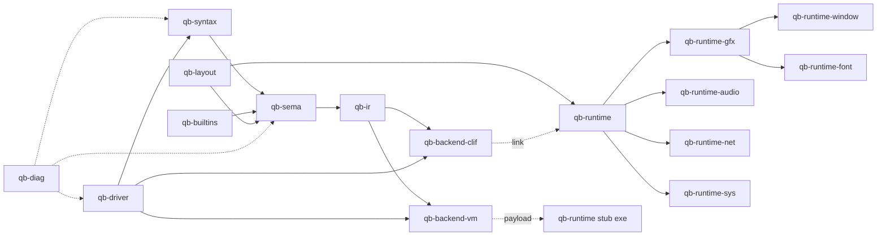
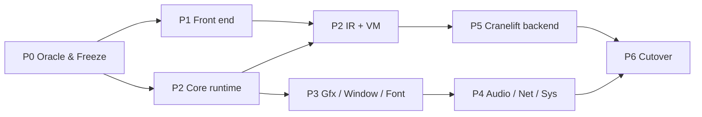

# แผนการ Port / Remake QBNex เป็น Rust

> ## Revision 2 — 2026-11-09: เจ้าของโปรเจกต์ตัดสิน D10 = **เก็บ compiler เป็น BASIC**
>
> ผลต่อแผน (แทนที่ §3.2, §4, §5 ด้านล่างซึ่งคงไว้เป็นบันทึกทางเลือกเดิม):
>
> - **D2 = Runtime-first strangler ผ่าน C ABI.** compiler BASIC ยัง emit C++ fragment เหมือนเดิม; `internal/c/qbx.cpp` + fragment ยังถูก compile ด้วย g++ แต่ฟังก์ชันใน `libqb.cpp` และ `parts/*` ถูกแทนทีละ subsystem ด้วย crate Rust `qb-runtime` (staticlib `libqb_runtime.a`) ที่ export `extern "C"` ชื่อเดิม
> - **D1 ไม่ใช้แล้ว** — backend ยังเป็น C++ ผ่าน g++. ผลที่ตามมา: ผู้ใช้ **ยังต้องมี C++ compiler** และชั้นบาง ๆ C++ (`qbx.cpp` + glue) จะเหลืออยู่ตลอดตราบที่ compiler emit C++
> - Struct ที่ generated code แตะตรง (`qbs`, array descriptor, `img_struct`, `mem_block`) ต้องเป็น `#[repr(C)]` layout เดิมเป๊ะ — ห้ามเปลี่ยน layout โดยไม่แก้ compiler พร้อมกัน
> - **TDD + ลบ legacy ทันที (เจ้าของสั่ง 2026-11-09):** test Rust ก่อน → แดง → implement → differential กับสำเนา C++ legacy ใน `tests/diff/legacy/` (ใช้ใน test เท่านั้น) → **ลบ C++ ออกจาก `libqb.cpp`** เหลือ shim 1 บรรทัด ไม่มี `#ifdef LEGACY`
> - `libqb_runtime.a` build ตอน setup (เหมือน `libqb_setup.o`/`src.a`) และติดไปใน release bundle — **ผู้ใช้ไม่ต้องมี cargo**
>
> ### Phases ใหม่ (R = runtime)
>
> | Phase | งาน | Gate | สถานะ |
> | --- | --- | --- | --- |
> | R0 | Oracle: smoke tests เข้า CI, `tests/conformance/` corpus + runner, golden outputs | CI รัน smoke + conformance 3 OS | **เสร็จ (local)**, CI ยังไม่ได้รันจริง |
> | R1 | `crates/qb-runtime` crate, header C, build integration (CMake, setup scripts, `makeline_*.txt`, CI) + slice แรก: MBF (`msbin.cpp`) | self-host + smoke + conformance ผ่าน โดย MBF มาจาก Rust | **เสร็จ (Windows)** · `msbin.cpp/.c` ลบแล้ว |
> | R2 | Leaf functions ไม่แตะ allocator: math, rounding (`qbr`), number↔string formatting, `VAL`, RND/TIMER | differential test Rust vs C++ legacy ผ่านบน input สุ่ม | **เสร็จ (Windows)** · rounding + `fpu_reinit`, RND/RANDOMIZE, VAL, STR$ formatting, TIMER — C++ legacy ลบแล้ว |
> | R3 | String engine `qbs` (`#[repr(C)]`, allocator, tmp list, cleanup) | corpus ทั้งหมดผ่าน + benchmark ไม่ช้ากว่า 10% | pending |
> | R4 | File I/O (`gfs_*`, OPEN/GET/PUT/FIELD), SHELL/ENV, `_MEM` | corpus file group ผ่าน | pending |
> | R5 | Graphics software (`img_struct`, SCREEN, LINE/CIRCLE/PAINT/DRAW, palette, `_PUTIMAGE`) | framebuffer hash ตรง | **เสร็จ (Windows)** · software graphics ทั้งหมดอยู่ใน `crates/qb-runtime/src/gfx`, C++ legacy ลบแล้ว (เหลือ orchestration ของ SCREEN/hardware images ไว้ให้ R8) |
> | R6 | Audio (`audio.cpp` + miniaudio → cpal + synth Rust) | PCM offline ตรงภายใน tolerance | pending |
> | R7 | Fonts + image codec (FreeType → skrifa + ab_glyph_rasterizer, stb_image/dr_pcx → Rust ports + `png`/`zune-jpeg`) | glyph/decoded image tests | done (Windows), ดู progress.md |
> | R8 | Window/input/threads (freeglut+GLEW+gui.cpp → winit + softbuffer, atomic event flags) | interactive scripted tests 3 OS | pending |
> | R9 | Net, clipboard, screen capture, printer | loopback + platform tests | **เสร็จ (Windows)** · TCP (`std::net`), clipboard (Win32 / `arboard`), `_SCREENIMAGE`/`_SCREENCLICK`/`_SCREENPRINT`, printer, `GetTicks` + start-of-day time — C++ legacy ลบแล้ว (`printer.cpp`, `myip.cpp`, `time64.*`) |
> | R10 | ลบ C++ legacy, vendored third-party, `download/` dirs; เหลือแค่ `qbx.cpp` + glue | repo ไม่มี third-party C ที่ไม่ใช้ | done (Windows), ดู progress.md |
> | R11 (เสนอ) | ให้ compiler BASIC emit Rust (หรือ IR ที่ runtime Rust รัน) แทน C++ → ลบ `qbx.cpp` และ C++ สุดท้าย; ผู้ใช้ต้องมี `rustc` แทน `g++` | ไม่มีไฟล์ C/C++ ใน repo | ต้องอนุมัติ |
>
> ประมาณการ R1–R10 ≈ 10–14 PM (Assumed). R8 เสี่ยงสุดเพราะเปลี่ยน thread model
>
> ---
>
> สถานะเดิม: **Proposed** — ส่วนที่เหลือของไฟล์นี้คือการวิเคราะห์ทางเลือก full rewrite (D10 = ไม่เก็บ BASIC) เก็บไว้อ้างอิง
> อ้างอิงสถานะปัจจุบัน: [`README.md`](README.md) · พฤติกรรมที่ต้องรักษา: [`semantics-catalog.md`](semantics-catalog.md)

## 1. เป้าหมายและนิยามคำว่า "เสร็จ"

**เป้าหมาย:** แทน compiler (BASIC) + runtime (C++) + third-party C ด้วย Rust workspace เดียว โดยโปรแกรม `.bas` ที่ทำงานบน QBNex 1.0.x วันนี้ ยังทำงานได้ผลเหมือนเดิม

**Done when (เสนอ):**

1. Conformance corpus (Phase 0) ผ่าน ≥ 99% เมื่อเทียบ output ของ binary เดิม — ข้อที่ต่างต้องมีบันทึกเป็น intentional deviation
2. ผู้ใช้ปลายทาง **ไม่ต้องมี C++ compiler** อีกต่อไป (ถ้า D1 = A หรือ B)
3. CI รัน conformance + smoke tests บน Windows/Linux/macOS ทุก PR
4. ลบ `internal/c/**`, `internal/source/**`, MinGW download ออกได้
5. Diagnostics format (`[x] [@] [#] [>] [::] [!] [+]`, รหัส E1xxx/W2xxx) เข้ากันได้กับ tests เดิม

**Non-goals (เสนอ):** IDE, การ emit C++ ที่ byte-identical กับเดิม, การรองรับ 32-bit Windows ใน phase แรก, vwatch debugger (จนกว่า D9 จะตัดสิน)

## 2. หลักการออกแบบ (แก้ debt เดิมไม่ให้กลับมา)

| ปัญหาในระบบเดิม | หลักการในระบบใหม่ |
| --- | --- |
| ไม่มี AST, token เป็นสตริงคั่น CHR$(13), emit C++ ทันทีขณะ parse | Pipeline แยกชั้นชัดเจน: tokens → **AST** → **HIR (typed)** → **IR (CFG)** → backend |
| CLASS/TopLevelRuntime lowering ทำบน text ก่อน tokenize | Desugar บน AST หลัง parse, มี source span ติดตลอด |
| Global state ~380 ตัว, ~1150 GOTO ใน driver | State อยู่ใน struct ต่อ compilation (`Session`, `SymbolTable`, `TypeTable`) ส่งผ่านแบบ explicit |
| Recompile ทั้งโปรแกรมจนนิ่ง (fixpoint) | วิเคราะห์หลาย pass บน AST: (1) collect declarations, (2) resolve, (3) infer cmem/array-rank constraints, (4) lower — ไม่ restart |
| Builtin registry เป็นโค้ด BASIC ที่รันทุก recompile | Registry เป็น **ข้อมูล** (Rust table/`build.rs` จาก TOML) มี signature, specialformat, dependency flag |
| Runtime ↔ codegen ผูกด้วยชื่อ symbol และ layout ของ C (descriptor `[4i+1]`, `qbs->chr`) | Runtime API เป็น Rust trait/function ที่ versioned; layout ที่ต้อง byte-exact (UDT, `_MEM`, VARPTR) นิยามใน `qb-layout` crate เดียว ใช้ร่วมทั้ง compiler และ runtime |
| Flag ข้าม thread เป็น int ธรรมดา (data race) | ใช้ `AtomicBool`/`AtomicU32` + channel; ไม่มี `static mut` |
| Extern ชนิดไม่ตรงข้าม TU (vector vs pointer) | Rust ไม่มีปัญหานี้โดยธรรมชาติ; FFI (ถ้ามี) ผ่าน `#[repr(C)]` + `cbindgen` ที่ generate header |
| Tests แค่ grep stdout และไม่รันใน CI | Differential conformance testing กับ binary เดิม + snapshot tests (`insta`) + รันใน CI |

## 3. สถาปัตยกรรมเป้าหมาย (Proposed)

### 3.1 Cargo workspace

```
qbnex/                      (Cargo workspace)
├─ crates/
│  ├─ qb-span        source map, file id, span, line/col (UTF-8 + CP437)
│  ├─ qb-diag        Diagnostic {code, severity, span, notes}, renderer แบบเดิม + --compact-errors
│  ├─ qb-syntax      lexer, preprocessor ($INCLUDE/$IMPORT/$IF/$LET/metacommands), parser → AST
│  ├─ qb-builtins    ตาราง builtin (ชื่อ, signature, specialformat, $NOPREFIX alias, dependency)
│  ├─ qb-layout      type encoding, UDT field offsets, array descriptor layout, fixed-length string
│  ├─ qb-sema        name resolution, DEFtype ranges, OPTION BASE/_EXPLICIT, scopes, labels/line numbers,
│  │                 consteval, overload by sigil, CLASS desugar, TopLevelRuntime → HIR (typed)
│  ├─ qb-ir          CFG IR: blocks, explicit GOSUB stack ops, error regions, event-poll points, temp-string scopes
│  ├─ qb-backend-vm  bytecode emitter + (ใน qb-runtime) interpreter        ← backend แรก (D1)
│  ├─ qb-backend-clif Cranelift AOT → object file + linker            ← backend ที่สอง (D1)
│  ├─ qb-driver      CLI (flags เดิม), config.ini, build cache, packaging exe
│  │
│  ├─ qb-runtime           core runtime: QbString(Vec<u8>), arrays, numeric (QB rounding, MBF), RND,
│  │                 PRINT/PRINT USING/INPUT formatting, file I/O (RANDOM/BINARY/FIELD), errors, events,
│  │                 DATA/READ, CHAIN/COMMON, SHELL/ENVIRON/COMMAND$, _MEM, cmem emulation (D4)
│  ├─ qb-runtime-gfx       software framebuffer: SCREEN 0–13 + 32-bit images, palette, PSET/LINE/CIRCLE/PAINT/DRAW,
│  │                 _PUTIMAGE/_MAPTRIANGLE, bitmap fonts 8x8/8x16, image registry
│  ├─ qb-runtime-window    winit (main thread) + softbuffer/pixels presenter, keyboard/mouse/gamepad → event queue
│  ├─ qb-runtime-font      TTF ผ่าน fontdue หรือ ab_glyph (แทน FreeType)
│  ├─ qb-runtime-audio     cpal output, SOUND/PLAY MML/_VOICE/_ADSR/_WAVE synth, _SND* (decoder: symphonia/lewton/minimp3)
│  ├─ qb-runtime-net       TCP host/client (std::net)
│  ├─ qb-runtime-sys       clipboard (arboard), _SCREENIMAGE (xcap หรือ platform API), printer (Windows, D8)
│  └─ qb-runtime-gl        (ทางเลือก, D6) SUB _GL ผ่าน glow
├─ stdlib/           ย้ายจาก compiler/stdlib (ยังเป็น .bas)
├─ tests/conformance/      corpus + expected outputs + runner (Phase 0)
└─ xtask/            งาน dev: regenerate golden, import registry จาก subs_functions.bas
```



### 3.2 Backend (D1 — ต้องอนุมัติ)

| ตัวเลือก | ข้อดี | ข้อเสีย |
| --- | --- | --- |
| **B. Bytecode VM + prebuilt runtime stub** (exe = stub + payload ต่อท้าย) | ไม่ต้องมี linker/compiler ฝั่งผู้ใช้เลย, compile เร็วมาก, ทำ parity ได้เร็ว, ใช้เป็น reference semantics | ช้ากว่า native (ประมาณ 3–10 เท่าสำหรับลูปตัวเลข — Assumed) |
| **A. Cranelift AOT** (`cranelift-object` → `.o` → link กับ `qb-runtime` staticlib) | native speed, GOTO/label map ตรงกับ block ของ Cranelift | ยังต้องมี linker (bundle `lld`/`rust-lld` ได้, license Apache-2.0 w/ LLVM exception), งานมากกว่า |
| C. Emit C + คง g++ | งานน้อยสุด | ไม่ตอบเป้าหมาย "Rust ทั้งหมด", ยังต้อง bundle GCC (GPL) |
| D. Emit Rust source + rustc | — | Rust ไม่มี `goto` → ต้องแปลงเป็น state machine, compile ช้ามาก, ผู้ใช้ต้องมี rustc — **ไม่แนะนำ** |

**ข้อแนะนำ:** ทำ **B ก่อน** (เป็นทั้ง product แรกและ oracle ภายใน) แล้วเพิ่ม **A** เป็น `-O`/release mode ใน Phase 5. ทั้งสอง backend อ่าน `qb-ir` ตัวเดียวกัน จึงไม่ซ้ำงาน semantic

### 3.3 Execution model ใน runtime ใหม่

- **Threads:** หน้าต่าง/อินพุตอยู่ main thread (macOS บังคับ, winit ต้องการ) · โปรแกรมผู้ใช้อยู่ worker thread · timer เป็น scheduler ใน runtime (ไม่ต้องมี thread 1 ms) · audio callback ของ cpal อยู่ thread ของมันเอง สื่อสารผ่าน lock-free ring buffer
- **Event polling:** แต่ละ statement มีจุด poll `if pending.load(Relaxed)` (เทียบเท่า `qbevent`) — IR มี instruction `Poll(line)` ชัดเจน; `$CHECKING:OFF` ตัดออกได้
- **Error handling (ON ERROR/RESUME):** แทนการเรียก `QBMAIN(NULL)` ซ้อน ด้วย:
  - error ที่เกิดใน statement → runtime เรียก "handler entry" ของ main module เป็น **function call แยก** (ตัวแปรระดับ module อยู่ใน module frame ที่ heap-allocated ไม่ใช่ stack)
  - handler คืนค่า `Resume::Retry | Resume::Next | Resume::Label(id)` → ณ จุดเกิด error, IR มี edge ไป statement เดิม / ถัดไป / dispatch label
  - error ใน SUB ที่ไม่มี handler ของตัวเอง → ใช้ handler ของ module ตาม semantics เดิม (Verify first: ต้องทดสอบกับ binary เดิมว่า RESUME กลับเข้า SUB จริงหรือไม่ — จาก qbx.cpp/fix_error คือใช่)
- **GOSUB/RETURN:** IR มี `PushReturn(id)`/`Return` ต่อ scope + dispatch table (เทียบเท่า `retN.txt`) · `ON TIMER/KEY/STRIG GOSUB` ใช้กลไกเดียวกับ error handler (เรียก main-module entry แล้ว return)
- **Strings:** `QbString` = `Vec<u8>` (byte string, ไม่ใช่ UTF-8) + small-string optimization ถ้าจำเป็น; temp ใช้ ownership ของ Rust แทน `qbs_tmp_list` + `qbs_cleanup` · fixed-length `STRING * n` เป็น view ใน buffer ของ UDT/array
- **Memory layout ที่ต้อง byte-exact:** UDT, array element, `_MEM`, `VARPTR/VARSEG/PEEK/POKE/DEF SEG/BLOAD/BSAVE` — runtime เก็บข้อมูลเหล่านี้เป็น `Box<[u8]>` + offset จาก `qb-layout` แทนการให้ codegen คำนวณ pointer เอง

## 4. กลยุทธ์ Migration (D2 — ต้องอนุมัติ)

**ข้อแนะนำ: Parallel rewrite + differential oracle** (ไม่ใช่ strangler ผ่าน C ABI)

เหตุผล: generated code ปัจจุบันแตะ field ของ `qbs`, array descriptor และ global ของ qbx.cpp ตรงๆ (README §5, debt F2) — ถ้าจะแทน libqb ทีละส่วนด้วย Rust ผ่าน C ABI ต้องเลียน layout C ทั้งหมดซึ่งจะถูกทิ้งเมื่อเปลี่ยน backend → งานเสียเปล่า. ทางที่คุ้มกว่าคือสร้างระบบใหม่คู่ขนาน แล้วใช้ `qb.exe` เดิมเป็น oracle จนกว่าจะผ่าน gate

ทางเลือกที่ไม่แนะนำแต่เป็นไปได้: strangler runtime-first (Rust `qb-runtime` export `extern "C"` แทน libqb ทีละ subsystem) — ใช้เฉพาะถ้าต้องส่งมอบ Rust ระหว่างทางให้ผู้ใช้เวอร์ชันเดิม

## 5. Phases + Exit Gates

ประมาณการเป็น **person-month (PM) ของคนที่รู้ Rust + compiler** — `Assumed` ใช้เพื่อเรียงลำดับเท่านั้น

### Phase 0 — Oracle & Freeze (≈1 PM) — ทำก่อนเขียน Rust บรรทัดแรก

- สร้าง `tests/conformance/` corpus: แตก `tests/fixtures` + โปรแกรมทดสอบต่อ keyword (เป้าหมาย ≥ 1 โปรแกรมต่อ builtin 354 ตัว, จัดกลุ่มตาม semantics-catalog)
- เพิ่ม **headless/capture mode** ให้ runtime เดิม (หรือใช้ `$CONSOLE:ONLY` + `_DEST _CONSOLE`) เพื่อจับ stdout, ไฟล์ที่เขียน, และ hash ของ framebuffer ทุก `_DISPLAY`/จบโปรแกรม
- จับ diagnostics (stdout ของ compiler) ของโปรแกรมที่ตั้งใจให้ error
- เอา smoke tests เข้า CI (ตอนนี้ไม่ได้รัน — debt F6)
- Regenerate `internal/source` snapshot จาก source ปัจจุบันแล้วตรวจว่า self-host ได้ (debt F1) — เพื่อให้ oracle ตรงกับ source จริง
- **Gate:** corpus ≥ 500 โปรแกรม, golden outputs ถูก commit, CI เขียว 3 OS

### Phase 1 — Front end (≈4–6 PM)

- `qb-span`, `qb-diag`, `qb-syntax` (lexer + preprocessor + parser → AST), `qb-builtins` (import อัตโนมัติจาก `subs_functions.bas` ด้วย `xtask`)
- `qb-sema`: symbol/type/scope/labels/DEFtype/consteval/CLASS desugar/`$NOPREFIX`
- โหมด `qb check file.bas` = ทำแค่ diagnostics
- **Gate:** diagnostics ของ corpus error ตรงกับเดิม (code + บรรทัด + คอลัมน์); parse ทั้ง `compiler/qbnex.bas` (โปรแกรม BASIC ใหญ่สุดที่มี) และ stdlib ได้ไม่ error — นี่เป็น stress test ที่ดีที่สุดเพราะใช้ฟีเจอร์ครบ

### Phase 2 — IR + Core runtime + VM (≈4–6 PM)

- `qb-ir` + lowering (control flow ทั้งหมดใน semantics-catalog §2)
- `qb-runtime` core: strings, numeric, arrays, PRINT/INPUT/PRINT USING, file I/O, errors/RESUME, DATA/READ, GOSUB, ON TIMER, SHELL/ENVIRON, `_MEM`
- `qb-backend-vm` + stub exe packaging
- **Gate:** corpus กลุ่ม console/ไฟล์/คณิตศาสตร์ ผ่าน ≥ 99%; `qb` ใหม่ compile โปรแกรมของ stdlib smoke test ได้ผลตรง

### Phase 3 — Graphics, Window, Input, Fonts (≈3–4 PM)

- `qb-runtime-gfx` (software rasterizer เทียบ pixel กับ golden hash), `qb-runtime-window`, `qb-runtime-font`
- **Gate:** framebuffer hash ตรงกับเดิมสำหรับ SCREEN 0/7/9/12/13/32-bit; input events ทดสอบด้วย scripted input

### Phase 4 — Audio, Net, Sys (≈2–3 PM)

- `qb-runtime-audio` (SOUND/PLAY/synth เทียบ PCM ที่ render offline), `qb-runtime-net`, `qb-runtime-sys`, printer (D8)
- **Gate:** PCM ของ PLAY/SOUND/`_WAVE` ตรงภายใน tolerance; TCP loopback tests ผ่าน

### Phase 5 — Native backend (≈3–5 PM)

- `qb-backend-clif` + bundle linker; benchmark เทียบ g++ build เดิม (`tests/smoke/benchmark_smoke`)
- **Gate:** corpus ทั้งหมดผ่านบน backend native เท่ากับ VM; perf ไม่ต่ำกว่าเดิมเกิน X% (กำหนดใน D1)

### Phase 6 — Cutover & Cleanup (≈1–2 PM)

- installer/portable bundle/Docker ใหม่ (ไม่มี MinGW), release notes ระบุ deviation
- ลบ `internal/c`, `internal/source`, setup scripts เดิม; อัปเดต README/CONTRIBUTING
- **Gate:** release candidate ผ่าน CI 3 OS + ผู้ใช้ทดสอบ beta

**รวมประมาณ 18–27 PM** (Assumed; ความไม่แน่นอนสูงสุดอยู่ที่ Phase 1 และ 3)



(Runtime core เริ่มคู่ขนานกับ front end ได้หลัง Phase 0 เพราะเทสต์ผ่าน Rust unit tests ได้โดยไม่ต้องมี compiler)

## 6. Mapping: ของเดิม → ของใหม่

| ของเดิม | ของใหม่ | หมายเหตุ |
| --- | --- | --- |
| `lineformat$` + `getelement$` token string | `qb-syntax::lexer` (Token enum + Span) | string literal ต้องเก็บ byte ดิบ (CP437) |
| `$IF/$LET` (directives.bas) | `qb-syntax::preproc` | symbol `WINDOWS/LINUX/MAC/32BIT/64BIT/VERSION` |
| include manager (qbnex.bas:2358, 10584) | `qb-syntax::loader` | relative-to-includer ก่อน, depth ≤ 100 |
| `idstruct` + `HashTable` | `qb-sema::SymbolTable` (`IndexMap` + scope stack) | overload by sigil ใช้ key (name, sigil) |
| type LONG bit-flags (qbnex.bas:738-766) | `enum QbType` + `qb-layout` | `_FLOAT` ดู D3 |
| `udtx*/udte*` parallel arrays | `TypeTable { udts: Vec<Udt> }` | offset ต้องตรงของเดิม (packed, ไม่มี padding) |
| `evaluate$` → C string | HIR expression + type checker | |
| `subs_functions.bas` (405 regid) | `qb-builtins` data table | 28 stub = handled inline/ไม่ implement |
| `PRINT #n` fragments (`main.txt`, `dataN.txt`, …) | `qb-ir` + backend | ไม่มี fragment files อีกต่อไป |
| `makeline_*.txt`, `nm`, `objcopy` | `qb-driver::package` | VM: copy stub + append payload; native: link |
| build cache fingerprint (linker.bas:147-237) | `qb-driver::cache` (hash ของ IR) | |
| `qbs` + `qbs_tmp_list` + arena | `QbString` (`Vec<u8>`) | |
| array descriptor `ptrszint[4n+5]` | `QbArray { dims: SmallVec<[Dim;2]>, data: Box<[u8]> }` | LBOUND/UBOUND/ REDIM PRESERVE semantics |
| `gfs_file_struct` | `qb_runtime::fs::FileTable` | FIELD, RANDOM record len, COM syntax (D7) |
| `img_struct` + `img` registry | `qb-runtime-gfx::ImageRegistry` (handle = negative long เหมือนเดิม) | |
| freeglut + GLEW + gui.cpp | winit + softbuffer/pixels | |
| FreeType amalgam | fontdue / ab_glyph | ผล rasterize อาจต่าง 1px → tolerance |
| miniaudio + audio.cpp | cpal + synth เดิม port ตรง | |
| stb_image/dr_pcx | `image` crate (+ PCX decoder เล็ก) | |
| stb_vorbis/minimp3/libxmp-lite/tinysoundfont | symphonia / lewton / minimp3 / (xmp: หา crate หรือ FFI) | |
| Win32/X11/Cocoa clipboard | `arboard` | |
| TCP ใน libqb.cpp | `std::net` | |
| SIGFPE handler | Rust checked arithmetic → `error(6/11)` | |
| x87 inline asm rounding | round-half-even ใน Rust (`f64::round_ties_even`) | |

## 7. Testing Strategy

1. **Differential conformance** (หลัก): `tests/conformance/run` compile ด้วยทั้ง `qb-legacy` และ `qb` ใหม่ → เทียบ stdout, ไฟล์ output, framebuffer hash, PCM hash, exit code
2. **Snapshot tests** (`insta`) ของ AST/HIR/IR/diagnostics
3. **Unit + property tests** ใน `qb-runtime` (เช่น `STR$`/`VAL` round-trip, PRINT USING, MBF, RND sequence)
4. **Fuzzing** (`cargo-fuzz`) ของ lexer/parser/preprocessor — ระบบเดิมไม่มี
5. **Self-test ขนาดใหญ่:** compile `compiler/qbnex.bas` เดิม (40k บรรทัด) ด้วย compiler ใหม่ แล้วให้มัน compile corpus — ถ้าผลตรง แปลว่า semantics ของภาษาเกือบครบ

## 8. Safe Next Actions (เรียงลำดับ)

1. ตอบ decision D1–D4 ใน `open-questions.md`
2. Phase 0 ข้อแรก: เอา `tests/*.sh|cmd` เข้า CI (เล็ก, ไม่เปลี่ยนพฤติกรรม)
3. Regenerate + ตรวจ `internal/source` snapshot (debt F1)
4. Spike 1–2 สัปดาห์: lexer + parser ของ subset (PRINT/IF/FOR/GOSUB/SUB) + VM ที่รัน "hello world" — วัดว่า architecture ใน §3 ใช้ได้จริงก่อนลงทุนเต็ม

## 9. Revision 3 — โครงสร้างใหม่และการตัดสินใจที่เหลือ (2026-11-09)

เจ้าของอนุมัติให้ตัดสินใจเองและทำจนจบ บันทึกการตัดสินใจไว้ที่นี่

### 9.1 โครงสร้าง (ทำแล้ว)
`compiler/` (BASIC), `crates/qb-runtime`, `crates/qb-audio`, `crates/qb-exec`, `tests/{conformance,diff,smoke,fixtures}`, `scripts/`, `docker/`, `packaging/installer/`. ชื่อโปรแกรมคือ QBNex เรียกได้ทั้ง `qb` และ `qbnex`; ห้ามมีชื่อที่สื่อว่าเป็น Rust (`qbrt`/`qbrun` เลิกใช้). C ABI prefix `qb_`. โฟลเดอร์ OS ใช้ชื่อเต็ม `windows`/`linux`/`macos`.

### 9.2 เฟสที่เหลือ
| เฟส | งาน | Exit gate |
| --- | --- | --- |
| R10 | ลบ third-party และไฟล์ค้าง (`internal/c/parts/**` ที่ไม่ใช้, `gl.h`, bridge ที่ไม่จำเป็น, zlib, license ของ lib ที่ถูกลบ) | build + conformance + smoke ผ่าน |
| R12 | port ส่วนที่เหลือของ `libqb.cpp` (PRINT/INPUT/LOCATE/COLOR/text mode, keyboard, error handler, DATA/READ, arrays, event loop) เข้า `qb-runtime` เป็น Rust API ที่ `qb-exec` เรียกได้ตรง; C++ เหลือแค่ shim | `libqb.cpp` เหลือเฉพาะ shim; diff/conformance ผ่าน |
| R11 เต็ม | QIR v1 ใน pipeline จริง (`evaluate$` → QIR), ครอบคลุมภาษาเต็ม, typed VM, Cranelift JIT, self-host ผ่าน QIR | conformance ทุก case ผ่านทั้งสอง backend; compiler self-host ผ่าน QIR |
| Cutover | QIR เป็น default; ลบ `qbx.cpp`, `libqb.cpp`, `internal/source` C++ (แทนด้วย `bootstrap/qbnex.qir`), `makeline_*`, การดาวน์โหลด MinGW, `tests/diff` legacy | ไม่มีไฟล์ `.c/.cpp/.h` ใน repo; build ไม่ต้องใช้ C/C++ compiler |

### 9.3 การตัดสินใจ (D11–D14)
- **D11 `DECLARE LIBRARY`:** รองรับแบบไม่มี header และ `DECLARE DYNAMIC LIBRARY` ด้วยการหา symbol ตอนรัน (LoadLibrary/GetProcAddress, dlopen/dlsym) + call thunk ตาม signature. แบบที่อ้าง header `.h` ของผู้ใช้ (มีโค้ด C/macro) **ไม่รองรับ** → compile error ที่ชัดเจน + deviation D-10. compiler เองใช้ `getpid` ผ่าน DECLARE LIBRARY → ต้องทำงานได้
- **D12 `_FLOAT`:** จำลอง x87 80-bit ในซอฟต์แวร์ให้ผลตรงทุก bit (ไม่ยอมให้ผลต่าง)
- **D13 JIT:** Cranelift JIT เป็นงานบังคับก่อน cutover (gate: loop benchmark ≤ 2x ของ C++ path, front end ของ compiler ≤ 2x)
- **D14 `SUB _GL`:** คงเป็น deviation D-09 ตอน cutover; นำกลับผ่าน OpenGL จาก Rust เป็นงานหลัง port
- **D15 Native AOT:** `qb file.bas` สร้าง exe แบบ native เป็นค่าเริ่มต้น: Cranelift สร้าง machine code ตอน compile (`cranelift-object`), linker เล็กที่เขียนเอง (`crates/qb-link`, crate `object`) เขียน PE/ELF/Mach-O ที่รวมโค้ดโปรแกรมกับ runtime ที่ build ไว้ — ไม่ต้องมี linker ภายนอก ไม่มี C/C++. `qb run` ใช้ VM+JIT. Gate: ผลตรงกับ VM ทุก case, ไม่มี warm-up, loop ≤ 2x ของ C++ path
- **D16 Rust ล่าสุด:** Rust edition 2024 ทุก crate, toolchain stable ล่าสุด (ตอนนี้ 1.99.1) ปักใน `rust-toolchain.toml`, `rust-version` = toolchain นั้น, dependency ทุกตัวเป็นเวอร์ชันล่าสุด (`cargo upgrade --incompatible` + `cargo update`), `cargo deny`/`cargo audit` ใน CI. ทำเป็นขั้นแยกทันทีหลัง merge R10–R12/R11 (ก่อน cutover) เพราะ migration edition 2024 แตะทุก `#[no_mangle]`/`extern` และจะ conflict กับ session ที่กำลังทำงาน; crate ใหม่ที่สร้างระหว่างนี้ใช้ edition 2024 + dependency ล่าสุดได้เลย

### 9.4 R13 — ฟีเจอร์ภาษาใหม่ที่ QBasic ยังขาด (ทำในข้อจำกัดปัจจุบัน)

ข้อจำกัดที่ต้องเคารพ: compiler ยังเป็น BASIC; ไม่มี C/C++ และไม่มี dependency ที่ bundle C (เช่น SQLite แบบ C, libcurl) — ใช้ pure-Rust crate เท่านั้น; **backward compatible 100%** (โปรแกรม QBasic/QB64 เดิมต้อง compile และให้ผลเหมือนเดิม: keyword ใหม่ที่อาจชนชื่อตัวแปรเดิมใช้รูป `_KEYWORD` หรือเปิดด้วย `$` metacommand); ทำบน QIR backend (หลัง cutover) ไม่ต้องรองรับ C++ path; ทุกฟีเจอร์มี conformance case + เอกสารใน README.

มีอยู่แล้ว (ไม่ต้องทำ): `IMPORT`, `+=`, `#` comment, `FUNCTION f AS type`, CLASS/EXTENDS/IMPLEMENTS (text lowering), `_CONTINUE`, stdlib collections/strings/io/json-generation/sys/math/result.

| กลุ่ม | ฟีเจอร์ | หมายเหตุ |
| --- | --- | --- |
| Control flow | `_IIF(cond, a, b)`, `_ANDALSO`/`_ORELSE` (short-circuit), `FOR EACH x IN arr()`, `EXIT`/`_CONTINUE` ระบุ loop ได้ | QIR = jump ธรรมดา |
| Error handling | `TRY ... CATCH [e] ... FINALLY ... END TRY` บนกลไก ON ERROR เดิม; `_THROW code[, msg$]`; `_ERRORMESSAGE$` | ON ERROR GOTO เดิมทำงานเหมือนเดิม |
| Types | `ENUM ... END ENUM`; STRING ความยาวแปรผันใน TYPE; array ใน TYPE; array literal `DIM a() AS LONG = {1, 2, 3}`; CONST ทุกชนิด | descriptor ใหม่ใน qb-runtime |
| Procedures | `OPTIONAL` + ค่า default ของพารามิเตอร์; overload ตามชนิด (opt-in); function pointer `@SubName` + `CALL ptr(...)`; recursion ลึกโดยไม่ stack overflow (heap frames ใน VM) | |
| OOP | CLASS แบบจริงใน QIR: method dispatch (virtual), constructor/destructor อัตโนมัติ, `NEW`/`DELETE`, property | แทน text lowering เดิม; syntax เดิมยังใช้ได้ |
| Strings | string interpolation `$"Hello {name$}"`; UTF-8 helpers (`_ULEN`, `_UMID$`, `_UCHR$`, `_UASC`); `_SPLIT`, `_JOIN$`, `_REPLACE$`, `_STARTSWITH`, `_ENDSWITH`, `_FORMAT$` | ASCII เดิมไม่เปลี่ยน |
| Collections ในตัว | `_LIST`, `_DICT` (hash map) เป็นชนิดของภาษา (ไม่ใช่แค่ stdlib) + FOR EACH | pure Rust ใน qb-runtime |
| Library (pure Rust) | JSON parse+generate, regex (`_REGEX`), HTTP/HTTPS client (`rustls`), base64/hex, SHA-256/MD5/CRC32, zip/unzip, UUID, random ที่ดีกว่า (`_RANDOMSEED`), date/time แบบ ISO | ไม่มี C dependency |
| Debug/quality | `$ASSERTS` + `_ASSERT cond, msg$`; `$CHECKING:ON` (bounds/overflow ละเอียด); stack trace ตอน error (บรรทัด .bas + SUB chain) | |
| Tooling | debugger (breakpoint/step/watch ผ่าน qb-exec), `qb run file.bas` (ไม่สร้าง exe), REPL, LSP server สำหรับ VS Code, formatter (`qb fmt`) | |
| Platform | WebAssembly target (`qb --target wasm`) รันในเบราว์เซอร์; cross-compile Windows/Linux/macOS จากเครื่องเดียว; `_GL` กลับมาผ่าน wgpu/OpenGL จาก Rust (D14) | |

ลำดับ: control flow/errors/types/procedures ก่อน (แตะ emitter) → strings/collections/library (แตะ runtime) → OOP → tooling/platform. Exit gate ต่อฟีเจอร์: spec ใน `docs/language/*.md`, conformance case, ไม่มี regression ใน corpus เดิม.

### 9.5 R14 — Hardening: สแกนบั๊กทุกจุด + ขัดเกลาความเสถียร (เฟสสุดท้าย)

เริ่มหลัง cutover และ R13 (โค้ดต้องนิ่ง, ไม่มี C/C++ แล้ว, ฟีเจอร์ใหม่ต้องถูกสแกนด้วย). Scan Mode note ของ senior-architect pass:

**หลักฐานตั้งต้น (Direct, 2026-11-10):** `unsafe` 998 จุดใน 49 ไฟล์ของ `crates/` (ส่วนใหญ่เป็น C ABI shim ที่จะหายหลัง cutover); debt register เดิม F0–F16 ใน `debt-and-risks.md` (F3 data race, F8 error re-entry, F13/F16 flow conflicts ยังต้องยืนยันว่าหายจริงในระบบใหม่); xfail ค้าง L-02/L-03/L-04/L-06; ทดสอบเฉพาะ Windows x64 (Linux/macOS/ARM/32-bit ไม่เคยรัน).

| งาน | วิธี | Exit gate |
| --- | --- | --- |
| H1 unsafe audit | ลด `unsafe` ที่เหลือหลัง cutover ให้เหลือเฉพาะ FFI/JIT; ทุกจุดมี `// SAFETY:`; `cargo miri test` กับ crate ที่ไม่แตะ OS | 0 miri error; ทุก unsafe มีเหตุผล |
| H2 Lint เข้ม | `cargo clippy --workspace -- -D warnings -W clippy::pedantic` (ยกเว้นที่มีเหตุผล), `cargo deny` (license/advisory), `cargo audit` | 0 warning ใน CI |
| H3 Fuzzing | `cargo-fuzz` บน: QIR parser/validator, VAL, STR$/PRINT USING, image/font decoder, file I/O (GFS), DRAW/PLAY parser, compiler front end (โปรแกรม BASIC สุ่ม/กลายพันธุ์) | ≥ 1 ชม./target ไม่มี crash/hang/OOM |
| H4 Differential สุ่ม | expression generator → VM vs JIT vs C++ oracle (`.oracle/qb.exe`) สำหรับตัวเลข/สตริง | 0 mismatch นอก deviation ที่บันทึกไว้ |
| H5 Corpus โปรแกรมจริง | รวมโปรแกรม QBasic/QB64 จริง (ตัวอย่าง, เกม, utility) เป็น smoke + golden; compile ทุกตัว, รันแบบ headless/script input | ไม่มี crash; output ตรง oracle |
| H6 Concurrency | ตรวจ thread model (main/QBMAIN/timer/audio/window) ด้วย `loom` หรือ stress + ThreadSanitizer บน Linux | 0 race; ยืนยัน F3 หาย |
| H7 Error paths | ทดสอบทุก error code (ERR 1–255), ON ERROR/RESUME ซ้อน, error ใน SUB/handler, หน่วยความจำหมด, ไฟล์หาย/สิทธิ์ไม่พอ, disk เต็ม | ไม่มี panic หลุดถึงผู้ใช้; ข้อความ error ตรง QB |
| H8 Cross-platform | CI จริงบน Windows x64/x86, Linux x64/ARM64, macOS ARM64; conformance + smoke ทุก OS | เขียวทุก OS |
| H9 xfail ค้าง | แก้ L-02/L-03/L-04/L-06 และ deviation ที่แก้ได้ | xfail เหลือเฉพาะที่ตั้งใจ |
| H10 Performance regression | benchmark ใน CI (loop, string, graphics, compile time) เทียบ baseline | ไม่ช้าลงเกิน 5% ต่อ commit |
| H11 Debt register ปิดงาน | ไล่ F0–F16 + finding ใหม่จาก H1–H10 ทีละข้อ: ปิด / ยอมรับพร้อมเหตุผล | ทุกข้อมีสถานะ |

ผลลัพธ์: `docs/rust-port/hardening-report.md` (finding ทุกข้อมี evidence/impact/severity/confidence ตามรูปแบบ debt register) และทุก fix มี regression test.
