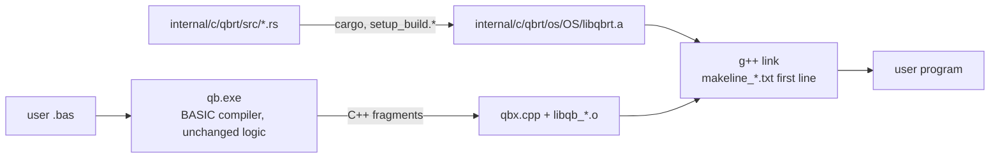

# Rust Port — Progress Log

> Project: `D:\QBNex-Rust` (git branch `rust-port`, cloned from `D:\QBNex` at `545b859`).
> The original `D:\QBNex` is **not modified** by the port. Remote `legacy-local` points at it.
> Strategy: Revision 2 in [`port-plan.md`](port-plan.md) — the BASIC compiler stays, the C++ runtime is replaced subsystem by subsystem with the Rust crate `qbrt`.

## Status (2026-11-09)

| Phase | Status | Evidence |
| --- | --- | --- |
| R0 Oracle + CI | **done (local), CI unverified** | `conformance/` runner + 25 cases (19 golden, 6 xfail); smoke + conformance + unit + differential steps in `.github/workflows/{push,pull_request}.yml` |
| R1 `qbrt` foundation + MBF slice | **done (Windows), Linux/macOS unverified** | `internal/c/qbrt`; `libqb.cpp` includes `qbrt.h` instead of `msbin.cpp`; exhaustive differential test 0 mismatches |
| R2 Leaf numeric code | **done (Windows)** | TDD + differential + legacy deleted for rounding (`qbr*`, `fpu_reinit`), RND/RANDOMIZE, VAL, STR$ number formatting (all `qbs_str` overloads), TIMER arithmetic. `libqb.cpp` is ~600 lines shorter |
| L-00 self-host fixpoint | **done (Windows)** | TopLevelRuntime lowering fixed (`classes.bas`); gen1 = gen2 = gen3 byte-identical C++; `internal/source` regenerated and reproducible; `tests/selfhost_fixpoint.{sh,cmd}` in CI |
| R3 String engine (`qbs`) | **done (Windows)** | descriptor pool, tracking lists, `qbs_data` arena, DBLOCK (cmem) strings, `qbs_set`/`qbs_free`/`qbs_cleanup` and the string functions in `qbrt/src/qbs.rs`; legacy C++ deleted (`libqb.cpp` ~850 lines shorter); debt F2 fixed |
| R4–R10 | pending | — |

### Verified on Windows (MinGW-Builds g++ 15.2.0 ucrt, rustc 1.98.0)

- `cmake --build --preset windows-mingw-selfhost` builds `libqbrt.a`, `qb-stage0.exe` and `qb.exe` linked against Rust.
- `cargo test --workspace`: 64/64 pass; `cargo clippy --workspace --all-targets`: 0 warnings.
- `diff_msbin` (legacy `msbin.cpp` vs Rust, every 2³² single-precision bit pattern in both directions + 50M double samples + edge cases): **0 mismatches**.
- `diff_round` (legacy x87 `fistp` asm vs Rust, 30M random 80-bit/double/float inputs + specials): **0 mismatches**; a mutation run reports 138k mismatches, so the harness can fail.
- `diff_val` (legacy `func_val` with `__mingw_sscanf` vs Rust, 3M generated strings incl. hex/oct/bin, 60-digit mantissas, exponents to ±5000): **0 mismatches** outside the L-05 forms that Rust fixes on purpose.
- `diff_str` (legacy `qbs_str` with MinGW printf vs Rust, 5M iterations x 10 types: random bit patterns, decimals, integers of all widths): **0 mismatches**; 553k L-07/D-05 inputs skipped by design; mutation run reports 189k mismatches.
- `diff_timer` (legacy `func_timer` + x87 `qbr` vs Rust, 20M random tick/start/accuracy combinations incl. errors): **0 mismatches**; mutation run reports 121k mismatches.
- `diff_qbs` (verbatim legacy string engine vs Rust, 5.17M random BASIC-like statements: nested string expressions, comparisons, INSTR/_INSTRREV/ASC/LEN, MID$ statement, fixed-length and DBLOCK strings, FREE, scope cleanup, 300k live strings, 150k tmp strings in one scope, concatenation loops growing the arena; after each statement every tracking-list entry, descriptor-pool position (incl. free list), arena/DBLOCK offset, stack pointer, DBLOCK byte and variable is compared): **0 mismatches**; mutation runs: arena compaction threshold 175 mismatches, MID$ boundary 133k mismatches; a third mutant (tmp-source skip in `qbs_set`) survives because that legacy branch is unreachable (a tmp source in the same list is always acquired first).
- `conformance`: 39 cases — 35 passed, 4 xfail (known legacy defects), 0 failed; golden output from the unmodified legacy build, plus hand-written `.deviation` cases. R3 added `strings/{concat_loop,mid_statement,fixed_length_ops,cmem_strings,case_trim_search}`.
- Self-host fixpoint with the Rust string engine: gen2 = gen3 C++, both pass the corpus.
- Benchmark (interleaved A/B, median of 5, legacy-engine `qb` vs Rust-engine `qb`, same machine and toolchain): tiny -9.0%, warning path -16.7%, medium -14.5%, large -11.5%, `qb source/qbnex.bas -z` (front end only) 19.0 s -> 10.0 s (-47.7%). The machine was shared with other builds, so treat single numbers as noisy; no case got slower.
- `tests/*_smoke.cmd` (cli, diagnostics, warnings, labels, encoding, stdlib, audio): 7/7 pass.

### Not verified yet

- Linux and macOS builds (native-library lists for the Rust staticlib are taken from rustc docs, not run).
- GitHub Actions runs of the new CI steps.
- Docker images (Rust toolchain added, not built).
- 32-bit Windows (`i686-pc-windows-gnu` selected automatically, not built).

## R3 string engine

`internal/c/qbrt/src/qbs.rs` owns all string-engine state: the descriptor pool (65536-descriptor blocks, LIFO free list), the three tracking lists (arena, DBLOCK, tmp), the `qbs_data` arena (1 MB, compaction when a gap above 32 bytes opens, growth `size*2+needed`) and the DBLOCK string area. `struct qbs` keeps the exact `common.h` layout (`#[repr(C)]`, checked by a unit test and by the harness) because generated C++ reads and writes its fields.

- Rust exports the globals generated code uses: `qbs_tmp_list_nexti` (scope marker), `qbs_cmem_sp`, `qbs_cmem_descriptor_space`; `qbx.cpp`/`libqb.cpp` now only declare them.
- Conventional memory stays C++ (`cmem`, `dblock`, `cmem_sp`); errors and FIELD buffers go through `qbrt_host_error` / `qbrt_host_field_free` in `libqb.cpp`.
- `libqb.cpp` keeps one-line shims with the old C++ signatures; `sub_mid` keeps its `new_error`/`nothingstring` checks in the shim. `qbs_cleanup` (qbx.cpp and libqb.cpp) keeps the inline fast path and calls `qbrt_qbs_cleanup` otherwise, so C++ no longer touches the tmp list: **F2 fixed** (`extern ptrszint *qbs_tmp_list` vs `std::vector` is gone).
- Still in C++: `qbs_inkey`, `qbs_str` shims, MK*/CV* helpers (`b2string` …), `LSET`/`RSET` (FIELD-coupled), `qbs_print`/`qbs_input`.
- Known legacy behaviour kept: DBLOCK string descriptors (4 bytes below `cmem_sp`) are never returned by `qbs_free`; generated code restores `cmem_sp` when a SUB exits. Allocation failure aborts the process (legacy raised error 508 and continued with a NULL block).

## Bootstrap snapshot and self-host fixpoint (L-00)

`internal/source` is the generated C++ of the compiler itself; CMake builds `qb-stage0` from it, and stage0 compiles `source/qbnex.bas` into `qb`. Since L-00 is fixed the chain is a true fixpoint: the C++ that gen1, gen2 and gen3 emit for `source/qbnex.bas` is byte-identical, and equal to the committed snapshot.

- `tests/selfhost_fixpoint.{sh,cmd}` builds gen2 and gen3 from `qb`, requires identical `-z` output, and runs the conformance corpus with both (CI step "Self-host fixpoint"). `--no-conformance` skips the corpus runs.
- `tests/refresh_stage0_snapshot.{sh,cmd}` regenerates `internal/source` with `qb -z` (only `*.txt` and `data.bin`; `icon.rc`, `*.bat`, `manifest.h`, manifests and icons stay as committed). Refresh after compiler changes, then rebuild from scratch and run it again: the second run must leave `internal/source` unchanged. The snapshot is generated on Windows, as before.

## Porting workflow (TDD, legacy C++ deleted)

Every subsystem goes through the same loop:

1. **RED** — Rust unit tests describing the behaviour (values captured from the legacy oracle or QBasic semantics); run them against a stub and watch them fail on assertions.
2. **GREEN** — minimal Rust implementation in `internal/c/qbrt/src/<module>.rs`.
3. **Differential** — a harness in `internal/c/qbrt/tests/diff_<module>.cpp` links the Rust code with a *verbatim copy* of the legacy C++ (`tests/legacy/*.inc`, test-only) and compares them on millions of inputs. A mutation run proves the harness can fail.
4. **Delete** — the legacy C++ is removed from `libqb.cpp` (no `#ifdef LEGACY` fallback); only a one-line shim with the old C++ signature stays, because generated code and `qbx.cpp` call it.
5. **Conformance** — new cases blessed from `.oracle`, then the whole corpus + smoke tests run against the Rust build.

Where the legacy behaviour is a clear defect against QBasic, the Rust code fixes it, the unit test asserts the QBasic result, and the conformance case carries a `.deviation` note with a hand-written golden file.

### What "remove all C/C++" can reach under D10

With the compiler kept in BASIC, it still **emits C++**, so `internal/c/qbx.cpp`, the generated fragments and a C++ compiler at user compile time remain. Everything else can go: `libqb.cpp` shrinks to shims and then disappears, and every library under `internal/c/parts` is replaced by Rust crates. Removing the last C++ needs a separate phase (proposed **R11**): change the BASIC compiler's emitter to generate Rust (or an IR the Rust runtime executes) instead of C++. That keeps D10 (compiler stays BASIC) but needs `rustc` instead of `g++` on the user's machine. Not started; needs approval.

## How the pieces fit



- `libqb.cpp` references Rust symbols, so **every** link needs `libqbrt.a`. It is on the first line of `internal/c/makeline_*.txt`, which both the bootstrap `qb-stage0` and the current compiler read at run time. That is the only way to reach the stage0 link, because stage0 is built from the frozen snapshot in `internal/source` (see L-00).
- Windows native libs are written `-l ws2_32` (with a space) on purpose: `PrepareWindowsBuildCommand$` strips every `-lws2_32` when sockets are unused.
- `libqbrt.stamp` is rewritten on each Rust build and is part of the native build-cache key (`linker.bas`), so cached executables are rebuilt after a runtime change.
- End users do not need cargo: release bundles copy `internal/`, which contains the prebuilt `libqbrt.a`.

## How to run

```bash
# Rust unit tests
cargo test --workspace
```

```bash
# Build compiler + runtime (Windows; needs internal/c/c_compiler = MinGW, and cargo)
cmake --preset windows-mingw && cmake --build --preset windows-mingw-selfhost
```

```bash
# Conformance against golden files
cargo run --release -p qbnex-conformance
```

```bash
# Re-capture golden output from the legacy oracle (only when adding cases)
git clone --branch main . .oracle
(cd .oracle && cmake --preset windows-mingw && cmake --build --preset windows-mingw-selfhost)
cargo run --release -p qbnex-conformance -- --qb .oracle/qb.exe --bless
```

Golden output must always come from the legacy C++ runtime (`.oracle`, gitignored), never from the Rust build.

## Legacy defects found by the corpus

These reproduce on the unmodified legacy build. They are kept as `xfail` cases (the runner reports `XPASS` once one is fixed).

| ID | Defect | Case | Severity |
| --- | --- | --- | --- |
| L-00 | **Self-host fixpoint is broken.** `qb.exe` built from HEAD compiles `source/qbnex.bas` into a second-generation compiler that fails on hello world with `[E9999] Too many errors`. Root cause: the TopLevelRuntime lowering counted `FUNCTION getpid& ()` inside `DECLARE LIBRARY` as a procedure opening, so main-module code before the block moved into `SUB QBNEX_TOPLEVEL_RUNTIME0` (with its own locals, called only at the end) while later code ran first, before `InitCompilerServices` set `maxErrors` (0 -> first diagnostic aborts). **Fixed** (D-06). | `control/declare_library_toplevel` (`.deviation`), `tests/selfhost_fixpoint.*` | Critical |
| L-01 | A main-module `ON ERROR GOTO` handler label makes compilation fail with `Unknown statement 'END'` on a line past the end of the file (TopLevelRuntime lowering, `classes.bas`). Classic QB error handling does not compile. **Fixed** for main-module code before the first SUB/FUNCTION (D-06); a handler label placed *after* a SUB (or after an `$INCLUDE` that defines SUBs) is still moved into the runtime SUB and still fails. | `errors/*`, `binary/mbf_overflow` (`.deviation`) | High |
| L-02 | `PRINT a, b` (14-column zones) writes spaces forever when stdout is redirected. | `console/print_comma_redirected` | High |
| L-03 | `RESTORE <label>` never returns. | `data/restore_label` | High |
| L-04 | Relational operators inside `PRINT` (`PRINT a$ < "K"`) are rejected as `Unknown statement 'PRINT'`. | `strings/compare_in_print` | Medium |
| L-05 | `VAL` negates the exponent after normalising: `VAL("123E-2")` = `.000123`, `VAL("0.5E-1")` = `5`. **Fixed in Rust** (intentional deviation). | `strings/val_negative_exponent` (`.deviation`) | High |
| L-06 | `PRINT USING "#.##^^^^"` on a `_FLOAT` near 1E4932 prints `%0.118973149535723F+4984` and corrupts the heap (exit `0xC0000374`). | `strings/print_using_huge_exponent` | High |
| L-07 | `STR$` of a DOUBLE that needs more than 19 decimals (e.g. `1.234567890123456D-16`) builds a broken printf format and returns ` .0f`. **Fixed in Rust** (D-04). | `strings/str_many_decimals` (`.deviation`) | Medium |
| L-08 | Compiled programs exit with `0xC0000409` (fail-fast) about once in 300-400 runs, legacy oracle build included (`control/gosub_goto`, 1/400 with `.oracle`). Probably the exit-time thread race in F3. Can make a conformance run flaky. | none (statistical) | Medium |

Output quirks that are preserved bug-for-bug (golden files depend on them):

- `MKSMBF$(0)` yields MBF exponent 2 (`00 00 00 02`), not zero.
- Some DOUBLE values print with a trailing zero (`-2.50`, `3.141592653589790`).
- `MKDMBF$(-0#)` and tiny/huge doubles raise overflow (error 5).
- DOUBLE `STR$`/`PRINT` adds one decimal when there are two or more significant digits (` 42.0`, `-.250`, ` 123456789012345.59`, ` .33333333333333331`): legacy uses a buffer index as the digit count. Ported as is (`numfmt.rs`).
- `STR$` of infinity or NaN is ` 0`.

Intentional deviations (Rust differs from legacy on purpose):

| ID | Change | Why |
| --- | --- | --- |
| D-01 | `VAL` applies the sign to the written exponent (fixes L-05). | QBasic semantics; legacy result is wrong by powers of ten. |
| D-02 | Rounding is QBasic round-half-even on every CPU. Legacy non-x86 builds rounded half away from zero (`f+0.5` truncation). | One behaviour on all platforms, matching x86 and QBasic. |
| D-03 | `VAL` keeps 1000 significant digits exactly and treats further non-zero digits as "slightly more". Legacy overran a 256-byte buffer past 256 digits (undefined behaviour). | Defined behaviour; correctly rounded up to 1000 digits. |
| D-04 | `STR$` prints all decimals the legacy algorithm asks for, also beyond 19 (fixes L-07). | Legacy output was garbage from a malformed printf format. |
| D-05 | `STR$` of a non-finite SINGLE is ` 0`. Legacy read a stale static buffer (result depended on the previous call). | Defined result, same as DOUBLE. |
| D-06 | Compiler: the TopLevelRuntime lowering only moves top-level code that follows a SUB/FUNCTION (where it used to be a "between SUB/FUNCTIONs" error) into `SUB QBNEX_TOPLEVEL_RUNTIME0`; code before the first procedure stays in the main module. `SUB`/`FUNCTION` lines inside `DECLARE [DYNAMIC\|CUSTOMTYPE\|STATIC] LIBRARY` are not procedure openings, `END SUB 'comment` closes a procedure, and the runtime SUB is called where main closes instead of at the first `END` (fixes L-00, most of L-01). | Legacy moved every main-module line into a SUB called at the end: wrong order, separate locals, broken `ON ERROR`, non-reproducible bootstrap. |

## Next steps

2. L-01 remainder: error handler labels after a SUB still end up inside the runtime SUB.
3. Grow the corpus per builtin group (`subs_functions.bas`), especially PRINT USING, file I/O and string functions, before R3/R4.
4. Run the new CI on GitHub to verify Linux/macOS builds of `libqbrt.a`.
