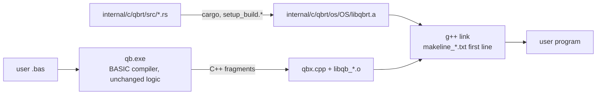

# Rust Port — Progress Log

> Project: `D:\QBNex-Rust` (git branch `rust-port`, cloned from `D:\QBNex` at `545b859`).
> The original `D:\QBNex` is **not modified** by the port. Remote `legacy-local` points at it.
> Strategy: Revision 2 in [`port-plan.md`](port-plan.md) — the BASIC compiler stays, the C++ runtime is replaced subsystem by subsystem with the Rust crate `qbrt`.

## Status (2026-11-09)

| Phase | Status | Evidence |
| --- | --- | --- |
| R0 Oracle + CI | **done (local), CI unverified** | `conformance/` runner + 25 cases (19 golden, 6 xfail); smoke + conformance + unit + differential steps in `.github/workflows/{push,pull_request}.yml` |
| R1 `qbrt` foundation + MBF slice | **done (Windows), Linux/macOS unverified** | `internal/c/qbrt`; `libqb.cpp` includes `qbrt.h` instead of `msbin.cpp`; exhaustive differential test 0 mismatches |
| R2 Leaf numeric code | **done (Windows)** | TDD + differential + legacy deleted for rounding (`qbr*`, `fpu_reinit`), RND/RANDOMIZE, VAL, STR$ number formatting (all `qbs_str` overloads), TIMER arithmetic. `libqb.cpp` is ~600 lines shorter |
| R6 Audio | **done (Windows), Linux/macOS unverified** | Crate `internal/c/qbrt/audio` (cpal, symphonia, xmrs) replaces `parts/audio` (audio.cpp, miniaudio, stb_vorbis, minimp3, libxmp-lite, tinysoundfont, RADv2: ~130k lines deleted). Synth bit-exact vs legacy over 204M frames. See [R6 audio](#r6-audio) |
| R3–R10 | pending | — |

### Verified on Windows (MinGW-Builds g++ 15.2.0 ucrt, rustc 1.98.0)

- `cmake --build --preset windows-mingw-selfhost` builds `libqbrt.a`, `qb-stage0.exe` and `qb.exe` linked against Rust.
- `cargo test --workspace`: 48/48 pass; `cargo clippy --workspace --all-targets`: 0 warnings.
- `diff_msbin` (legacy `msbin.cpp` vs Rust, every 2³² single-precision bit pattern in both directions + 50M double samples + edge cases): **0 mismatches**.
- `diff_round` (legacy x87 `fistp` asm vs Rust, 30M random 80-bit/double/float inputs + specials): **0 mismatches**; a mutation run reports 138k mismatches, so the harness can fail.
- `diff_val` (legacy `func_val` with `__mingw_sscanf` vs Rust, 3M generated strings incl. hex/oct/bin, 60-digit mantissas, exponents to ±5000): **0 mismatches** outside the L-05 forms that Rust fixes on purpose.
- `diff_str` (legacy `qbs_str` with MinGW printf vs Rust, 5M iterations x 10 types: random bit patterns, decimals, integers of all widths): **0 mismatches**; 553k L-07/D-05 inputs skipped by design; mutation run reports 189k mismatches.
- `diff_timer` (legacy `func_timer` + x87 `qbr` vs Rust, 20M random tick/start/accuracy combinations incl. errors): **0 mismatches**; mutation run reports 121k mismatches.
- `conformance`: 30 cases — 23 passed, 7 xfail (known legacy defects), 0 failed; golden output from the unmodified legacy build, plus one hand-written `.deviation` case.
- `tests/*_smoke.cmd` (cli, diagnostics, warnings, labels, encoding, stdlib, audio): 7/7 pass.

### Not verified yet

- Linux and macOS builds (native-library lists for the Rust staticlib are taken from rustc docs, not run).
- GitHub Actions runs of the new CI steps.
- Docker images (Rust toolchain added, not built).
- 32-bit Windows (`i686-pc-windows-gnu` selected automatically, not built).

## R6 audio

`internal/c/parts/audio/{out,decode,conversion}` are gone. Only `parts/audio/out/audio.h` (declarations) and `src.c` (shims, `#include`d by `libqb.cpp`) remain; the shims keep the old `sub_*`/`func_*` signatures, raise BASIC errors and manage `_MEMSOUND` mem locks, and call the C ABI in `internal/c/qbrt/include/qbrt_audio.h`.

- **Crate layout.** `qbrt-audio` is a separate crate linked into `libqbrt.a` (`extern crate qbrt_audio` in `qbrt`). The release profile builds one object per crate, so a program only pulls the audio object (and cpal/symphonia) when libqb references a `qbrt_snd_*` symbol, which happens only with `DEPENDENCY_AUDIO_OUT`. A console `PRINT "hi"` exe is 2.6 MB with no audio strings; an audio exe is 5.0 MB.
- **Modules.** `synth.rs` (envelope, waveforms, `GenerateWaveform`), `mml.rs` (`PLAY` state machine transcribed from the `goto` code, `SOUND`, `_VOICE`, `_ADSR`, `_WAVE`, VARPTR$), `queue.rs` (raw frame queue), `engine.rs` (handle table, mixer, `_SND*`), `decode.rs`, `device.rs` (cpal on its own thread), `ffi.rs`.
- **F3 fixed for audio.** One mutex guards the whole engine; the BASIC thread, libqb's main-loop thread (`snd_mainloop`) and the cpal callback all take it. Legacy shared `soundHandles`, the raw queues and miniaudio sounds between those threads with no lock.
- **Build.** No extra Windows link libraries (the `windows` crate uses raw-dylib). Linux user links get `-lasound` and need `libasound2-dev` (added to CI apt lines; Dockerfiles already had it). macOS links CoreAudio, AudioUnit, AudioToolbox, CoreFoundation. Building `libqbrt.a` now needs Rust 1.88 (xmrsplayer; cpal 0.18 needs 1.85). `QBRT_AUDIO_DEVICE=none` runs a program without an output device (same behaviour as legacy when miniaudio failed to start).

Verified on Windows:

- `cargo test -p qbrt-audio`: 40 tests (envelope, waveforms, custom wave parsing incl. `strtod` forms, rand LCG, MML: octave/`<`/`>`, length, tempo, dots, MB/MF/MN/ML/MS, N, sharps/flats, P, chords, VARPTR$, errors, state between statements; queue blocks; handle allocation, play/loop/pause/stop/seek/limit/volume/pan, `_MEMSOUND`, raw streams, voice draining; WAV decoding and resampling). RED run first: 11 PLAY tests failed on assertions against a stub.
- `diff_audio` (legacy synth + `sub_play`/`sub_sound`/`sub__voice`/`sub__adsr`/`sub__wave` copied verbatim into `tests/legacy/audio_synth*.inc`, rendered offline vs Rust): 50,000 random statements over 8000/22050/44100/48000 Hz, **204,132,081 frames, 0 mismatches, 0 samples off even by 1 LSB** (documented tolerance is 1 LSB for libm differences; not needed on MinGW). Noise waveforms included. A mutation run (pink-noise coefficient 0.1848 -> 0.1849 and dotted-note divisor 2 -> 2.01) reports 911 mismatches in the quick run. The harness found two real porting bugs on the way: x87 unnormal long doubles in `"=" + VARPTR$` and the out-of-range double -> int16 conversion (`cvttsd2si` gives 0x80000000, Rust `as` saturates); both are now emulated.
- End-to-end on a real device (48 kHz): `_SNDOPEN` WAV, `_SNDLEN`, `_MEMSOUND` (size, element size and a spot-checked sample match the file), `_SNDPLAY` to the end, `_SNDCOPY`, `_SNDRAW` + `_SNDRAWDONE` until `_SNDRAWLEN` = 0, `PLAY` until `PLAY(0)` = 0; and the same program with `QBRT_AUDIO_DEVICE=none`.
- `tests/audio_smoke.cmd` and the other 6 smoke tests pass; conformance 35 cases: 28 passed, 7 xfail, 0 failed (2 new device-independent cases in `conformance/cases/audio/`).

Not verified: Linux (ALSA) and macOS (CoreAudio) builds and playback; MP3/FLAC/Ogg/MOD/XM/S3M/IT files beyond the decoder unit tests (WAV); audible quality by ear.

Legacy defect found (not reproducible in the corpus because output is device dependent):

| ID | Defect | Severity |
| --- | --- | --- |
| L-60 | `SOUND`, `BEEP` and `PLAY` were silent: the four synth voice queues were never registered as sound handles, so `snd_mainloop` never streamed them, and `PLAY(n)` only grew. **Fixed in Rust** (D-60). | High |

Intentional deviations of R6:

| ID | Change | Why |
| --- | --- | --- |
| D-60 | Synth voices are mixed into the output and drain, so `PLAY(n)` counts down (fixes L-60). `PLAY` still never blocks, as in legacy (QBasic blocks in MF mode). | Legacy output was silence. |
| D-61 | When a chord (`,`) is followed by a longer note or pause, the grown part of the PLAY buffer is silence; legacy left it uninitialised (`realloc`). The legacy `memset` that zeroes part of the chord is kept. | Defined output instead of heap garbage. |
| D-62 | Noise waveforms use the MSVCRT/UCRT `rand()` LCG (seed 1) on every platform and no longer share the C runtime's `rand()` state. | Identical noise on all platforms; matches the legacy Windows build exactly. |
| D-63 | Decoders: symphonia (WAV, FLAC, MP3, Ogg Vorbis) and xmrs (MOD, XM, S3M, IT, rendered once, loops not repeated, max 30 min). **MIDI (tinysoundfont + AWE32 ROM) and RAD v2 are dropped**: `_SNDOPEN` returns -1. "STREAM" sounds are decoded completely at open (still not copyable and not `_MEMSOUND`-able, as legacy). Resampling to the device rate is linear without miniaudio's low-pass filter. WAV keeps its integer sample format for `_MEMSOUND`, other formats are f32, modules s16 stereo. | No pure-Rust MIDI synth with an embedded bank; RAD has no Rust player. |
| D-64 | `_SNDBAL` with y/z uses inverse-distance gain and x-direction pan instead of miniaudio's spatializer (no doppler, cones or HRTF-like channel gains). Stereo pan uses miniaudio's `ma_pan_mode_pan` law. | Approximation of the 3-D model. |
| D-65 | Raw streams (`_SNDRAW`, synth voices) are pulled by the device callback under the engine lock instead of being copied block by block into a ping-pong buffer by `snd_mainloop`. A forced partial block plays without padding; `_SNDRAWLEN` counts queued frames only. Legacy `_SNDLIMIT` semantics (absolute engine time) are kept. | Race-free (F3) and independent of the main-loop rate. |

License changes: miniaudio, stb_vorbis, minimp3, libxmp-lite, tinysoundfont and RADv2 are no longer distributed (their entries and license files were removed from `licenses/`). Added: cpal (Apache-2.0), Symphonia (**MPL-2.0**, file-level copyleft, used unmodified), xmrs/xmrsplayer (MIT) and their MIT/Apache-2.0/Zlib/BSD dependencies (`licenses/COPYING.TXT`, `license_apache_2_0.txt`, `license_mpl_2_0.txt`, `license_xmrs.txt`).

## Porting workflow (TDD, legacy C++ deleted)

Every subsystem goes through the same loop:

1. **RED** — Rust unit tests describing the behaviour (values captured from the legacy oracle or QBasic semantics); run them against a stub and watch them fail on assertions.
2. **GREEN** — minimal Rust implementation in `internal/c/qbrt/src/<module>.rs`.
3. **Differential** — a harness in `internal/c/qbrt/tests/diff_<module>.cpp` links the Rust code with a *verbatim copy* of the legacy C++ (`tests/legacy/*.inc`, test-only) and compares them on millions of inputs. A mutation run proves the harness can fail.
4. **Delete** — the legacy C++ is removed from `libqb.cpp` (no `#ifdef LEGACY` fallback); only a one-line shim with the old C++ signature stays, because generated code and `qbx.cpp` call it.
5. **Conformance** — new cases blessed from `.oracle`, then the whole corpus + smoke tests run against the Rust build.

Where the legacy behaviour is a clear defect against QBasic, the Rust code fixes it, the unit test asserts the QBasic result, and the conformance case carries a `.deviation` note with a hand-written golden file.

### What "remove all C/C++" can reach under D10

With the compiler kept in BASIC, it still **emits C++**, so `internal/c/qbx.cpp`, the generated fragments and a C++ compiler at user compile time remain. Everything else can go: `libqb.cpp` shrinks to shims and then disappears, and every library under `internal/c/parts` is replaced by Rust crates. Removing the last C++ needs a separate phase (proposed **R11**): change the BASIC compiler's emitter to generate Rust (or an IR the Rust runtime executes) instead of C++. That keeps D10 (compiler stays BASIC) but needs `rustc` instead of `g++` on the user's machine. Not started; needs approval.

## How the pieces fit



- `libqb.cpp` references Rust symbols, so **every** link needs `libqbrt.a`. It is on the first line of `internal/c/makeline_*.txt`, which both the bootstrap `qb-stage0` and the current compiler read at run time. That is the only way to reach the stage0 link, because stage0 is built from the frozen snapshot in `internal/source` (see L-00).
- Windows native libs are written `-l ws2_32` (with a space) on purpose: `PrepareWindowsBuildCommand$` strips every `-lws2_32` when sockets are unused.
- `libqbrt.stamp` is rewritten on each Rust build and is part of the native build-cache key (`linker.bas`), so cached executables are rebuilt after a runtime change.
- End users do not need cargo: release bundles copy `internal/`, which contains the prebuilt `libqbrt.a`.

## How to run

```bash
# Rust unit tests
cargo test --workspace
```

```bash
# Build compiler + runtime (Windows; needs internal/c/c_compiler = MinGW, and cargo)
cmake --preset windows-mingw && cmake --build --preset windows-mingw-selfhost
```

```bash
# Conformance against golden files
cargo run --release -p qbnex-conformance
```

```bash
# Re-capture golden output from the legacy oracle (only when adding cases)
git clone --branch main . .oracle
(cd .oracle && cmake --preset windows-mingw && cmake --build --preset windows-mingw-selfhost)
cargo run --release -p qbnex-conformance -- --qb .oracle/qb.exe --bless
```

Golden output must always come from the legacy C++ runtime (`.oracle`, gitignored), never from the Rust build.

## Legacy defects found by the corpus

These reproduce on the unmodified legacy build. They are kept as `xfail` cases (the runner reports `XPASS` once one is fixed).

| ID | Defect | Case | Severity |
| --- | --- | --- | --- |
| L-00 | **Self-host fixpoint is broken.** `qb.exe` built from HEAD compiles `source/qbnex.bas` into a second-generation compiler that fails on hello world with `[E9999] Too many errors`. Builds only work because stage0 comes from the old snapshot in `internal/source`. Regenerating the snapshot from current source is therefore impossible until this is fixed. | manual (see progress log) | Critical |
| L-01 | A main-module `ON ERROR GOTO` handler label makes compilation fail with `Unknown statement 'END'` on a line past the end of the file (TopLevelRuntime lowering, `classes.bas`). Classic QB error handling does not compile. | `errors/*`, `binary/mbf_overflow` | High |
| L-02 | `PRINT a, b` (14-column zones) writes spaces forever when stdout is redirected. | `console/print_comma_redirected` | High |
| L-03 | `RESTORE <label>` never returns. | `data/restore_label` | High |
| L-04 | Relational operators inside `PRINT` (`PRINT a$ < "K"`) are rejected as `Unknown statement 'PRINT'`. | `strings/compare_in_print` | Medium |
| L-05 | `VAL` negates the exponent after normalising: `VAL("123E-2")` = `.000123`, `VAL("0.5E-1")` = `5`. **Fixed in Rust** (intentional deviation). | `strings/val_negative_exponent` (`.deviation`) | High |
| L-06 | `PRINT USING "#.##^^^^"` on a `_FLOAT` near 1E4932 prints `%0.118973149535723F+4984` and corrupts the heap (exit `0xC0000374`). | `strings/print_using_huge_exponent` | High |
| L-07 | `STR$` of a DOUBLE that needs more than 19 decimals (e.g. `1.234567890123456D-16`) builds a broken printf format and returns ` .0f`. **Fixed in Rust** (D-04). | `strings/str_many_decimals` (`.deviation`) | Medium |

Output quirks that are preserved bug-for-bug (golden files depend on them):

- `MKSMBF$(0)` yields MBF exponent 2 (`00 00 00 02`), not zero.
- Some DOUBLE values print with a trailing zero (`-2.50`, `3.141592653589790`).
- `MKDMBF$(-0#)` and tiny/huge doubles raise overflow (error 5).
- DOUBLE `STR$`/`PRINT` adds one decimal when there are two or more significant digits (` 42.0`, `-.250`, ` 123456789012345.59`, ` .33333333333333331`): legacy uses a buffer index as the digit count. Ported as is (`numfmt.rs`).
- `STR$` of infinity or NaN is ` 0`.

Intentional deviations (Rust differs from legacy on purpose):

| ID | Change | Why |
| --- | --- | --- |
| D-01 | `VAL` applies the sign to the written exponent (fixes L-05). | QBasic semantics; legacy result is wrong by powers of ten. |
| D-02 | Rounding is QBasic round-half-even on every CPU. Legacy non-x86 builds rounded half away from zero (`f+0.5` truncation). | One behaviour on all platforms, matching x86 and QBasic. |
| D-03 | `VAL` keeps 1000 significant digits exactly and treats further non-zero digits as "slightly more". Legacy overran a 256-byte buffer past 256 digits (undefined behaviour). | Defined behaviour; correctly rounded up to 1000 digits. |
| D-04 | `STR$` prints all decimals the legacy algorithm asks for, also beyond 19 (fixes L-07). | Legacy output was garbage from a malformed printf format. |
| D-05 | `STR$` of a non-finite SINGLE is ` 0`. Legacy read a stale static buffer (result depended on the previous call). | Defined result, same as DOUBLE. |

## Next steps

1. R3 string engine (`qbs`): decide on L-00 first, because generated code touches `qbs` fields directly and stage0 is frozen.
2. Decide on L-00 (frozen `internal/source`) before R3; the string engine changes structs that generated code touches directly.
3. Grow the corpus per builtin group (`subs_functions.bas`), especially PRINT USING, file I/O and string functions, before R3/R4.
4. Run the new CI on GitHub to verify Linux/macOS builds of `libqbrt.a`.
