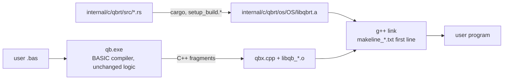

# Rust Port — Progress Log

> Project: `D:\QBNex-Rust` (git branch `rust-port`, cloned from `D:\QBNex` at `545b859`).
> The original `D:\QBNex` is **not modified** by the port. Remote `legacy-local` points at it.
> Strategy: Revision 2 in [`port-plan.md`](port-plan.md) — the BASIC compiler stays, the C++ runtime is replaced subsystem by subsystem with the Rust crate `qbrt`.

## Status (2026-11-09)

| Phase | Status | Evidence |
| --- | --- | --- |
| R0 Oracle + CI | **done (local), CI unverified** | `conformance/` runner + 25 cases (19 golden, 6 xfail); smoke + conformance + unit + differential steps in `.github/workflows/{push,pull_request}.yml` |
| R1 `qbrt` foundation + MBF slice | **done (Windows), Linux/macOS unverified** | `internal/c/qbrt`; `libqb.cpp` includes `qbrt.h` instead of `msbin.cpp`; exhaustive differential test 0 mismatches |
| R2 Leaf numeric code | **done (Windows)** | TDD + differential + legacy deleted for rounding (`qbr*`, `fpu_reinit`), RND/RANDOMIZE, VAL, STR$ number formatting (all `qbs_str` overloads), TIMER arithmetic. `libqb.cpp` is ~600 lines shorter |
| R3–R10 | pending | — |
| R7 Fonts + image codecs | **done (Windows)** | FreeType 2.4.9 wrapper → `qbrt::font` (skrifa + ab_glyph_rasterizer); stb_image 2.27 + dr_pcx → `qbrt::image` (ports + png/zune-jpeg crates). FreeType, stb_image, dr_pcx deleted (~170k lines of C). See [R7](#r7-fonts-and-image-codecs) |

### Verified on Windows (MinGW-Builds g++ 15.2.0 ucrt, rustc 1.98.0)

- `cmake --build --preset windows-mingw-selfhost` builds `libqbrt.a`, `qb-stage0.exe` and `qb.exe` linked against Rust.
- `cargo test --workspace`: 48/48 pass; `cargo clippy --workspace --all-targets`: 0 warnings.
- `diff_msbin` (legacy `msbin.cpp` vs Rust, every 2³² single-precision bit pattern in both directions + 50M double samples + edge cases): **0 mismatches**.
- `diff_round` (legacy x87 `fistp` asm vs Rust, 30M random 80-bit/double/float inputs + specials): **0 mismatches**; a mutation run reports 138k mismatches, so the harness can fail.
- `diff_val` (legacy `func_val` with `__mingw_sscanf` vs Rust, 3M generated strings incl. hex/oct/bin, 60-digit mantissas, exponents to ±5000): **0 mismatches** outside the L-05 forms that Rust fixes on purpose.
- `diff_str` (legacy `qbs_str` with MinGW printf vs Rust, 5M iterations x 10 types: random bit patterns, decimals, integers of all widths): **0 mismatches**; 553k L-07/D-05 inputs skipped by design; mutation run reports 189k mismatches.
- `diff_timer` (legacy `func_timer` + x87 `qbr` vs Rust, 20M random tick/start/accuracy combinations incl. errors): **0 mismatches**; mutation run reports 121k mismatches.
- `conformance`: 30 cases — 23 passed, 7 xfail (known legacy defects), 0 failed; golden output from the unmodified legacy build, plus one hand-written `.deviation` case.
- `tests/*_smoke.cmd` (cli, diagnostics, warnings, labels, encoding, stdlib, audio): 7/7 pass.

### Not verified yet

- Linux and macOS builds (native-library lists for the Rust staticlib are taken from rustc docs, not run).
- GitHub Actions runs of the new CI steps.
- Docker images (Rust toolchain added, not built).
- 32-bit Windows (`i686-pc-windows-gnu` selected automatically, not built).

## Porting workflow (TDD, legacy C++ deleted)

Every subsystem goes through the same loop:

1. **RED** — Rust unit tests describing the behaviour (values captured from the legacy oracle or QBasic semantics); run them against a stub and watch them fail on assertions.
2. **GREEN** — minimal Rust implementation in `internal/c/qbrt/src/<module>.rs`.
3. **Differential** — a harness in `internal/c/qbrt/tests/diff_<module>.cpp` links the Rust code with a *verbatim copy* of the legacy C++ (`tests/legacy/*.inc`, test-only) and compares them on millions of inputs. A mutation run proves the harness can fail.
4. **Delete** — the legacy C++ is removed from `libqb.cpp` (no `#ifdef LEGACY` fallback); only a one-line shim with the old C++ signature stays, because generated code and `qbx.cpp` call it.
5. **Conformance** — new cases blessed from `.oracle`, then the whole corpus + smoke tests run against the Rust build.

Where the legacy behaviour is a clear defect against QBasic, the Rust code fixes it, the unit test asserts the QBasic result, and the conformance case carries a `.deviation` note with a hand-written golden file.

### What "remove all C/C++" can reach under D10

With the compiler kept in BASIC, it still **emits C++**, so `internal/c/qbx.cpp`, the generated fragments and a C++ compiler at user compile time remain. Everything else can go: `libqb.cpp` shrinks to shims and then disappears, and every library under `internal/c/parts` is replaced by Rust crates. Removing the last C++ needs a separate phase (proposed **R11**): change the BASIC compiler's emitter to generate Rust (or an IR the Rust runtime executes) instead of C++. That keeps D10 (compiler stays BASIC) but needs `rustc` instead of `g++` on the user's machine. Not started; needs approval.

## How the pieces fit



- `libqb.cpp` references Rust symbols, so **every** link needs `libqbrt.a`. It is on the first line of `internal/c/makeline_*.txt`, which both the bootstrap `qb-stage0` and the current compiler read at run time. That is the only way to reach the stage0 link, because stage0 is built from the frozen snapshot in `internal/source` (see L-00).
- Windows native libs are written `-l ws2_32` (with a space) on purpose: `PrepareWindowsBuildCommand$` strips every `-lws2_32` when sockets are unused.
- `libqbrt.stamp` is rewritten on each Rust build and is part of the native build-cache key (`linker.bas`), so cached executables are rebuilt after a runtime change.
- End users do not need cargo: release bundles copy `internal/`, which contains the prebuilt `libqbrt.a`.

## How to run

```bash
# Rust unit tests
cargo test --workspace
```

```bash
# Build compiler + runtime (Windows; needs internal/c/c_compiler = MinGW, and cargo)
cmake --preset windows-mingw && cmake --build --preset windows-mingw-selfhost
```

```bash
# Conformance against golden files
cargo run --release -p qbnex-conformance
```

```bash
# Re-capture golden output from the legacy oracle (only when adding cases)
git clone --branch main . .oracle
(cd .oracle && cmake --preset windows-mingw && cmake --build --preset windows-mingw-selfhost)
cargo run --release -p qbnex-conformance -- --qb .oracle/qb.exe --bless
```

Golden output must always come from the legacy C++ runtime (`.oracle`, gitignored), never from the Rust build.

## Legacy defects found by the corpus

These reproduce on the unmodified legacy build. They are kept as `xfail` cases (the runner reports `XPASS` once one is fixed).

| ID | Defect | Case | Severity |
| --- | --- | --- | --- |
| L-00 | **Self-host fixpoint is broken.** `qb.exe` built from HEAD compiles `source/qbnex.bas` into a second-generation compiler that fails on hello world with `[E9999] Too many errors`. Builds only work because stage0 comes from the old snapshot in `internal/source`. Regenerating the snapshot from current source is therefore impossible until this is fixed. | manual (see progress log) | Critical |
| L-01 | A main-module `ON ERROR GOTO` handler label makes compilation fail with `Unknown statement 'END'` on a line past the end of the file (TopLevelRuntime lowering, `classes.bas`). Classic QB error handling does not compile. | `errors/*`, `binary/mbf_overflow` | High |
| L-02 | `PRINT a, b` (14-column zones) writes spaces forever when stdout is redirected. | `console/print_comma_redirected` | High |
| L-03 | `RESTORE <label>` never returns. | `data/restore_label` | High |
| L-04 | Relational operators inside `PRINT` (`PRINT a$ < "K"`) are rejected as `Unknown statement 'PRINT'`. | `strings/compare_in_print` | Medium |
| L-05 | `VAL` negates the exponent after normalising: `VAL("123E-2")` = `.000123`, `VAL("0.5E-1")` = `5`. **Fixed in Rust** (intentional deviation). | `strings/val_negative_exponent` (`.deviation`) | High |
| L-06 | `PRINT USING "#.##^^^^"` on a `_FLOAT` near 1E4932 prints `%0.118973149535723F+4984` and corrupts the heap (exit `0xC0000374`). | `strings/print_using_huge_exponent` | High |
| L-07 | `STR$` of a DOUBLE that needs more than 19 decimals (e.g. `1.234567890123456D-16`) builds a broken printf format and returns ` .0f`. **Fixed in Rust** (D-04). | `strings/str_many_decimals` (`.deviation`) | Medium |

Output quirks that are preserved bug-for-bug (golden files depend on them):

- `MKSMBF$(0)` yields MBF exponent 2 (`00 00 00 02`), not zero.
- Some DOUBLE values print with a trailing zero (`-2.50`, `3.141592653589790`).
- `MKDMBF$(-0#)` and tiny/huge doubles raise overflow (error 5).
- DOUBLE `STR$`/`PRINT` adds one decimal when there are two or more significant digits (` 42.0`, `-.250`, ` 123456789012345.59`, ` .33333333333333331`): legacy uses a buffer index as the digit count. Ported as is (`numfmt.rs`).
- `STR$` of infinity or NaN is ` 0`.

Intentional deviations (Rust differs from legacy on purpose):

| ID | Change | Why |
| --- | --- | --- |
| D-01 | `VAL` applies the sign to the written exponent (fixes L-05). | QBasic semantics; legacy result is wrong by powers of ten. |
| D-02 | Rounding is QBasic round-half-even on every CPU. Legacy non-x86 builds rounded half away from zero (`f+0.5` truncation). | One behaviour on all platforms, matching x86 and QBasic. |
| D-03 | `VAL` keeps 1000 significant digits exactly and treats further non-zero digits as "slightly more". Legacy overran a 256-byte buffer past 256 digits (undefined behaviour). | Defined behaviour; correctly rounded up to 1000 digits. |
| D-04 | `STR$` prints all decimals the legacy algorithm asks for, also beyond 19 (fixes L-07). | Legacy output was garbage from a malformed printf format. |
| D-05 | `STR$` of a non-finite SINGLE is ` 0`. Legacy read a stale static buffer (result depended on the previous call). | Defined result, same as DOUBLE. |
| D-R7-1 | PCX images whose pixel buffer exceeds 4 GiB fail to load. dr_pcx computed the size in 32 bits and overflowed the heap. | Defined failure instead of memory corruption. |
| D-R7-2 | JPEG pixels come from `zune-jpeg`, not stb_image: sizes are identical, pixels within a tolerance (mean absolute error < 1, at most 1% of samples off by more than 12; measured worst case 0.36 / 0.70% on chroma-subsampled noise). | JPEG is lossy; IDCT and chroma upsampling are implementation details. |
| D-R7-3 | PSD, PIC (Softimage) and Radiance HDR are no longer decoded (`_LOADIMAGE` returns -1). A file with their signature still stops the format search, as before. | Rarely used; no small Rust decoder matching stb's conversions. |
| D-R7-4 | 16-bit PNM (maxval > 255) decodes to the high byte of each sample. stb_image 2.27 converted 8-bit channels and then read them as 16-bit (heap over-read, garbage pixels). | Defined, correct result. |
| D-R7-5 | BMP palette entries that stb_image never reads (it reads 4 entries fewer than an OS/2 BMP holds; files whose data offset implies a negative palette size) are black. Legacy used uninitialised stack memory. | Defined result. |
| D-R7-6 | Fonts: size metrics (`_FONTHEIGHT`, baseline), `_FONTWIDTH` of monospace fonts, and the font/handle life cycle match FreeType 2.4.9 exactly. Glyph placement matches for 94-100% of renders, otherwise one pixel off; anti-aliased coverage differs slightly (mean 0.3-8 / 255 per pixel). Only TrueType/OpenType (incl. `.ttc`) load: Type 1, CID, PFR, Type 42, Windows `.fon`/FNT, PCF and BDF fonts and embedded bitmap strikes are no longer supported. | FreeType's hinting engine and rasterisers are not reproduced; skrifa implements the same TrueType bytecode and auto-hinting models. |

## R7 fonts and image codecs

### What changed

| Before (C, deleted) | After (Rust, `internal/c/qbrt`) | C entry points kept |
| --- | --- | --- |
| `parts/video/font/ttf/src.c` wrapper + `src/freetypeamalgam.{c,h}` (FreeType 2.4.9, ~158k lines) + `download/` copy | `src/font.rs`: wrapper logic ported line by line; FreeType replaced by `skrifa` 0.36 (outlines, TrueType bytecode hinter, auto-hinter) and `ab_glyph_rasterizer` | `FontLoad`, `FontRenderTextUTF32`, `FontRenderTextASCII`, `FontWidth`, `FontFree` (thin shims in `ttf/src.c`, still `#include`d by libqb.cpp) |
| `parts/video/image/stb_image.h` (v2.27) + `dr_pcx.h` (v0.3.1) | `src/image/pcx.rs` (dr_pcx port), `src/image/stb.rs` (ports of stb's BMP, TGA, GIF, PNM loaders and format dispatch), `src/image/codecs.rs` (`png`, `zune-jpeg`), `src/image/quant.rs` (8bpp quantizer + palette remap) | `func__loadimage` keeps its C++ body; decoding and 8bpp conversion call `qbrt_image_*` |

- The ports keep the legacy quirks bit for bit, e.g. stb's OS/2 BMP palette that is 4 entries short, "all alpha 0 means opaque", the GIF background colour stored as B,G,R (red and blue swapped), dr_pcx's 4-bit nibble mask and reads past EOF as zero bytes.
- Font metrics use FreeType's fixed-point formulas (`FT_MulFix`/`FT_DivFix`, `tt_size_reset` ppem rounding, `hdmx` advances), FreeType 2.4.9's hinter choice (bytecode for instructed TrueType, auto-hinter when `maxp.maxSizeOfInstructions` is 0) and its two renderers' bitmap boxes (smooth: floor/ceil of the control box; mono: rounded control box, pixel-centre sampling).
- Dependency flags are unchanged (`DEPENDENCY_LOADFONT`, `DEPENDENCY_IMAGE_CODEC`, `DEPENDENCY_SCREENIMAGE` still select the stubs or the shims); the code is always in `libqbrt.a`, so `dependencies.bas` no longer builds or links `ttf/os/<os>/src.o`.
- **L-00 workaround:** the frozen stage0 (`internal/source`) still links `parts/video/font/ttf/os/<os>/src.o` when it builds `qb`. The `ttf/os/*` build scripts now compile `ttf/placeholder.c` (an empty object), so CMake and the setup scripts work unchanged. Delete it once stage0 is regenerated.
- New crate dependencies (all permissive, listed in `licenses/COPYING.TXT`): `skrifa`/`read-fonts`/`font-types` (MIT/Apache-2.0), `ab_glyph_rasterizer` (Apache-2.0, text in `licenses/license_apache_2_0.txt`), `png` (+`fdeflate`, `flate2`, `zlib-rs`, `miniz_oxide`), `zune-jpeg`. `skrifa` is pinned to 0.36 because the workspace declares `rust-version = 1.80`.

### License notes

- **FreeType's FTL/GPL obligation is removed.** Programs that use `_LOADFONT` no longer contain FreeType, so the "your program includes the FreeType library" notice is not required any more. `licenses/license_freetype_ftl.txt` and `licenses/license_gnu_gpl_2.txt` (only used for FreeType) were deleted; the note at the top of `COPYING.TXT` says so.
- stb_image (MIT/public domain) and dr_pcx (public domain) code survives as Rust ports; `COPYING.TXT` keeps the stb_image entry and points it at `internal/c/qbrt/src/image/`.
- Test fonts in `internal/c/qbrt/tests/data/fonts/` are Noto (SIL OFL 1.1, `OFL.txt` next to them; only used by tests). Test images are synthetic (`make_corpus.py`).

### Evidence (Windows, MinGW g++ 15.2, rustc 1.98)

- Unit tests: 24 new (`image::*`, `font::*`). Expected values (pixel hashes, metrics) were captured from the legacy decoders and FreeType with `diff_image --dump` / `diff_font --dump`; the image corpus test was run against stubs first and failed on its assertions.
- `diff_image` (legacy dr_pcx + stb_image + quantizer, sources from git history, vs Rust), 93-file corpus (`tests/data/images`: PNG all colour types and bit depths, interlaced, tRNS, 16-bit; BMP 1/4/8/16/24/32-bit, OS/2, V4/V5, bitfields, top-down, RLE; GIF still/interlaced/transparent/animated; TGA raw/RLE, colour-mapped 15/16/24/32-bit, grey, grey+alpha, top/bottom origin; PCX 1/2/4/8-bit, 1-4 planes, CGA, palette/grey/RGB/RGBA, long runs, truncated; PNM; JPEG baseline/progressive/4:2:0/4:2:2/4:4:4/grey; garbage): **0 mismatches** on every lossless file, JPEG within D-R7-2. 60 000 fuzzed files: Rust never crashed and PCX (own port) matched exactly; disagreements on corrupt non-PCX files (2 687) are informational (different decoder libraries). Headers that ask for more than 16M pixels (3 274) are skipped because both decoders then allocate gigabytes; PCX headers whose size wraps in 32 bits are checked on the Rust side only (legacy dr_pcx overflows the heap and crashes, D-R7-1). Rust never aborts on allocation failure for file-sized buffers (fallible allocation, JPEG frame size checked before zune-jpeg). Quantizer/remapper: 5 000 random images, 0 mismatches.
- `diff_font` (legacy wrapper + FreeType 2.4.9 vs Rust; 21 sizes, plain and monospace, AA and mono, 1-glyph and 2-7-glyph strings): handles, load results, `_FONTWIDTH`, rendered height and empty/negative-length renders always identical. Width/pre-increment exact for 100% (Noto Sans Symbols 2, Times New Roman, Courier New), 99.6-99.99% (Noto Sans, Arial, Lucida Console, Verdana, Tahoma), 96.7-97.3% (Noto Sans Thai, Segoe UI, Cambria), 94.0% (Consolas). Mean pixel difference 0.02-8.2 / 255 (full run; Consolas reaches 12.5 in `--quick`, threshold 16). MS Gothic (embedded bitmaps) differs in `_FONTWIDTH` at one size, see D-R7-6.
- Mutation runs: flipping one bit in stb's BMP channel scaling → 2 corpus mismatches; PCX RLE count mask `0x3F`→`0x1F` → 55 fuzz mismatches; dropping the dither factor → 300/300 quantizer mismatches; mono glyph box floor/ceil instead of round → exact widths drop to 74-78% on the Noto test fonts and the harness fails.
- Conformance: `video/loadimage_formats` (PNG, BMP 24/8-bit, PCX, GIF, TGA RLE, JPEG size, garbage, missing file; 32bpp pixels and both 8bpp modes) and `video/font_metrics` (`_LOADFONT` plain/monospace at 6 sizes: `_FONTWIDTH`, `_FONTHEIGHT`, `_PRINTWIDTH`, missing font), golden output from the legacy oracle, pass on the Rust build.

```bash
# R7 differential tests (also part of run_diff); legacy sources come from git history
internal/c/qbrt/tests/run_diff.cmd
```

## Next steps

1. R3 string engine (`qbs`): decide on L-00 first, because generated code touches `qbs` fields directly and stage0 is frozen.
2. Decide on L-00 (frozen `internal/source`) before R3; the string engine changes structs that generated code touches directly.
3. Grow the corpus per builtin group (`subs_functions.bas`), especially PRINT USING, file I/O and string functions, before R3/R4.
4. Run the new CI on GitHub to verify Linux/macOS builds of `libqbrt.a`.
