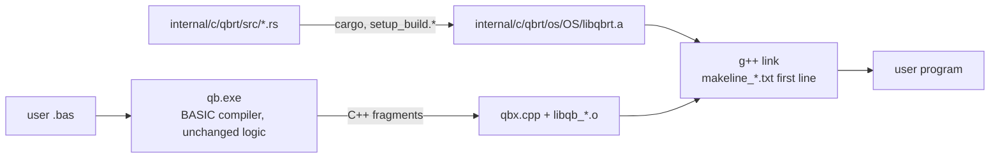

# Rust Port — Progress Log

> Project: `D:\QBNex-Rust` (git branch `rust-port`, cloned from `D:\QBNex` at `545b859`).
> The original `D:\QBNex` is **not modified** by the port. Remote `legacy-local` points at it.
> Strategy: Revision 2 in [`port-plan.md`](port-plan.md) — the BASIC compiler stays, the C++ runtime is replaced subsystem by subsystem with the Rust crate `qbrt`.

## Status (2026-11-09)

| Phase | Status | Evidence |
| --- | --- | --- |
| R0 Oracle + CI | **done (local), CI unverified** | `conformance/` runner + 25 cases (19 golden, 6 xfail); smoke + conformance + unit + differential steps in `.github/workflows/{push,pull_request}.yml` |
| R1 `qbrt` foundation + MBF slice | **done (Windows), Linux/macOS unverified** | `internal/c/qbrt`; `libqb.cpp` includes `qbrt.h` instead of `msbin.cpp`; exhaustive differential test 0 mismatches |
| R2 Leaf numeric code | **done (Windows)** | TDD + differential + legacy deleted for rounding (`qbr*`, `fpu_reinit`), RND/RANDOMIZE, VAL, STR$ number formatting (all `qbs_str` overloads), TIMER arithmetic. `libqb.cpp` is ~600 lines shorter |
| R4 Files, file system, ENVIRON, SHELL, `_MEM` | **done (Windows), Linux/macOS unverified** | see [R4 details](#r4-files-file-system-environ-shell-_mem). TDD + differential + legacy deleted; `libqb.cpp` is ~4,400 lines shorter |
| R3, R5–R10 | other sessions / pending | — |

### Verified on Windows (MinGW-Builds g++ 15.2.0 ucrt, rustc 1.98.0)

- `cmake --build --preset windows-mingw-selfhost` builds `libqbrt.a`, `qb-stage0.exe` and `qb.exe` linked against Rust.
- `cargo test --workspace`: 48/48 pass; `cargo clippy --workspace --all-targets`: 0 warnings.
- `diff_msbin` (legacy `msbin.cpp` vs Rust, every 2³² single-precision bit pattern in both directions + 50M double samples + edge cases): **0 mismatches**.
- `diff_round` (legacy x87 `fistp` asm vs Rust, 30M random 80-bit/double/float inputs + specials): **0 mismatches**; a mutation run reports 138k mismatches, so the harness can fail.
- `diff_val` (legacy `func_val` with `__mingw_sscanf` vs Rust, 3M generated strings incl. hex/oct/bin, 60-digit mantissas, exponents to ±5000): **0 mismatches** outside the L-05 forms that Rust fixes on purpose.
- `diff_str` (legacy `qbs_str` with MinGW printf vs Rust, 5M iterations x 10 types: random bit patterns, decimals, integers of all widths): **0 mismatches**; 553k L-07/D-05 inputs skipped by design; mutation run reports 189k mismatches.
- `diff_timer` (legacy `func_timer` + x87 `qbr` vs Rust, 20M random tick/start/accuracy combinations incl. errors): **0 mismatches**; mutation run reports 121k mismatches.
- `conformance`: 30 cases — 23 passed, 7 xfail (known legacy defects), 0 failed; golden output from the unmodified legacy build, plus one hand-written `.deviation` case.
- `tests/*_smoke.cmd` (cli, diagnostics, warnings, labels, encoding, stdlib, audio): 7/7 pass.

### Not verified yet

- Linux and macOS builds (native-library lists for the Rust staticlib are taken from rustc docs, not run).
- GitHub Actions runs of the new CI steps.
- Docker images (Rust toolchain added, not built).
- 32-bit Windows (`i686-pc-windows-gnu` selected automatically, not built).

## Porting workflow (TDD, legacy C++ deleted)

Every subsystem goes through the same loop:

1. **RED** — Rust unit tests describing the behaviour (values captured from the legacy oracle or QBasic semantics); run them against a stub and watch them fail on assertions.
2. **GREEN** — minimal Rust implementation in `internal/c/qbrt/src/<module>.rs`.
3. **Differential** — a harness in `internal/c/qbrt/tests/diff_<module>.cpp` links the Rust code with a *verbatim copy* of the legacy C++ (`tests/legacy/*.inc`, test-only) and compares them on millions of inputs. A mutation run proves the harness can fail.
4. **Delete** — the legacy C++ is removed from `libqb.cpp` (no `#ifdef LEGACY` fallback); only a one-line shim with the old C++ signature stays, because generated code and `qbx.cpp` call it.
5. **Conformance** — new cases blessed from `.oracle`, then the whole corpus + smoke tests run against the Rust build.

Where the legacy behaviour is a clear defect against QBasic, the Rust code fixes it, the unit test asserts the QBasic result, and the conformance case carries a `.deviation` note with a hand-written golden file.

### What "remove all C/C++" can reach under D10

With the compiler kept in BASIC, it still **emits C++**, so `internal/c/qbx.cpp`, the generated fragments and a C++ compiler at user compile time remain. Everything else can go: `libqb.cpp` shrinks to shims and then disappears, and every library under `internal/c/parts` is replaced by Rust crates. Removing the last C++ needs a separate phase (proposed **R11**): change the BASIC compiler's emitter to generate Rust (or an IR the Rust runtime executes) instead of C++. That keeps D10 (compiler stays BASIC) but needs `rustc` instead of `g++` on the user's machine. Not started; needs approval.

## How the pieces fit



- `libqb.cpp` references Rust symbols, so **every** link needs `libqbrt.a`. It is on the first line of `internal/c/makeline_*.txt`, which both the bootstrap `qb-stage0` and the current compiler read at run time. That is the only way to reach the stage0 link, because stage0 is built from the frozen snapshot in `internal/source` (see L-00).
- Windows native libs are written `-l ws2_32` (with a space) on purpose: `PrepareWindowsBuildCommand$` strips every `-lws2_32` when sockets are unused.
- `libqbrt.stamp` is rewritten on each Rust build and is part of the native build-cache key (`linker.bas`), so cached executables are rebuilt after a runtime change.
- End users do not need cargo: release bundles copy `internal/`, which contains the prebuilt `libqbrt.a`.

## How to run

```bash
# Rust unit tests
cargo test --workspace
```

```bash
# Build compiler + runtime (Windows; needs internal/c/c_compiler = MinGW, and cargo)
cmake --preset windows-mingw && cmake --build --preset windows-mingw-selfhost
```

```bash
# Conformance against golden files
cargo run --release -p qbnex-conformance
```

```bash
# Re-capture golden output from the legacy oracle (only when adding cases)
git clone --branch main . .oracle
(cd .oracle && cmake --preset windows-mingw && cmake --build --preset windows-mingw-selfhost)
cargo run --release -p qbnex-conformance -- --qb .oracle/qb.exe --bless
```

Golden output must always come from the legacy C++ runtime (`.oracle`, gitignored), never from the Rust build.

## Legacy defects found by the corpus

These reproduce on the unmodified legacy build. They are kept as `xfail` cases (the runner reports `XPASS` once one is fixed).

| ID | Defect | Case | Severity |
| --- | --- | --- | --- |
| L-00 | **Self-host fixpoint is broken.** `qb.exe` built from HEAD compiles `source/qbnex.bas` into a second-generation compiler that fails on hello world with `[E9999] Too many errors`. Builds only work because stage0 comes from the old snapshot in `internal/source`. Regenerating the snapshot from current source is therefore impossible until this is fixed. | manual (see progress log) | Critical |
| L-01 | A main-module `ON ERROR GOTO` handler label makes compilation fail with `Unknown statement 'END'` on a line past the end of the file (TopLevelRuntime lowering, `classes.bas`). Classic QB error handling does not compile. | `errors/*`, `binary/mbf_overflow` | High |
| L-02 | `PRINT a, b` (14-column zones) writes spaces forever when stdout is redirected. | `console/print_comma_redirected` | High |
| L-03 | `RESTORE <label>` never returns. | `data/restore_label` | High |
| L-04 | Relational operators inside `PRINT` (`PRINT a$ < "K"`) are rejected as `Unknown statement 'PRINT'`. | `strings/compare_in_print` | Medium |
| L-05 | `VAL` negates the exponent after normalising: `VAL("123E-2")` = `.000123`, `VAL("0.5E-1")` = `5`. **Fixed in Rust** (intentional deviation). | `strings/val_negative_exponent` (`.deviation`) | High |
| L-06 | `PRINT USING "#.##^^^^"` on a `_FLOAT` near 1E4932 prints `%0.118973149535723F+4984` and corrupts the heap (exit `0xC0000374`). | `strings/print_using_huge_exponent` | High |
| L-07 | `STR$` of a DOUBLE that needs more than 19 decimals (e.g. `1.234567890123456D-16`) builds a broken printf format and returns ` .0f`. **Fixed in Rust** (D-04). | `strings/str_many_decimals` (`.deviation`) | Medium |
| L-08 | `_MEMFREE` of a `_MEMNEW` block frees the buffer twice (vector erase, then `free()` in `free_mem_lock`); exit `0xC0000374`. **Fixed in Rust** (D-06). | `mem/memfree_memnew` (`.deviation`) | High |
| L-09 | After one `OPEN "COMn:..."` every later COM name fails with "Bad file name": `gfs_open_com_syntax` checks a function-static `x` before setting it, and the first parse leaves it at the OP timeout (10000). Kept. | unit test `gfs::com_syntax_*` (no COM port on CI) | Medium |
| L-10 | An unhandled runtime error opens a `MessageBox`. From a console it returns at once and the program continues; under the conformance runner it blocks until the timeout. Error paths therefore cannot be golden cases while L-01 blocks `ON ERROR`; their error numbers are compared by `diff_files` / `diff_sys` instead. | manual | Medium |
| L-11 | `LINE INPUT #` on a BINARY file treats a line as the last one when it ends within 2 bytes of EOF, so a final 1-character line (`"two" CR LF "x"`) is dropped. Kept. | `files/binary_ops` | Medium |
| L-12 | `_MEMGET` with a failed check and a 0-byte type raises critical error 518 ("Out of memory") and ends the program: the zero-length scratch vector has no `data()`. Kept. | `diff_mem` | Low |

Output quirks that are preserved bug-for-bug (golden files depend on them):

- `MKSMBF$(0)` yields MBF exponent 2 (`00 00 00 02`), not zero.
- Some DOUBLE values print with a trailing zero (`-2.50`, `3.141592653589790`).
- `MKDMBF$(-0#)` and tiny/huge doubles raise overflow (error 5).
- DOUBLE `STR$`/`PRINT` adds one decimal when there are two or more significant digits (` 42.0`, `-.250`, ` 123456789012345.59`, ` .33333333333333331`): legacy uses a buffer index as the digit count. Ported as is (`numfmt.rs`).
- `STR$` of infinity or NaN is ` 0`.

Intentional deviations (Rust differs from legacy on purpose):

| ID | Change | Why |
| --- | --- | --- |
| D-01 | `VAL` applies the sign to the written exponent (fixes L-05). | QBasic semantics; legacy result is wrong by powers of ten. |
| D-02 | Rounding is QBasic round-half-even on every CPU. Legacy non-x86 builds rounded half away from zero (`f+0.5` truncation). | One behaviour on all platforms, matching x86 and QBasic. |
| D-03 | `VAL` keeps 1000 significant digits exactly and treats further non-zero digits as "slightly more". Legacy overran a 256-byte buffer past 256 digits (undefined behaviour). | Defined behaviour; correctly rounded up to 1000 digits. |
| D-04 | `STR$` prints all decimals the legacy algorithm asks for, also beyond 19 (fixes L-07). | Legacy output was garbage from a malformed printf format. |
| D-05 | `STR$` of a non-finite SINGLE is ` 0`. Legacy read a stale static buffer (result depended on the previous call). | Defined result, same as DOUBLE. |
| D-06 | `_MEMFREE` of a `_MEMNEW` block releases it once (fixes L-08). | Legacy corrupted the heap. |
| D-07 | Undefined legacy reads get defined results: GET of a variable-length string whose header claims more bytes than the record holds copies zero bytes where legacy read past its buffer; FILES pads names whose `.` lies past column 9 without the `memmove`/negative `memset` overrun; `SHELL(...)` returns 1 when the command is a lone leading space (legacy returned an uninitialised value) and 0 when only `command.com` was available. | No legacy behaviour to copy (undefined). |
| D-08 | `shell_call_in_progress` is set for the whole waited SHELL call instead of only around `WaitForSingleObject`. | The Rust launcher runs as one call; the flag only pauses window events. |

## R4: files, file system, ENVIRON, SHELL, `_MEM`

Branch `claude/r4-files-e9033c`. `libqb.cpp`: 4,371 lines removed, 316 added (shims).

| Rust module | Replaces (libqb.cpp) |
| --- | --- |
| `mem.rs` | `new_mem_lock`, `free_mem_lock`, lock storage, `_MEMNEW/_MEMFREE/_MEMEXISTS/_MEMGET/_MEMFILL*/_MEMCOPY/_MEM`. `mem_lock_id`, `mem_lock_tmp`, `mem_lock_base` are now Rust `#[no_mangle]` globals (generated code and `audio.cpp` use them); `mem_block`/`mem_lock` keep the `common.h` layout |
| `gfs.rs` | `gfs_file_struct` table and `gfs_new ... gfs_unlock`, `gfs_open_com_syntax`, COM port setup. Same Win32 calls as `GFS_WINDOWS`; `std::fs` stands in for `GFS_C` elsewhere (unverified) |
| `fileio.rs` | `sub_open(_gwbasic)`, `sub_close`, `sub_file_print`, INPUT # (`file_input_*`, `n_inputnumberfromfile`, `sub_file_input_string`), `LINE INPUT #`, `INPUT$(n,#)`, `sub_get/get2/put/put2`, FIELD (`field_new/add/get/put`, `lrset_field`, `field_free`), `sub_lset/rset`, `func_lof/eof/seek/loc`, `sub_seek`, `sub_lock/unlock`, `generic_put/get` |
| `fsops.rs` | `sub_kill`, `sub_name`, `sub_chdir`, `sub_mkdir`, `sub_rmdir`, `sub_files`, `func__fileexists`, `func__direxists`, `func__cwd` (CRT `rename/_chdir/_mkdir/_rmdir` + `errno` kept for identical error codes) |
| `env.rs` | `func_environ` (both), `sub_environ`, `func__environcount`, `func_command` |
| `shell.rs` | `cmd_ok`, `cmd_command`, the launch logic of `func_shell`, `func__shellhide`, `sub_shell`, `sub_shell2/3/4` (one engine: show/hide x wait/no-wait x console) |

What stays in C++ on purpose: TCP/IP special handles in GET/PUT/LOF/EOF/CLOSE; the `qbs` side of FIELD (`field_update` resizes strings, ported with R3 strings); `n_float/n_int64/n_uint64` and `func_file_input_*` range checks (shared with READ/DATA); leaving full screen and the `console/console_active` checks around SHELL; `func__startdir`. C++ that still reads open files (PRINT # TAB, FIELD) goes through `gfs_file[i]` / `gfs_fileno[f]` views onto the Rust table.

Verified on Windows:

- Unit tests: 29 new (`mem` 9, `gfs` 6, `fileio` 7, `fsops` 3, `env` 2, `shell` 2); each module's tests fail on assertions with stubbed bodies (RED) and pass with the implementation.
- `diff_mem` (verbatim legacy `_MEM` code): 5M random operations incl. stale/foreign locks, 0 mismatches; mutation run 23,983 mismatches.
- `diff_files` (verbatim legacy GFS + file statements, two temp folders, file bytes compared after every step): 400k random operations over OPEN modes/ACCESS/LOCK, PRINT #, INPUT # strings and numbers, LINE INPUT #, INPUT$, GET/PUT (incl. RANDOM strings), LOF/EOF/LOC/SEEK, LOCK/UNLOCK, generic_put/get, LSET/RSET: 0 mismatches. COM names are left out (opening a real port can block). Mutation run (PRINT # zone width 14 to 13): 25 mismatches within the first 909 operations (the harness stops at 25).
- `diff_sys` (verbatim legacy KILL/NAME/CHDIR/MKDIR/RMDIR/FILES/_FILEEXISTS/_DIREXISTS/_CWD$/ENVIRON/COMMAND$/SHELL): 62k operations, 0 mismatches; mutation run (RMDIR error, ENVIRON separator, exit code) reports mismatches in each.
- Conformance: 9 new cases (`files/*` 5, `system/*` 2, `mem/*` 2 incl. one `.deviation`), golden from `.oracle`. Whole corpus against the Rust build: 42 cases, 35 passed, 7 xfail (L-01..L-04, L-06), 0 failed.
- `tests/*_smoke.cmd`: 8/8 pass (audio, benchmark, cli, diagnostics, encoding, labels, stdlib, warnings).
- `cargo clippy -p qbrt --all-targets`: 0 warnings.

Not verified: Linux/macOS (`GFS_C` replacement on `std::fs`, `setenv`, `system()`), real COM ports, FILES on non-Windows (legacy printed nothing there either).

## Next steps

1. R3 string engine (`qbs`): decide on L-00 first, because generated code touches `qbs` fields directly and stage0 is frozen.
2. Decide on L-00 (frozen `internal/source`) before R3; the string engine changes structs that generated code touches directly.
3. Grow the corpus per builtin group (`subs_functions.bas`), especially PRINT USING, file I/O and string functions, before R3/R4.
4. Run the new CI on GitHub to verify Linux/macOS builds of `libqbrt.a`.
