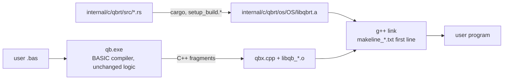

# Rust Port — Progress Log

> Project: `D:\QBNex-Rust` (git branch `rust-port`, cloned from `D:\QBNex` at `545b859`).
> The original `D:\QBNex` is **not modified** by the port. Remote `legacy-local` points at it.
> Strategy: Revision 2 in [`port-plan.md`](port-plan.md) — the BASIC compiler stays, the C++ runtime is replaced subsystem by subsystem with the Rust crate `qbrt`.

## Status (2026-11-09)

| Phase | Status | Evidence |
| --- | --- | --- |
| R0 Oracle + CI | **done (local), CI unverified** | `conformance/` runner + 25 cases (19 golden, 6 xfail); smoke + conformance + unit + differential steps in `.github/workflows/{push,pull_request}.yml` |
| R1 `qbrt` foundation + MBF slice | **done (Windows), Linux/macOS unverified** | `internal/c/qbrt`; `libqb.cpp` includes `qbrt.h` instead of `msbin.cpp`; exhaustive differential test 0 mismatches |
| R2 Leaf numeric code | **done (Windows)** | TDD + differential + legacy deleted for rounding (`qbr*`, `fpu_reinit`), RND/RANDOMIZE, VAL, STR$ number formatting (all `qbs_str` overloads), TIMER arithmetic. `libqb.cpp` is ~600 lines shorter |
| L-00 self-host fixpoint | **done (Windows)** | TopLevelRuntime lowering fixed (`classes.bas`); gen1 = gen2 = gen3 byte-identical C++; `internal/source` regenerated and reproducible; `tests/selfhost_fixpoint.{sh,cmd}` in CI |
| R3 String engine (`qbs`) | **done (Windows)** | descriptor pool, tracking lists, `qbs_data` arena, DBLOCK (cmem) strings, `qbs_set`/`qbs_free`/`qbs_cleanup` and the string functions in `qbrt/src/qbs.rs`; legacy C++ deleted (`libqb.cpp` ~850 lines shorter); debt F2 fixed |
| R4 Files, file system, ENVIRON, SHELL, `_MEM` | **done (Windows), Linux/macOS unverified** | see [R4 details](#r4-files-file-system-environ-shell-_mem). TDD + differential + legacy deleted; `libqb.cpp` is ~4,400 lines shorter |
| R5 Software graphics | **done (Windows)** | `qbrt/src/gfx/*`: image registry + `img_struct`, palettes/fonts data, SCREEN mode decisions, COLOR/PALETTE, PSET/PRESET/POINT, LINE, CIRCLE, PAINT (color + tile), DRAW, VIEW/WINDOW/PMAP, GET/PUT, PCOPY, `_PUTIMAGE`, `_COPYIMAGE`/`_FREEIMAGE` storage, `_SETALPHA`, `_CLEARCOLOR`, `_RGB*`, `_PALETTECOLOR`, software `_MAPTRIANGLE`, built-in 8x8/8x14/8x16 text. Legacy C++ deleted, one-line shims left; `mtri*.cpp` moved to `tests/legacy` |
| R6 Audio | **done (Windows), Linux/macOS unverified** | Crate `internal/c/qbrt/audio` (cpal, symphonia, xmrs) replaces `parts/audio` (audio.cpp, miniaudio, stb_vorbis, minimp3, libxmp-lite, tinysoundfont, RADv2: ~130k lines deleted). Synth bit-exact vs legacy over 204M frames. See [R6 audio](#r6-audio) |
| R7 Fonts + image codecs | **done (Windows)** | FreeType 2.4.9 wrapper → `qbrt::font` (skrifa + ab_glyph_rasterizer); stb_image 2.27 + dr_pcx → `qbrt::image` (ports + png/zune-jpeg crates). FreeType, stb_image, dr_pcx deleted (~170k lines of C). See [R7](#r7-fonts-and-image-codecs) |
| R8 Window / input / threads | **done (Windows), Linux/macOS unverified** | freeglut, GLEW, `libqb/gui.cpp` and `parts/input/game_controller` deleted; Rust `window.rs` (winit + softbuffer), `keymap.rs`, `keybuf.rs`, `raster.rs`, `script.rs`, `gamepad.rs` (gilrs); see "R8" below |
| R9–R10 | pending | — |

### Verified on Windows (MinGW-Builds g++ 15.2.0 ucrt, rustc 1.98.0)

- `cmake --build --preset windows-mingw-selfhost` builds `libqbrt.a`, `qb-stage0.exe` and `qb.exe` linked against Rust.
- `cargo test --workspace`: 64/64 pass; `cargo clippy --workspace --all-targets`: 0 warnings.
- `diff_msbin` (legacy `msbin.cpp` vs Rust, every 2³² single-precision bit pattern in both directions + 50M double samples + edge cases): **0 mismatches**.
- `diff_round` (legacy x87 `fistp` asm vs Rust, 30M random 80-bit/double/float inputs + specials): **0 mismatches**; a mutation run reports 138k mismatches, so the harness can fail.
- `diff_val` (legacy `func_val` with `__mingw_sscanf` vs Rust, 3M generated strings incl. hex/oct/bin, 60-digit mantissas, exponents to ±5000): **0 mismatches** outside the L-05 forms that Rust fixes on purpose.
- `diff_str` (legacy `qbs_str` with MinGW printf vs Rust, 5M iterations x 10 types: random bit patterns, decimals, integers of all widths): **0 mismatches**; 553k L-07/D-05 inputs skipped by design; mutation run reports 189k mismatches.
- `diff_timer` (legacy `func_timer` + x87 `qbr` vs Rust, 20M random tick/start/accuracy combinations incl. errors): **0 mismatches**; mutation run reports 121k mismatches.
- `diff_qbs` (verbatim legacy string engine vs Rust, 5.17M random BASIC-like statements: nested string expressions, comparisons, INSTR/_INSTRREV/ASC/LEN, MID$ statement, fixed-length and DBLOCK strings, FREE, scope cleanup, 300k live strings, 150k tmp strings in one scope, concatenation loops growing the arena; after each statement every tracking-list entry, descriptor-pool position (incl. free list), arena/DBLOCK offset, stack pointer, DBLOCK byte and variable is compared): **0 mismatches**; mutation runs: arena compaction threshold 175 mismatches, MID$ boundary 133k mismatches; a third mutant (tmp-source skip in `qbs_set`) survives because that legacy branch is unreachable (a tmp source in the same list is always acquired first).
- `conformance`: 39 cases — 35 passed, 4 xfail (known legacy defects), 0 failed; golden output from the unmodified legacy build, plus hand-written `.deviation` cases. R3 added `strings/{concat_loop,mid_statement,fixed_length_ops,cmem_strings,case_trim_search}`.
- Self-host fixpoint with the Rust string engine: gen2 = gen3 C++, both pass the corpus.
- Benchmark (interleaved A/B, median of 5, legacy-engine `qb` vs Rust-engine `qb`, same machine and toolchain): tiny -9.0%, warning path -16.7%, medium -14.5%, large -11.5%, `qb source/qbnex.bas -z` (front end only) 19.0 s -> 10.0 s (-47.7%). The machine was shared with other builds, so treat single numbers as noisy; no case got slower.
- `tests/*_smoke.cmd` (cli, diagnostics, warnings, labels, encoding, stdlib, audio): 7/7 pass.
- R5 `diff_gfx` (verbatim legacy graphics in `tests/legacy/gfx_*.inc` + `mtri*.cpp` vs Rust on twin images, 6000 rounds x 60 random ops over SCREEN 1/2/7-13, 256-color and 32-bit images, plus exhaustive SCREEN decisions, blend tables, built-in palettes/fonts, 4M x87 long-double loads for DRAW `VARPTR$`): **2,278,925 checks, 0 mismatches** (skipped by design: 1829 `_PUTIMAGE` D-06 cases, 3337 2-bit GET D-07 cases, 10830 SCREEN 0 D-08 layouts). The mutation run reports mismatches in every op.
- R5 framebuffer conformance: `QBNEX_FB_CAPTURE=<file>` makes the runtime record each `_DISPLAY` frame and the final graphics screen (pixels + palette); the runner hashes them (FNV-1a 64) into `<case>.fb`. Eight cases in `conformance/cases/graphics` (SCREEN 7/9/12/13/32, image ops, pages + DRAW, GET/PUT, SCREEN mode switches) are pixel-exact against the legacy oracle, plus the hand-written `get_2bit_partial` deviation case. Conformance total: 43 cases, 36 passed, 7 xfail, 0 failed (a full run occasionally times out one case under load; it passes on rerun).
- `cargo test --workspace`: 132/132 pass; `cargo clippy --workspace --all-targets`: 0 warnings.

### Not verified yet

- Linux and macOS builds (native-library lists for the Rust staticlib are taken from rustc docs, not run).
- GitHub Actions runs of the new CI steps.
- Docker images (Rust toolchain added, not built).
- 32-bit Windows (`i686-pc-windows-gnu` selected automatically, not built).

## R3 string engine

`internal/c/qbrt/src/qbs.rs` owns all string-engine state: the descriptor pool (65536-descriptor blocks, LIFO free list), the three tracking lists (arena, DBLOCK, tmp), the `qbs_data` arena (1 MB, compaction when a gap above 32 bytes opens, growth `size*2+needed`) and the DBLOCK string area. `struct qbs` keeps the exact `common.h` layout (`#[repr(C)]`, checked by a unit test and by the harness) because generated C++ reads and writes its fields.

- Rust exports the globals generated code uses: `qbs_tmp_list_nexti` (scope marker), `qbs_cmem_sp`, `qbs_cmem_descriptor_space`; `qbx.cpp`/`libqb.cpp` now only declare them.
- Conventional memory stays C++ (`cmem`, `dblock`, `cmem_sp`); errors and FIELD buffers go through `qbrt_host_error` / `qbrt_host_field_free` in `libqb.cpp`.
- `libqb.cpp` keeps one-line shims with the old C++ signatures; `sub_mid` keeps its `new_error`/`nothingstring` checks in the shim. `qbs_cleanup` (qbx.cpp and libqb.cpp) keeps the inline fast path and calls `qbrt_qbs_cleanup` otherwise, so C++ no longer touches the tmp list: **F2 fixed** (`extern ptrszint *qbs_tmp_list` vs `std::vector` is gone).
- Still in C++: `qbs_inkey`, `qbs_str` shims, MK*/CV* helpers (`b2string` …), `LSET`/`RSET` (FIELD-coupled), `qbs_print`/`qbs_input`.
- Known legacy behaviour kept: DBLOCK string descriptors (4 bytes below `cmem_sp`) are never returned by `qbs_free`; generated code restores `cmem_sp` when a SUB exits. Allocation failure aborts the process (legacy raised error 508 and continued with a NULL block).

## Bootstrap snapshot and self-host fixpoint (L-00)

`internal/source` is the generated C++ of the compiler itself; CMake builds `qb-stage0` from it, and stage0 compiles `source/qbnex.bas` into `qb`. Since L-00 is fixed the chain is a true fixpoint: the C++ that gen1, gen2 and gen3 emit for `source/qbnex.bas` is byte-identical, and equal to the committed snapshot.

- `tests/selfhost_fixpoint.{sh,cmd}` builds gen2 and gen3 from `qb`, requires identical `-z` output, and runs the conformance corpus with both (CI step "Self-host fixpoint"). `--no-conformance` skips the corpus runs.
- `tests/refresh_stage0_snapshot.{sh,cmd}` regenerates `internal/source` with `qb -z` (only `*.txt` and `data.bin`; `icon.rc`, `*.bat`, `manifest.h`, manifests and icons stay as committed). Refresh after compiler changes, then rebuild from scratch and run it again: the second run must leave `internal/source` unchanged. The snapshot is generated on Windows, as before.
## R6 audio

`internal/c/parts/audio/{out,decode,conversion}` are gone. Only `parts/audio/out/audio.h` (declarations) and `src.c` (shims, `#include`d by `libqb.cpp`) remain; the shims keep the old `sub_*`/`func_*` signatures, raise BASIC errors and manage `_MEMSOUND` mem locks, and call the C ABI in `internal/c/qbrt/include/qbrt_audio.h`.

- **Crate layout.** `qbrt-audio` is a separate crate linked into `libqbrt.a` (`extern crate qbrt_audio` in `qbrt`). The release profile builds one object per crate, so a program only pulls the audio object (and cpal/symphonia) when libqb references a `qbrt_snd_*` symbol, which happens only with `DEPENDENCY_AUDIO_OUT`. A console `PRINT "hi"` exe is 2.6 MB with no audio strings; an audio exe is 5.0 MB.
- **Modules.** `synth.rs` (envelope, waveforms, `GenerateWaveform`), `mml.rs` (`PLAY` state machine transcribed from the `goto` code, `SOUND`, `_VOICE`, `_ADSR`, `_WAVE`, VARPTR$), `queue.rs` (raw frame queue), `engine.rs` (handle table, mixer, `_SND*`), `decode.rs`, `device.rs` (cpal on its own thread), `ffi.rs`.
- **F3 fixed for audio.** One mutex guards the whole engine; the BASIC thread, libqb's main-loop thread (`snd_mainloop`) and the cpal callback all take it. Legacy shared `soundHandles`, the raw queues and miniaudio sounds between those threads with no lock.
- **Build.** No extra Windows link libraries (the `windows` crate uses raw-dylib). Linux user links get `-lasound` and need `libasound2-dev` (added to CI apt lines; Dockerfiles already had it). macOS links CoreAudio, AudioUnit, AudioToolbox, CoreFoundation. Building `libqbrt.a` now needs Rust 1.88 (xmrsplayer; cpal 0.18 needs 1.85). `QBRT_AUDIO_DEVICE=none` runs a program without an output device (same behaviour as legacy when miniaudio failed to start).

Verified on Windows:

- `cargo test -p qbrt-audio`: 40 tests (envelope, waveforms, custom wave parsing incl. `strtod` forms, rand LCG, MML: octave/`<`/`>`, length, tempo, dots, MB/MF/MN/ML/MS, N, sharps/flats, P, chords, VARPTR$, errors, state between statements; queue blocks; handle allocation, play/loop/pause/stop/seek/limit/volume/pan, `_MEMSOUND`, raw streams, voice draining; WAV decoding and resampling). RED run first: 11 PLAY tests failed on assertions against a stub.
- `diff_audio` (legacy synth + `sub_play`/`sub_sound`/`sub__voice`/`sub__adsr`/`sub__wave` copied verbatim into `tests/legacy/audio_synth*.inc`, rendered offline vs Rust): 50,000 random statements over 8000/22050/44100/48000 Hz, **204,132,081 frames, 0 mismatches, 0 samples off even by 1 LSB** (documented tolerance is 1 LSB for libm differences; not needed on MinGW). Noise waveforms included. A mutation run (pink-noise coefficient 0.1848 -> 0.1849 and dotted-note divisor 2 -> 2.01) reports 911 mismatches in the quick run. The harness found two real porting bugs on the way: x87 unnormal long doubles in `"=" + VARPTR$` and the out-of-range double -> int16 conversion (`cvttsd2si` gives 0x80000000, Rust `as` saturates); both are now emulated.
- End-to-end on a real device (48 kHz): `_SNDOPEN` WAV, `_SNDLEN`, `_MEMSOUND` (size, element size and a spot-checked sample match the file), `_SNDPLAY` to the end, `_SNDCOPY`, `_SNDRAW` + `_SNDRAWDONE` until `_SNDRAWLEN` = 0, `PLAY` until `PLAY(0)` = 0; and the same program with `QBRT_AUDIO_DEVICE=none`.
- `tests/audio_smoke.cmd` and the other 6 smoke tests pass; conformance 35 cases: 28 passed, 7 xfail, 0 failed (2 new device-independent cases in `conformance/cases/audio/`).

Not verified: Linux (ALSA) and macOS (CoreAudio) builds and playback; MP3/FLAC/Ogg/MOD/XM/S3M/IT files beyond the decoder unit tests (WAV); audible quality by ear.

Legacy defect found (not reproducible in the corpus because output is device dependent):

| ID | Defect | Severity |
| --- | --- | --- |
| L-60 | `SOUND`, `BEEP` and `PLAY` were silent: the four synth voice queues were never registered as sound handles, so `snd_mainloop` never streamed them, and `PLAY(n)` only grew. **Fixed in Rust** (D-60). | High |

Intentional deviations of R6:

| ID | Change | Why |
| --- | --- | --- |
| D-60 | Synth voices are mixed into the output and drain, so `PLAY(n)` counts down (fixes L-60). `PLAY` still never blocks, as in legacy (QBasic blocks in MF mode). | Legacy output was silence. |
| D-61 | When a chord (`,`) is followed by a longer note or pause, the grown part of the PLAY buffer is silence; legacy left it uninitialised (`realloc`). The legacy `memset` that zeroes part of the chord is kept. | Defined output instead of heap garbage. |
| D-62 | Noise waveforms use the MSVCRT/UCRT `rand()` LCG (seed 1) on every platform and no longer share the C runtime's `rand()` state. | Identical noise on all platforms; matches the legacy Windows build exactly. |
| D-63 | Decoders: symphonia (WAV, FLAC, MP3, Ogg Vorbis) and xmrs (MOD, XM, S3M, IT, rendered once, loops not repeated, max 30 min). **MIDI (tinysoundfont + AWE32 ROM) and RAD v2 are dropped**: `_SNDOPEN` returns -1. "STREAM" sounds are decoded completely at open (still not copyable and not `_MEMSOUND`-able, as legacy). Resampling to the device rate is linear without miniaudio's low-pass filter. WAV keeps its integer sample format for `_MEMSOUND`, other formats are f32, modules s16 stereo. | No pure-Rust MIDI synth with an embedded bank; RAD has no Rust player. |
| D-64 | `_SNDBAL` with y/z uses inverse-distance gain and x-direction pan instead of miniaudio's spatializer (no doppler, cones or HRTF-like channel gains). Stereo pan uses miniaudio's `ma_pan_mode_pan` law. | Approximation of the 3-D model. |
| D-65 | Raw streams (`_SNDRAW`, synth voices) are pulled by the device callback under the engine lock instead of being copied block by block into a ping-pong buffer by `snd_mainloop`. A forced partial block plays without padding; `_SNDRAWLEN` counts queued frames only. Legacy `_SNDLIMIT` semantics (absolute engine time) are kept. | Race-free (F3) and independent of the main-loop rate. |

License changes: miniaudio, stb_vorbis, minimp3, libxmp-lite, tinysoundfont and RADv2 are no longer distributed (their entries and license files were removed from `licenses/`). Added: cpal (Apache-2.0), Symphonia (**MPL-2.0**, file-level copyleft, used unmodified), xmrs/xmrsplayer (MIT) and their MIT/Apache-2.0/Zlib/BSD dependencies (`licenses/COPYING.TXT`, `license_apache_2_0.txt`, `license_mpl_2_0.txt`, `license_xmrs.txt`).
## R8 — window, input, threads (branch `claude/r8-window-bec52a`)

What moved to Rust (`internal/c/qbrt/src`, C ABI in `include/qbrt_window.h`):

| Module | Replaces | Notes |
| --- | --- | --- |
| `window.rs` | freeglut window + GLUT main loop, `glutSetWindowTitle/ReshapeWindow/FullScreen/PositionWindow/SetCursor/WarpPointer/IconifyWindow`, `glutGet(GLUT_SCREEN_*)` | winit event loop on the **main thread**; softbuffer presents the frame; setters queue commands and wake the loop; getters read atomics |
| `raster.rs` | the OpenGL presenter of `gui.cpp`: `prepare_environment_2d`, `hardware_img_put/tri2d/tri3d`, letterbox, stretch/smooth | software rasteriser for "hardware" images (`_COPYIMAGE(,33)`), depth buffer, culling, near-plane clipping |
| `keymap.rs` | freeglut's Win32 key translation + `GLUT_key_ascii`/`GLUT_key_special` | stage 2 is verbatim (diffed); stage 1 maps winit keys |
| `keybuf.rs` | `keyhit[]` ring, `keyheld_*`, `update_shift_state` bytes | one mutex per operation + re-entrant `qbrt_input_lock` around `keydown()/keyup()`/mouse queue writes (fixes F3 for these) |
| `script.rs` | — (new) | `QBNEX_INPUT_SCRIPT=<file>` replays keys/mouse/resize/close; `snapshot` prints a frame hash |
| `gamepad.rs` | libstem gamepad (`parts/input/game_controller`) | gilrs (XInput on Windows); glue logic kept in `libqb/gamepad_bridge.cpp` |

C++ glue that stays (until `libqb.cpp` itself goes): `libqb/window_bridge.cpp` (frame composition from `display_frame[]` + the hardware command list, mouse queue handlers, callbacks), `libqb/gamepad_bridge.cpp`.

Thread layout now: main thread = window event loop (`window_main()` → `qbrt_window_run`); QBMAIN = user program; MAIN_LOOP = timer bytes, autodisplay, gamepad poll; TIMERTHREAD unchanged. Frames are composed on the thread that built them (MAIN_LOOP, or the program thread on `_DISPLAY`) under `present_mutex`, so `display_frame[].state` and the hardware command list are no longer shared with the window thread. `qbevent`, `lock_display`, `autodisplay` handshakes and the mouse queue readers are still plain C++ globals (F3 partly open, see below).

Environment variables: `QBNEX_HEADLESS=1` runs GUI programs without a window (desktop size reported as 1920x1080, the "window" follows the frame size); `QBNEX_INPUT_SCRIPT=<file>` (syntax in `script.rs`). The conformance runner sets `QBNEX_HEADLESS=1` for every case and passes `<name>.input` as the script.

Build changes: makelines/CMake/setup scripts no longer build or link `parts/core` or GL; Windows links `user32 gdi32 ole32 oleaut32 shell32 imm32 dwmapi uxtheme comctl32 advapi32 xinput` for the Rust window layer. `internal/c/parts/core` keeps only `gl_header_for_parsing` (the compiler reads it for the `_gl*` keyword table) and `os/{win,lnx}/build.*` one-liners that create an empty `src.a`: the frozen stage0 (L-00) still calls `Build` on that folder.

### R8 evidence (Windows)

- `cargo test -p qbrt`: 76 unit tests (keymap, keybuf, raster, script, gamepad, window helpers) — each module first run RED against stubs.
- `diff_keymap` (verbatim `GLUT_key_ascii`/`GLUT_key_special` vs Rust, exhaustive 12,544 cases): 0 mismatches; mutation run 32 mismatches.
- `diff_keybuf` (verbatim `keyheld*`, `update_shift_state`, keyhit ring vs Rust, 5M random operations incl. ring overflow): 0 mismatches; mutation run 5,130 mismatches.
- `diff_layout` (verbatim `prepare_environment_2d` vs Rust, 5M size/mode combinations): 0 mismatches; mutation run 21,904 mismatches.
- Conformance: new cases `input/inkey_script`, `input/keyhit_mouse_script` (scripted input, `.deviation`, hand-checked goldens), `graphics/gui_basics` (blessed from the legacy oracle, run headless), `graphics/sub_gl` (xfail, D-14).
- Smoke tests 8/8 pass.
- Manual GUI check: a SCREEN 12 program in a real window showed the title, text, PAINTed circle, typed keys (`Hello R8<59><75>`) and PSET dots following scripted and real mouse movement; ESC closed it (exit 0).

### R8 deviations and open items

| ID | Change |
| --- | --- |
| D-13 | "Hardware" images are rendered in software at SCREEN resolution and then scaled with the frame; edge pixels and bilinear filtering can differ from the OpenGL output. `_DISPLAYORDER _GLRENDER` layers are ignored. |
| D-14 | `SUB _GL` / `_gl*` (OpenGL) are not supported: such programs stop at C++ compile time with an `#error` naming D-14 (`graphics/sub_gl` xfail). A `glow`-based GL path would need a GL context next to softbuffer; not done. |
| D-15 | Game controller buttons/axes use gilrs' standard layout (fixed indices, 19 buttons, 8 axes, Y axes down-positive); legacy reported raw driver order. |
| D-16 | Attaching more controllers than `device_max` no longer overflows the heap (legacy assigned `realloc` to a local). |
| D-17 | The process is per-monitor DPI aware (winit), so a 640x480 SCREEN is 640x480 physical pixels; legacy was DPI-unaware and got scaled by Windows. A non-ASCII key no longer emits a stray ANSI keyup on release. |

Open: `_DEVICEINPUT` keyboard device events (legacy `qbnex_os_event_windows` scan codes) are not generated; Linux `_CLIPBOARD$` lost its X11 hook (`x11filter`); macOS `libqb.mm` not adapted; `qbevent`/`lock_display`/mouse-queue readers still unsynchronised; during early manual runs a windowed program aborted twice with `std::bad_alloc` while another `qb.exe` build was running, not reproduced in 20+ later runs (stress included) — watch for it.

## Porting workflow (TDD, legacy C++ deleted)

Every subsystem goes through the same loop:

1. **RED** — Rust unit tests describing the behaviour (values captured from the legacy oracle or QBasic semantics); run them against a stub and watch them fail on assertions.
2. **GREEN** — minimal Rust implementation in `internal/c/qbrt/src/<module>.rs`.
3. **Differential** — a harness in `internal/c/qbrt/tests/diff_<module>.cpp` links the Rust code with a *verbatim copy* of the legacy C++ (`tests/legacy/*.inc`, test-only) and compares them on millions of inputs. A mutation run proves the harness can fail.
4. **Delete** — the legacy C++ is removed from `libqb.cpp` (no `#ifdef LEGACY` fallback); only a one-line shim with the old C++ signature stays, because generated code and `qbx.cpp` call it.
5. **Conformance** — new cases blessed from `.oracle`, then the whole corpus + smoke tests run against the Rust build.

Where the legacy behaviour is a clear defect against QBasic, the Rust code fixes it, the unit test asserts the QBasic result, and the conformance case carries a `.deviation` note with a hand-written golden file.

### What "remove all C/C++" can reach under D10

With the compiler kept in BASIC, it still **emits C++**, so `internal/c/qbx.cpp`, the generated fragments and a C++ compiler at user compile time remain. Everything else can go: `libqb.cpp` shrinks to shims and then disappears, and every library under `internal/c/parts` is replaced by Rust crates. Removing the last C++ needs a separate phase (proposed **R11**): change the BASIC compiler's emitter to generate Rust (or an IR the Rust runtime executes) instead of C++. That keeps D10 (compiler stays BASIC) but needs `rustc` instead of `g++` on the user's machine. Not started; needs approval.

## How the pieces fit



- `libqb.cpp` references Rust symbols, so **every** link needs `libqbrt.a`. It is on the first line of `internal/c/makeline_*.txt`, which both the bootstrap `qb-stage0` and the current compiler read at run time. That is the only way to reach the stage0 link, because stage0 is built from the frozen snapshot in `internal/source` (see L-00).
- Windows native libs are written `-l ws2_32` (with a space) on purpose: `PrepareWindowsBuildCommand$` strips every `-lws2_32` when sockets are unused.
- `libqbrt.stamp` is rewritten on each Rust build and is part of the native build-cache key (`linker.bas`), so cached executables are rebuilt after a runtime change.
- End users do not need cargo: release bundles copy `internal/`, which contains the prebuilt `libqbrt.a`.

## How to run

```bash
# Rust unit tests
cargo test --workspace
```

```bash
# Build compiler + runtime (Windows; needs internal/c/c_compiler = MinGW, and cargo)
cmake --preset windows-mingw && cmake --build --preset windows-mingw-selfhost
```

```bash
# Conformance against golden files
cargo run --release -p qbnex-conformance
```

```bash
# Re-capture golden output from the legacy oracle (only when adding cases)
git clone --branch main . .oracle
(cd .oracle && cmake --preset windows-mingw && cmake --build --preset windows-mingw-selfhost)
cargo run --release -p qbnex-conformance -- --qb .oracle/qb.exe --bless
```

Golden output must always come from the legacy C++ runtime (`.oracle`, gitignored), never from the Rust build.

Framebuffer goldens (`.fb`) need an oracle that can capture: clone `.oracle` to `.oracle-fb`, run `conformance/oracle/make_fb_oracle.sh .oracle-fb` (adds `fb_capture_legacy.inc` to its `libqb.cpp`), build it (on Windows under Git Bash: `env -u NoDefaultCurrentDirectoryInExePath cmake --build --preset windows-mingw-selfhost`), then bless with `--qb .oracle-fb/qb.exe`. `--fb-dump <dir>` writes the raw frames for inspection.

## Legacy defects found by the corpus

These reproduce on the unmodified legacy build. They are kept as `xfail` cases (the runner reports `XPASS` once one is fixed).

| ID | Defect | Case | Severity |
| --- | --- | --- | --- |
| L-00 | **Self-host fixpoint is broken.** `qb.exe` built from HEAD compiles `source/qbnex.bas` into a second-generation compiler that fails on hello world with `[E9999] Too many errors`. Root cause: the TopLevelRuntime lowering counted `FUNCTION getpid& ()` inside `DECLARE LIBRARY` as a procedure opening, so main-module code before the block moved into `SUB QBNEX_TOPLEVEL_RUNTIME0` (with its own locals, called only at the end) while later code ran first, before `InitCompilerServices` set `maxErrors` (0 -> first diagnostic aborts). **Fixed** (D-06). | `control/declare_library_toplevel` (`.deviation`), `tests/selfhost_fixpoint.*` | Critical |
| L-01 | A main-module `ON ERROR GOTO` handler label makes compilation fail with `Unknown statement 'END'` on a line past the end of the file (TopLevelRuntime lowering, `classes.bas`). Classic QB error handling does not compile. **Fixed** for main-module code before the first SUB/FUNCTION (D-06); a handler label placed *after* a SUB (or after an `$INCLUDE` that defines SUBs) is still moved into the runtime SUB and still fails. | `errors/*`, `binary/mbf_overflow` (`.deviation`) | High |
| L-02 | `PRINT a, b` (14-column zones) writes spaces forever when stdout is redirected. | `console/print_comma_redirected` | High |
| L-03 | `RESTORE <label>` never returns. | `data/restore_label` | High |
| L-04 | Relational operators inside `PRINT` (`PRINT a$ < "K"`) are rejected as `Unknown statement 'PRINT'`. | `strings/compare_in_print` | Medium |
| L-05 | `VAL` negates the exponent after normalising: `VAL("123E-2")` = `.000123`, `VAL("0.5E-1")` = `5`. **Fixed in Rust** (intentional deviation). | `strings/val_negative_exponent` (`.deviation`) | High |
| L-06 | `PRINT USING "#.##^^^^"` on a `_FLOAT` near 1E4932 prints `%0.118973149535723F+4984` and corrupts the heap (exit `0xC0000374`). | `strings/print_using_huge_exponent` | High |
| L-07 | `STR$` of a DOUBLE that needs more than 19 decimals (e.g. `1.234567890123456D-16`) builds a broken printf format and returns ` .0f`. **Fixed in Rust** (D-04). | `strings/str_many_decimals` (`.deviation`) | Medium |
| L-08 | Compiled programs exit with `0xC0000409` (fail-fast) about once in 300-400 runs, legacy oracle build included (`control/gosub_goto`, 1/400 with `.oracle`). Probably the exit-time thread race in F3. Can make a conformance run flaky. | none (statistical) | Medium |
| L-09 | `_MEMFREE` of a `_MEMNEW` block frees the buffer twice (vector erase, then `free()` in `free_mem_lock`); exit `0xC0000374`. **Fixed in Rust** (D-07). | `mem/memfree_memnew` (`.deviation`) | High |
| L-10 | After one `OPEN "COMn:..."` every later COM name fails with "Bad file name": `gfs_open_com_syntax` checks a function-static `x` before setting it, and the first parse leaves it at the OP timeout (10000). Kept. | unit test `gfs::com_syntax_*` (no COM port on CI) | Medium |
| L-11 | An unhandled runtime error opens a `MessageBox`. From a console it returns at once and the program continues; under the conformance runner it blocks until the timeout. Error paths therefore cannot be golden cases while L-01 blocks `ON ERROR`; their error numbers are compared by `diff_files` / `diff_sys` instead. | manual | Medium |
| L-12 | `LINE INPUT #` on a BINARY file treats a line as the last one when it ends within 2 bytes of EOF, so a final 1-character line (`"two" CR LF "x"`) is dropped. Kept. | `files/binary_ops` | Medium |
| L-13 | `_MEMGET` with a failed check and a 0-byte type raises critical error 518 ("Out of memory") and ends the program: the zero-length scratch vector has no `data()`. Kept. | `diff_mem` | Low |

Output quirks that are preserved bug-for-bug (golden files depend on them):

- `MKSMBF$(0)` yields MBF exponent 2 (`00 00 00 02`), not zero.
- Some DOUBLE values print with a trailing zero (`-2.50`, `3.141592653589790`).
- `MKDMBF$(-0#)` and tiny/huge doubles raise overflow (error 5).
- DOUBLE `STR$`/`PRINT` adds one decimal when there are two or more significant digits (` 42.0`, `-.250`, ` 123456789012345.59`, ` .33333333333333331`): legacy uses a buffer index as the digit count. Ported as is (`numfmt.rs`).
- `STR$` of infinity or NaN is ` 0`.
- Graphics code keeps legacy float handling: `qbr_float_to_long` on SINGLE coordinates, `cvttsd2si` saturation to `INT_MIN`, and C wrap-around in CIRCLE/LINE arithmetic.

Still C++ after R5 (on purpose): the `qbg_screen` orchestration (display lock, page table, surface lifetime), `func__newimage`/`_COPYIMAGE`/`_FREEIMAGE` handle bookkeeping, hardware images and the hardware `_PUTIMAGE`/`_MAPTRIANGLE` command queue, custom (TTF) fonts in `printchr`, and text-mode surfaces. They touch window/GL state that R8 replaces, or fonts owned by R7.

Intentional deviations (Rust differs from legacy on purpose):

| ID | Change | Why |
| --- | --- | --- |
| D-01 | `VAL` applies the sign to the written exponent (fixes L-05). | QBasic semantics; legacy result is wrong by powers of ten. |
| D-02 | Rounding is QBasic round-half-even on every CPU. Legacy non-x86 builds rounded half away from zero (`f+0.5` truncation). | One behaviour on all platforms, matching x86 and QBasic. |
| D-03 | `VAL` keeps 1000 significant digits exactly and treats further non-zero digits as "slightly more". Legacy overran a 256-byte buffer past 256 digits (undefined behaviour). | Defined behaviour; correctly rounded up to 1000 digits. |
| D-04 | `STR$` prints all decimals the legacy algorithm asks for, also beyond 19 (fixes L-07). | Legacy output was garbage from a malformed printf format. |
| D-05 | `STR$` of a non-finite SINGLE is ` 0`. Legacy read a stale static buffer (result depended on the previous call). | Defined result, same as DOUBLE. |
| D-06 | Compiler: the TopLevelRuntime lowering only moves top-level code that follows a SUB/FUNCTION (where it used to be a "between SUB/FUNCTIONs" error) into `SUB QBNEX_TOPLEVEL_RUNTIME0`; code before the first procedure stays in the main module. `SUB`/`FUNCTION` lines inside `DECLARE [DYNAMIC\|CUSTOMTYPE\|STATIC] LIBRARY` are not procedure openings, `END SUB 'comment` closes a procedure, and the runtime SUB is called where main closes instead of at the first `END` (fixes L-00, most of L-01). | Legacy moved every main-module line into a SUB called at the end: wrong order, separate locals, broken `ON ERROR`, non-reproducible bootstrap. |
| D-07 | `_MEMFREE` of a `_MEMNEW` block releases it once (fixes L-09). | Legacy corrupted the heap. |
| D-08 | Undefined legacy reads get defined results: GET of a variable-length string whose header claims more bytes than the record holds copies zero bytes where legacy read past its buffer; FILES pads names whose `.` lies past column 9 without the `memmove`/negative `memset` overrun; `SHELL(...)` returns 1 when the command is a lone leading space (legacy returned an uninitialised value) and 0 when only `command.com` was available. | No legacy behaviour to copy (undefined). |
| D-09 | `shell_call_in_progress` is set for the whole waited SHELL call instead of only around `WaitForSingleObject`. | The Rust launcher runs as one call; the flag only pauses window events. |
| D-10 | Stretched `_PUTIMAGE` skips source samples that fall outside the source image. Legacy skipped source clipping when the destination is one pixel wide or high and read past the source buffer. | Defined behaviour instead of reading foreign memory; results inside the source are unchanged. |
| D-11 | Graphics `GET` in 2-bit modes (SCREEN 1) checks the array size it really writes (ceil(w/4) bytes per row, legacy checked ceil(w/8) and overran the array) and stores the last partial byte of a row left-aligned (legacy stored a stale static byte, so `PUT` drew wrong pixels). | Memory safety and QBasic array layout; `graphics/get_2bit_partial` (`.deviation`). |
| D-12 | SCREEN 0 layout compares the font in the 40x25/80x25 granularity test (legacy `(f=(16+1))` / `(f=16)` assigned it). | Code defect; every WIDTH path already passes fonts 17/16, so no reachable output changes. |

## R4: files, file system, ENVIRON, SHELL, `_MEM`

Branch `claude/r4-files-e9033c`. `libqb.cpp`: 4,371 lines removed, 316 added (shims).

| Rust module | Replaces (libqb.cpp) |
| --- | --- |
| `mem.rs` | `new_mem_lock`, `free_mem_lock`, lock storage, `_MEMNEW/_MEMFREE/_MEMEXISTS/_MEMGET/_MEMFILL*/_MEMCOPY/_MEM`. `mem_lock_id`, `mem_lock_tmp`, `mem_lock_base` are now Rust `#[no_mangle]` globals (generated code and `audio.cpp` use them); `mem_block`/`mem_lock` keep the `common.h` layout |
| `gfs.rs` | `gfs_file_struct` table and `gfs_new ... gfs_unlock`, `gfs_open_com_syntax`, COM port setup. Same Win32 calls as `GFS_WINDOWS`; `std::fs` stands in for `GFS_C` elsewhere (unverified) |
| `fileio.rs` | `sub_open(_gwbasic)`, `sub_close`, `sub_file_print`, INPUT # (`file_input_*`, `n_inputnumberfromfile`, `sub_file_input_string`), `LINE INPUT #`, `INPUT$(n,#)`, `sub_get/get2/put/put2`, FIELD (`field_new/add/get/put`, `lrset_field`, `field_free`), `sub_lset/rset`, `func_lof/eof/seek/loc`, `sub_seek`, `sub_lock/unlock`, `generic_put/get` |
| `fsops.rs` | `sub_kill`, `sub_name`, `sub_chdir`, `sub_mkdir`, `sub_rmdir`, `sub_files`, `func__fileexists`, `func__direxists`, `func__cwd` (CRT `rename/_chdir/_mkdir/_rmdir` + `errno` kept for identical error codes) |
| `env.rs` | `func_environ` (both), `sub_environ`, `func__environcount`, `func_command` |
| `shell.rs` | `cmd_ok`, `cmd_command`, the launch logic of `func_shell`, `func__shellhide`, `sub_shell`, `sub_shell2/3/4` (one engine: show/hide x wait/no-wait x console) |

What stays in C++ on purpose: TCP/IP special handles in GET/PUT/LOF/EOF/CLOSE; the `qbs` side of FIELD (`field_update` resizes strings, ported with R3 strings); `n_float/n_int64/n_uint64` and `func_file_input_*` range checks (shared with READ/DATA); leaving full screen and the `console/console_active` checks around SHELL; `func__startdir`. C++ that still reads open files (PRINT # TAB, FIELD) goes through `gfs_file[i]` / `gfs_fileno[f]` views onto the Rust table.

Verified on Windows:

- Unit tests: 29 new (`mem` 9, `gfs` 6, `fileio` 7, `fsops` 3, `env` 2, `shell` 2); each module's tests fail on assertions with stubbed bodies (RED) and pass with the implementation.
- `diff_mem` (verbatim legacy `_MEM` code): 5M random operations incl. stale/foreign locks, 0 mismatches; mutation run 23,983 mismatches.
- `diff_files` (verbatim legacy GFS + file statements, two temp folders, file bytes compared after every step): 400k random operations over OPEN modes/ACCESS/LOCK, PRINT #, INPUT # strings and numbers, LINE INPUT #, INPUT$, GET/PUT (incl. RANDOM strings), LOF/EOF/LOC/SEEK, LOCK/UNLOCK, generic_put/get, LSET/RSET: 0 mismatches. COM names are left out (opening a real port can block). Mutation run (PRINT # zone width 14 to 13): 25 mismatches within the first 909 operations (the harness stops at 25).
- `diff_sys` (verbatim legacy KILL/NAME/CHDIR/MKDIR/RMDIR/FILES/_FILEEXISTS/_DIREXISTS/_CWD$/ENVIRON/COMMAND$/SHELL): 62k operations, 0 mismatches; mutation run (RMDIR error, ENVIRON separator, exit code) reports mismatches in each.
- Conformance: 9 new cases (`files/*` 5, `system/*` 2, `mem/*` 2 incl. one `.deviation`), golden from `.oracle`. Whole corpus against the Rust build: 42 cases, 35 passed, 7 xfail (L-01..L-04, L-06), 0 failed.
- `tests/*_smoke.cmd`: 8/8 pass (audio, benchmark, cli, diagnostics, encoding, labels, stdlib, warnings).
- `cargo clippy -p qbrt --all-targets`: 0 warnings.

Not verified: Linux/macOS (`GFS_C` replacement on `std::fs`, `setenv`, `system()`), real COM ports, FILES on non-Windows (legacy printed nothing there either).
| D-R7-1 | PCX images whose pixel buffer exceeds 4 GiB fail to load. dr_pcx computed the size in 32 bits and overflowed the heap. | Defined failure instead of memory corruption. |
| D-R7-2 | JPEG pixels come from `zune-jpeg`, not stb_image: sizes are identical, pixels within a tolerance (mean absolute error < 1, at most 1% of samples off by more than 12; measured worst case 0.36 / 0.70% on chroma-subsampled noise). | JPEG is lossy; IDCT and chroma upsampling are implementation details. |
| D-R7-3 | PSD, PIC (Softimage) and Radiance HDR are no longer decoded (`_LOADIMAGE` returns -1). A file with their signature still stops the format search, as before. | Rarely used; no small Rust decoder matching stb's conversions. |
| D-R7-4 | 16-bit PNM (maxval > 255) decodes to the high byte of each sample. stb_image 2.27 converted 8-bit channels and then read them as 16-bit (heap over-read, garbage pixels). | Defined, correct result. |
| D-R7-5 | BMP palette entries that stb_image never reads (it reads 4 entries fewer than an OS/2 BMP holds; files whose data offset implies a negative palette size) are black. Legacy used uninitialised stack memory. | Defined result. |
| D-R7-6 | Fonts: size metrics (`_FONTHEIGHT`, baseline), `_FONTWIDTH` of monospace fonts, and the font/handle life cycle match FreeType 2.4.9 exactly. Glyph placement matches for 94-100% of renders, otherwise one pixel off; anti-aliased coverage differs slightly (mean 0.3-8 / 255 per pixel). Only TrueType/OpenType (incl. `.ttc`) load: Type 1, CID, PFR, Type 42, Windows `.fon`/FNT, PCF and BDF fonts and embedded bitmap strikes are no longer supported. | FreeType's hinting engine and rasterisers are not reproduced; skrifa implements the same TrueType bytecode and auto-hinting models. |

## R7 fonts and image codecs

### What changed

| Before (C, deleted) | After (Rust, `internal/c/qbrt`) | C entry points kept |
| --- | --- | --- |
| `parts/video/font/ttf/src.c` wrapper + `src/freetypeamalgam.{c,h}` (FreeType 2.4.9, ~158k lines) + `download/` copy | `src/font.rs`: wrapper logic ported line by line; FreeType replaced by `skrifa` 0.36 (outlines, TrueType bytecode hinter, auto-hinter) and `ab_glyph_rasterizer` | `FontLoad`, `FontRenderTextUTF32`, `FontRenderTextASCII`, `FontWidth`, `FontFree` (thin shims in `ttf/src.c`, still `#include`d by libqb.cpp) |
| `parts/video/image/stb_image.h` (v2.27) + `dr_pcx.h` (v0.3.1) | `src/image/pcx.rs` (dr_pcx port), `src/image/stb.rs` (ports of stb's BMP, TGA, GIF, PNM loaders and format dispatch), `src/image/codecs.rs` (`png`, `zune-jpeg`), `src/image/quant.rs` (8bpp quantizer + palette remap) | `func__loadimage` keeps its C++ body; decoding and 8bpp conversion call `qbrt_image_*` |

- The ports keep the legacy quirks bit for bit, e.g. stb's OS/2 BMP palette that is 4 entries short, "all alpha 0 means opaque", the GIF background colour stored as B,G,R (red and blue swapped), dr_pcx's 4-bit nibble mask and reads past EOF as zero bytes.
- Font metrics use FreeType's fixed-point formulas (`FT_MulFix`/`FT_DivFix`, `tt_size_reset` ppem rounding, `hdmx` advances), FreeType 2.4.9's hinter choice (bytecode for instructed TrueType, auto-hinter when `maxp.maxSizeOfInstructions` is 0) and its two renderers' bitmap boxes (smooth: floor/ceil of the control box; mono: rounded control box, pixel-centre sampling).
- Dependency flags are unchanged (`DEPENDENCY_LOADFONT`, `DEPENDENCY_IMAGE_CODEC`, `DEPENDENCY_SCREENIMAGE` still select the stubs or the shims); the code is always in `libqbrt.a`, so `dependencies.bas` no longer builds or links `ttf/os/<os>/src.o`.
- **L-00 workaround:** the frozen stage0 (`internal/source`) still links `parts/video/font/ttf/os/<os>/src.o` when it builds `qb`. The `ttf/os/*` build scripts now compile `ttf/placeholder.c` (an empty object), so CMake and the setup scripts work unchanged. Delete it once stage0 is regenerated.
- New crate dependencies (all permissive, listed in `licenses/COPYING.TXT`): `skrifa`/`read-fonts`/`font-types` (MIT/Apache-2.0), `ab_glyph_rasterizer` (Apache-2.0, text in `licenses/license_apache_2_0.txt`), `png` (+`fdeflate`, `flate2`, `zlib-rs`, `miniz_oxide`), `zune-jpeg`. `skrifa` is pinned to 0.36 because the workspace declares `rust-version = 1.80`.

### License notes

- **FreeType's FTL/GPL obligation is removed.** Programs that use `_LOADFONT` no longer contain FreeType, so the "your program includes the FreeType library" notice is not required any more. `licenses/license_freetype_ftl.txt` and `licenses/license_gnu_gpl_2.txt` (only used for FreeType) were deleted; the note at the top of `COPYING.TXT` says so.
- stb_image (MIT/public domain) and dr_pcx (public domain) code survives as Rust ports; `COPYING.TXT` keeps the stb_image entry and points it at `internal/c/qbrt/src/image/`.
- Test fonts in `internal/c/qbrt/tests/data/fonts/` are Noto (SIL OFL 1.1, `OFL.txt` next to them; only used by tests). Test images are synthetic (`make_corpus.py`).

### Evidence (Windows, MinGW g++ 15.2, rustc 1.98)

- Unit tests: 24 new (`image::*`, `font::*`). Expected values (pixel hashes, metrics) were captured from the legacy decoders and FreeType with `diff_image --dump` / `diff_font --dump`; the image corpus test was run against stubs first and failed on its assertions.
- `diff_image` (legacy dr_pcx + stb_image + quantizer, sources from git history, vs Rust), 93-file corpus (`tests/data/images`: PNG all colour types and bit depths, interlaced, tRNS, 16-bit; BMP 1/4/8/16/24/32-bit, OS/2, V4/V5, bitfields, top-down, RLE; GIF still/interlaced/transparent/animated; TGA raw/RLE, colour-mapped 15/16/24/32-bit, grey, grey+alpha, top/bottom origin; PCX 1/2/4/8-bit, 1-4 planes, CGA, palette/grey/RGB/RGBA, long runs, truncated; PNM; JPEG baseline/progressive/4:2:0/4:2:2/4:4:4/grey; garbage): **0 mismatches** on every lossless file, JPEG within D-R7-2. 60 000 fuzzed files: Rust never crashed and PCX (own port) matched exactly; disagreements on corrupt non-PCX files (2 687) are informational (different decoder libraries). Headers that ask for more than 16M pixels (3 274) are skipped because both decoders then allocate gigabytes; PCX headers whose size wraps in 32 bits are checked on the Rust side only (legacy dr_pcx overflows the heap and crashes, D-R7-1). Rust never aborts on allocation failure for file-sized buffers (fallible allocation, JPEG frame size checked before zune-jpeg). Quantizer/remapper: 5 000 random images, 0 mismatches.
- `diff_font` (legacy wrapper + FreeType 2.4.9 vs Rust; 21 sizes, plain and monospace, AA and mono, 1-glyph and 2-7-glyph strings): handles, load results, `_FONTWIDTH`, rendered height and empty/negative-length renders always identical. Width/pre-increment exact for 100% (Noto Sans Symbols 2, Times New Roman, Courier New), 99.6-99.99% (Noto Sans, Arial, Lucida Console, Verdana, Tahoma), 96.7-97.3% (Noto Sans Thai, Segoe UI, Cambria), 94.0% (Consolas). Mean pixel difference 0.02-8.2 / 255 (full run; Consolas reaches 12.5 in `--quick`, threshold 16). MS Gothic (embedded bitmaps) differs in `_FONTWIDTH` at one size, see D-R7-6.
- Mutation runs: flipping one bit in stb's BMP channel scaling → 2 corpus mismatches; PCX RLE count mask `0x3F`→`0x1F` → 55 fuzz mismatches; dropping the dither factor → 300/300 quantizer mismatches; mono glyph box floor/ceil instead of round → exact widths drop to 74-78% on the Noto test fonts and the harness fails.
- Conformance: `video/loadimage_formats` (PNG, BMP 24/8-bit, PCX, GIF, TGA RLE, JPEG size, garbage, missing file; 32bpp pixels and both 8bpp modes) and `video/font_metrics` (`_LOADFONT` plain/monospace at 6 sizes: `_FONTWIDTH`, `_FONTHEIGHT`, `_PRINTWIDTH`, missing font), golden output from the legacy oracle, pass on the Rust build.

```bash
# R7 differential tests (also part of run_diff); legacy sources come from git history
internal/c/qbrt/tests/run_diff.cmd
```

## Next steps

2. L-01 remainder: error handler labels after a SUB still end up inside the runtime SUB.
3. Grow the corpus per builtin group (`subs_functions.bas`), especially PRINT USING, file I/O and string functions, before R3/R4.
4. Run the new CI on GitHub to verify Linux/macOS builds of `libqbrt.a`.
