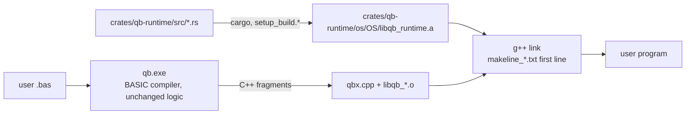

# Rust Port — Progress Log

> Project: `D:\QBNex-Rust` (git branch `rust-port`, cloned from `D:\QBNex` at `545b859`).
> The original `D:\QBNex` is **not modified** by the port. Remote `legacy-local` points at it.
> Strategy: Revision 2 in [`port-plan.md`](port-plan.md) — the BASIC compiler stays, the C++ runtime is replaced subsystem by subsystem with the Rust crate `qb-runtime`.

## Status (2026-11-09)

| Phase | Status | Evidence |
| --- | --- | --- |
| R0 Oracle + CI | **done (local), CI unverified** | `tests/conformance/` runner + 25 cases (19 golden, 6 xfail); smoke + conformance + unit + differential steps in `.github/workflows/{push,pull_request}.yml` |
| R1 `qb-runtime` foundation + MBF slice | **done (Windows), Linux/macOS unverified** | `crates/qb-runtime`; `libqb.cpp` includes `qb_runtime.h` instead of `msbin.cpp`; exhaustive differential test 0 mismatches |
| R2 Leaf numeric code | **done (Windows)** | TDD + differential + legacy deleted for rounding (`qbr*`, `fpu_reinit`), RND/RANDOMIZE, VAL, STR$ number formatting (all `qbs_str` overloads), TIMER arithmetic. `libqb.cpp` is ~600 lines shorter |
| L-00 self-host fixpoint | **done (Windows)** | TopLevelRuntime lowering fixed (`classes.bas`); gen1 = gen2 = gen3 byte-identical C++; `internal/source` regenerated and reproducible; `tests/selfhost_fixpoint.{sh,cmd}` in CI |
| R3 String engine (`qbs`) | **done (Windows)** | descriptor pool, tracking lists, `qbs_data` arena, DBLOCK (cmem) strings, `qbs_set`/`qbs_free`/`qbs_cleanup` and the string functions in `crates/qb-runtime/src/qbs.rs`; legacy C++ deleted (`libqb.cpp` ~850 lines shorter); debt F2 fixed |
| R4 Files, file system, ENVIRON, SHELL, `_MEM` | **done (Windows), Linux/macOS unverified** | see [R4 details](#r4-files-file-system-environ-shell-_mem). TDD + differential + legacy deleted; `libqb.cpp` is ~4,400 lines shorter |
| R5 Software graphics | **done (Windows)** | `crates/qb-runtime/src/gfx/*`: image registry + `img_struct`, palettes/fonts data, SCREEN mode decisions, COLOR/PALETTE, PSET/PRESET/POINT, LINE, CIRCLE, PAINT (color + tile), DRAW, VIEW/WINDOW/PMAP, GET/PUT, PCOPY, `_PUTIMAGE`, `_COPYIMAGE`/`_FREEIMAGE` storage, `_SETALPHA`, `_CLEARCOLOR`, `_RGB*`, `_PALETTECOLOR`, software `_MAPTRIANGLE`, built-in 8x8/8x14/8x16 text. Legacy C++ deleted, one-line shims left; `mtri*.cpp` moved to `tests/legacy` |
| R6 Audio | **done (Windows), Linux/macOS unverified** | Crate `crates/qb-audio` (cpal, symphonia, xmrs) replaces `parts/audio` (audio.cpp, miniaudio, stb_vorbis, minimp3, libxmp-lite, tinysoundfont, RADv2: ~130k lines deleted). Synth bit-exact vs legacy over 204M frames. See [R6 audio](#r6-audio) |
| R7 Fonts + image codecs | **done (Windows)** | FreeType 2.4.9 wrapper → `qb_runtime::font` (skrifa + ab_glyph_rasterizer); stb_image 2.27 + dr_pcx → `qb_runtime::image` (ports + png/zune-jpeg crates). FreeType, stb_image, dr_pcx deleted (~170k lines of C). See [R7](#r7-fonts-and-image-codecs) |
| R8 Window / input / threads | **done (Windows), Linux/macOS unverified** | freeglut, GLEW, `libqb/gui.cpp` and `parts/input/game_controller` deleted; Rust `window.rs` (winit + softbuffer), `keymap.rs`, `keybuf.rs`, `raster.rs`, `script.rs`, `gamepad.rs` (gilrs); see "R8" below |
| R9 Net, clipboard, screen, printer, clock | **done (Windows)**, Linux/macOS unverified | TCP (`std::net`), clipboard (Win32 `CF_TEXT`/`CF_BITMAP`, `arboard` elsewhere), `_SCREENIMAGE`/`_SCREENCLICK`/`_SCREENPRINT`, printer page output, `GetTicks` + TIMER start-of-day. Deleted: socket layer, X11/Cocoa/Win32 clipboard, screen code, `libqb/printer.{cpp,h}`, `myip.cpp`, `time64.{c,cpp,h}`; `libqb.cpp` ~1,860 lines shorter. See [R9 notes](#r9-notes) |
| R10 Third-party and leftover C/C++ removal | **done (Windows)** | `internal/c/parts/` deleted, system zlib replaced by `zlib-rs`, gl.h parser removed, licenses rewritten. See [R10](#r10-third-party-and-leftover-cc-removal) |

| R12b Core runtime (errors, DATA/READ, allocators, arrays, events, waits) | **done (Windows)**, Linux/macOS unverified | `error.rs`, `program.rs`, `numparse.rs`, `alloc.rs`, `arrays.rs`, `mathfn.rs`, `events.rs`, `waits.rs`; legacy C++ deleted from `libqb.cpp`/`qbx.cpp`, one-line shims left. See [R12b](#r12b-core-runtime) |
| R11 No-C++ backend | **design + spike** | [`r11-emitter-design.md`](r11-emitter-design.md): option B (QIR + prebuilt Rust runner `crates/qb-exec`); `qb --ir` runs PRINT/vars/IF/FOR/GOSUB/SUB/strings/ON ERROR end to end without g++; output matches the C++ backend |
| R11d `_FLOAT` + FFI | **done (Windows x64; Linux x86-64 and AArch64 unit/integration tests)** | `crates/qb-float80` (software x87, `diff_float80` 87.5M checks 0 mismatches) and `crates/qb-ffi` (DECLARE [DYNAMIC] LIBRARY, Win64/SysV/AAPCS64 thunks); see [R11d](#r11d-_float-and-declare-library) |
| R12a Text console | **done (Windows)**, Linux/macOS unverified | PRINT/LOCATE/CSRLIN/POS/CLS/VIEW PRINT/SCREEN(), SCREEN 0 cells + UTF-8 side table, INPUT/LINE INPUT/INPUT$/INKEY$, `$CONSOLE` paths in `crates/qb-runtime/src/console/`; `diff_console` 0 mismatches; `libqb.cpp` ~2,400 lines shorter. See [R12a](#r12a-text-console-branch-claudr12a-console-5af87c) |

### Verified on Windows (MinGW-Builds g++ 15.2.0 ucrt, rustc 1.98.0)

- `cmake --build --preset windows-mingw-selfhost` builds `libqb_runtime.a`, `qb-stage0.exe` and `qb.exe` linked against Rust.
- `cargo test --workspace`: 64/64 pass; `cargo clippy --workspace --all-targets`: 0 warnings.
- `diff_msbin` (legacy `msbin.cpp` vs Rust, every 2³² single-precision bit pattern in both directions + 50M double samples + edge cases): **0 mismatches**.
- `diff_round` (legacy x87 `fistp` asm vs Rust, 30M random 80-bit/double/float inputs + specials): **0 mismatches**; a mutation run reports 138k mismatches, so the harness can fail.
- `diff_val` (legacy `func_val` with `__mingw_sscanf` vs Rust, 3M generated strings incl. hex/oct/bin, 60-digit mantissas, exponents to ±5000): **0 mismatches** outside the L-05 forms that Rust fixes on purpose.
- `diff_str` (legacy `qbs_str` with MinGW printf vs Rust, 5M iterations x 10 types: random bit patterns, decimals, integers of all widths): **0 mismatches**; 553k L-07/D-05 inputs skipped by design; mutation run reports 189k mismatches.
- `diff_timer` (legacy `func_timer` + x87 `qbr` vs Rust, 20M random tick/start/accuracy combinations incl. errors): **0 mismatches**; mutation run reports 121k mismatches.
- `diff_qbs` (verbatim legacy string engine vs Rust, 5.17M random BASIC-like statements: nested string expressions, comparisons, INSTR/_INSTRREV/ASC/LEN, MID$ statement, fixed-length and DBLOCK strings, FREE, scope cleanup, 300k live strings, 150k tmp strings in one scope, concatenation loops growing the arena; after each statement every tracking-list entry, descriptor-pool position (incl. free list), arena/DBLOCK offset, stack pointer, DBLOCK byte and variable is compared): **0 mismatches**; mutation runs: arena compaction threshold 175 mismatches, MID$ boundary 133k mismatches; a third mutant (tmp-source skip in `qbs_set`) survives because that legacy branch is unreachable (a tmp source in the same list is always acquired first).
- `conformance`: 39 cases — 35 passed, 4 xfail (known legacy defects), 0 failed; golden output from the unmodified legacy build, plus hand-written `.deviation` cases. R3 added `strings/{concat_loop,mid_statement,fixed_length_ops,cmem_strings,case_trim_search}`.
- Self-host fixpoint with the Rust string engine: gen2 = gen3 C++, both pass the corpus.
- Benchmark (interleaved A/B, median of 5, legacy-engine `qb` vs Rust-engine `qb`, same machine and toolchain): tiny -9.0%, warning path -16.7%, medium -14.5%, large -11.5%, `qb compiler/qbnex.bas -z` (front end only) 19.0 s -> 10.0 s (-47.7%). The machine was shared with other builds, so treat single numbers as noisy; no case got slower.
- `tests/*_smoke.cmd` (cli, diagnostics, warnings, labels, encoding, stdlib, audio): 7/7 pass.
- R5 `diff_gfx` (verbatim legacy graphics in `tests/legacy/gfx_*.inc` + `mtri*.cpp` vs Rust on twin images, 6000 rounds x 60 random ops over SCREEN 1/2/7-13, 256-color and 32-bit images, plus exhaustive SCREEN decisions, blend tables, built-in palettes/fonts, 4M x87 long-double loads for DRAW `VARPTR$`): **2,278,925 checks, 0 mismatches** (skipped by design: 1829 `_PUTIMAGE` D-06 cases, 3337 2-bit GET D-07 cases, 10830 SCREEN 0 D-08 layouts). The mutation run reports mismatches in every op.
- R5 framebuffer conformance: `QBNEX_FB_CAPTURE=<file>` makes the runtime record each `_DISPLAY` frame and the final graphics screen (pixels + palette); the runner hashes them (FNV-1a 64) into `<case>.fb`. Eight cases in `tests/conformance/cases/graphics` (SCREEN 7/9/12/13/32, image ops, pages + DRAW, GET/PUT, SCREEN mode switches) are pixel-exact against the legacy oracle, plus the hand-written `get_2bit_partial` deviation case. Conformance total: 43 cases, 36 passed, 7 xfail, 0 failed (a full run occasionally times out one case under load; it passes on rerun).
- `cargo test --workspace`: 132/132 pass; `cargo clippy --workspace --all-targets`: 0 warnings.

### R9 notes

Rust modules (`crates/qb-runtime/src`): `net.rs`, `clipboard.rs`, `screen.rs`, `printer.rs`, `systime.rs`, `pixels.rs` (buffers handed to C). `libqb.cpp` keeps thin shims with the old signatures plus the handle tables (`special_handles`, streams) that file I/O shares; LPRINT text layout and image scaling stay in the graphics engine (R5).

Verified on Windows:

- `cargo test --workspace`: 82/82 (34 new: loopback host/client echo, non-blocking accept/recv, close detection, byte-swapped remote port, info-string parsing, `WHATISMYIP` against a local HTTP server and its reply parser, key/mouse event sequences, capture region, printer call flow, clock); `cargo clippy --workspace --all-targets`: 0 warnings.
- `diff_net` (legacy `connection_new`/`func__openclient`/`func__openhost`/`func__connectionaddress`, verbatim, on a mock qbs/list runtime, vs `qb_net_parse_info`/`qb_net_format_address`; 400k random info strings incl. VAL errors, embedded NULs, `$DEBUG` kind, 100k address texts): **0 mismatches**; mutation run 1,760.
- `diff_screen` (legacy `sub__screenprint` compiled as the Windows *and* the macOS build, `sub__screenclick`, `func__screenimage`, all against recording mocks of `SendInput`/`VkKeyScan`/CoreGraphics/GDI; 500k strings with random keyboard layouts, 500k clicks, 500k capture regions): **0 mismatches**; mutation run 56k.
- `diff_printer` (verbatim `printer.cpp` vs `qb_runtime::printer` page flow, every combination of failing GDI calls, page heights and image failure; 4,096 call sequences): **0 mismatches**; mutation run 2,048.
- `diff_systime` (verbatim start-of-day block from `main()` with scripted `time()`/`localtime()`, 2M scripts, plus a live check against the C library clock): **0 mismatches**; mutation run 98k.
- Conformance (whole corpus: 36 cases, 28 passed, 8 xfail, 0 failed): `net/loopback_echo` (host + client in one program: `_OPENHOST`, `_OPENCLIENT`, `_OPENCONNECTION`, `_CONNECTED`, `_CONNECTIONADDRESS`, binary-safe `PUT`/`GET` both ways, 20 KB transfer, close detection), `net/open_failures` (out-of-range ports, refused and unknown hosts, port in use, VAL-style port text), `net/send_buffer_full` (`.xfail`, L-08). Golden output from the legacy build.
- End to end against the legacy build (same output): `_CLIPBOARD$` set/get with a non-ASCII byte, `_CLIPBOARDIMAGE` write/read of a 32-bit image, `_SCREENIMAGE` whole screen and region. `_SCREENCLICK`, `_SCREENPRINT`, `_PRINTIMAGE` and `LPRINT` were compiled and linked but not run (they would inject input into, or print from, the desktop of the machine running the tests); their logic is covered by the differential tests above.
- `tests/*_smoke.cmd`: 8/8 pass (`benchmark_smoke` failed once with `std::bad_alloc` inside the compiler and passed on the rerun and on the R2 build; not investigated).

Notes:

- **Runtime error paths cannot be conformance cases yet.** An unhandled error opens a modal `MessageBox` ("Unhandled Error #… Continue?"); headless it hangs until the timeout, on a desktop it waits for a click. With L-01 (`ON ERROR GOTO` does not compile) there is no way to observe error codes from BASIC. The error codes of the network functions are covered by `diff_net` instead.
- **Precompiled `libqb_*.o` are not rebuilt when `libqb.cpp` changes.** After pulling this branch delete `internal/c/libqb/os/<os>/libqb_*.o` (or run `internal/c/purge_libqb_only.*`); a stale object still references the deleted `WHATISMYIP` and fails to link.
- `windows-sys` links through raw-dylib import stubs, so `libqb_runtime.a` needs no new `-l` flags on Windows (`--print native-static-libs` unchanged). macOS now needs `-framework AppKit -framework CoreGraphics -framework CoreFoundation -framework Foundation -lobjc` (added to CMake, `makeline_osx.txt`, `scripts/setup_osx.command`, `run_diff.sh`; not built). Linux needs nothing new (`arboard` uses the pure-Rust X11 client).
- Platform gaps kept from legacy: `_SCREENIMAGE` is a blank image of the screen size on Linux and macOS; `_SCREENCLICK`/`_SCREENPRINT` do nothing on Linux; the printer is Windows only (D8).

### Not verified yet

- Linux and macOS builds (native-library lists for the Rust staticlib are taken from rustc docs, not run).
- GitHub Actions runs of the new CI steps.
- Docker images (Rust toolchain added, not built).
- R9 on Linux/macOS: `net.rs`, `systime.rs` (chrono local time) and the `arboard` clipboard compile only for Windows here (the installed Linux std is a metadata stub). The macOS CoreGraphics key/mouse code and the new framework flags are untested.
- 32-bit Windows (`i686-pc-windows-gnu` selected automatically, not built).

## R3 string engine

`crates/qb-runtime/src/qbs.rs` owns all string-engine state: the descriptor pool (65536-descriptor blocks, LIFO free list), the three tracking lists (arena, DBLOCK, tmp), the `qbs_data` arena (1 MB, compaction when a gap above 32 bytes opens, growth `size*2+needed`) and the DBLOCK string area. `struct qbs` keeps the exact `common.h` layout (`#[repr(C)]`, checked by a unit test and by the harness) because generated C++ reads and writes its fields.

- Rust exports the globals generated code uses: `qbs_tmp_list_nexti` (scope marker), `qbs_cmem_sp`, `qbs_cmem_descriptor_space`; `qbx.cpp`/`libqb.cpp` now only declare them.
- Conventional memory stays C++ (`cmem`, `dblock`, `cmem_sp`); errors and FIELD buffers go through `qb_host_error` / `qb_host_field_free` in `libqb.cpp`.
- `libqb.cpp` keeps one-line shims with the old C++ signatures; `sub_mid` keeps its `new_error`/`nothingstring` checks in the shim. `qbs_cleanup` (qbx.cpp and libqb.cpp) keeps the inline fast path and calls `qb_qbs_cleanup` otherwise, so C++ no longer touches the tmp list: **F2 fixed** (`extern ptrszint *qbs_tmp_list` vs `std::vector` is gone).
- Still in C++: `qbs_inkey`, `qbs_str` shims, MK*/CV* helpers (`b2string` …), `LSET`/`RSET` (FIELD-coupled), `qbs_print`/`qbs_input`.
- Known legacy behaviour kept: DBLOCK string descriptors (4 bytes below `cmem_sp`) are never returned by `qbs_free`; generated code restores `cmem_sp` when a SUB exits. Allocation failure aborts the process (legacy raised error 508 and continued with a NULL block).

## Bootstrap snapshot and self-host fixpoint (L-00)

`internal/source` is the generated C++ of the compiler itself; CMake builds `qb-stage0` from it, and stage0 compiles `compiler/qbnex.bas` into `qb`. Since L-00 is fixed the chain is a true fixpoint: the C++ that gen1, gen2 and gen3 emit for `compiler/qbnex.bas` is byte-identical, and equal to the committed snapshot.

- `tests/selfhost_fixpoint.{sh,cmd}` builds gen2 and gen3 from `qb`, requires identical `-z` output, and runs the conformance corpus with both (CI step "Self-host fixpoint"). `--no-conformance` skips the corpus runs.
- `tests/refresh_stage0_snapshot.{sh,cmd}` regenerates `internal/source` with `qb -z` (only `*.txt` and `data.bin`; `icon.rc`, `*.bat`, `manifest.h`, manifests and icons stay as committed). Refresh after compiler changes, then rebuild from scratch and run it again: the second run must leave `internal/source` unchanged. The snapshot is generated on Windows, as before.
## R6 audio

`internal/c/parts/audio/{out,decode,conversion}` are gone. Only `parts/audio/out/audio.h` (declarations) and `src.c` (shims, `#include`d by `libqb.cpp`) remain; the shims keep the old `sub_*`/`func_*` signatures, raise BASIC errors and manage `_MEMSOUND` mem locks, and call the C ABI in `crates/qb-runtime/include/qb_audio.h`.

- **Crate layout.** `qb-runtime-audio` is a separate crate linked into `libqb_runtime.a` (`extern crate qb_audio` in `qb-runtime`). The release profile builds one object per crate, so a program only pulls the audio object (and cpal/symphonia) when libqb references a `qb_snd_*` symbol, which happens only with `DEPENDENCY_AUDIO_OUT`. A console `PRINT "hi"` exe is 2.6 MB with no audio strings; an audio exe is 5.0 MB.
- **Modules.** `synth.rs` (envelope, waveforms, `GenerateWaveform`), `mml.rs` (`PLAY` state machine transcribed from the `goto` code, `SOUND`, `_VOICE`, `_ADSR`, `_WAVE`, VARPTR$), `queue.rs` (raw frame queue), `engine.rs` (handle table, mixer, `_SND*`), `decode.rs`, `device.rs` (cpal on its own thread), `ffi.rs`.
- **F3 fixed for audio.** One mutex guards the whole engine; the BASIC thread, libqb's main-loop thread (`snd_mainloop`) and the cpal callback all take it. Legacy shared `soundHandles`, the raw queues and miniaudio sounds between those threads with no lock.
- **Build.** No extra Windows link libraries (the `windows` crate uses raw-dylib). Linux user links get `-lasound` and need `libasound2-dev` (added to CI apt lines; Dockerfiles already had it). macOS links CoreAudio, AudioUnit, AudioToolbox, CoreFoundation. Building `libqb_runtime.a` now needs Rust 1.88 (xmrsplayer; cpal 0.18 needs 1.85). `QB_AUDIO_DEVICE=none` runs a program without an output device (same behaviour as legacy when miniaudio failed to start).

Verified on Windows:

- `cargo test -p qb-runtime-audio`: 40 tests (envelope, waveforms, custom wave parsing incl. `strtod` forms, rand LCG, MML: octave/`<`/`>`, length, tempo, dots, MB/MF/MN/ML/MS, N, sharps/flats, P, chords, VARPTR$, errors, state between statements; queue blocks; handle allocation, play/loop/pause/stop/seek/limit/volume/pan, `_MEMSOUND`, raw streams, voice draining; WAV decoding and resampling). RED run first: 11 PLAY tests failed on assertions against a stub.
- `diff_audio` (legacy synth + `sub_play`/`sub_sound`/`sub__voice`/`sub__adsr`/`sub__wave` copied verbatim into `tests/legacy/audio_synth*.inc`, rendered offline vs Rust): 50,000 random statements over 8000/22050/44100/48000 Hz, **204,132,081 frames, 0 mismatches, 0 samples off even by 1 LSB** (documented tolerance is 1 LSB for libm differences; not needed on MinGW). Noise waveforms included. A mutation run (pink-noise coefficient 0.1848 -> 0.1849 and dotted-note divisor 2 -> 2.01) reports 911 mismatches in the quick run. The harness found two real porting bugs on the way: x87 unnormal long doubles in `"=" + VARPTR$` and the out-of-range double -> int16 conversion (`cvttsd2si` gives 0x80000000, Rust `as` saturates); both are now emulated.
- End-to-end on a real device (48 kHz): `_SNDOPEN` WAV, `_SNDLEN`, `_MEMSOUND` (size, element size and a spot-checked sample match the file), `_SNDPLAY` to the end, `_SNDCOPY`, `_SNDRAW` + `_SNDRAWDONE` until `_SNDRAWLEN` = 0, `PLAY` until `PLAY(0)` = 0; and the same program with `QB_AUDIO_DEVICE=none`.
- `tests/smoke/audio_smoke.cmd` and the other 6 smoke tests pass; conformance 35 cases: 28 passed, 7 xfail, 0 failed (2 new device-independent cases in `tests/conformance/cases/audio/`).

Not verified: Linux (ALSA) and macOS (CoreAudio) builds and playback; MP3/FLAC/Ogg/MOD/XM/S3M/IT files beyond the decoder unit tests (WAV); audible quality by ear.

Legacy defect found (not reproducible in the corpus because output is device dependent):

| ID | Defect | Severity |
| --- | --- | --- |
| L-60 | `SOUND`, `BEEP` and `PLAY` were silent: the four synth voice queues were never registered as sound handles, so `snd_mainloop` never streamed them, and `PLAY(n)` only grew. **Fixed in Rust** (D-60). | High |

Intentional deviations of R6:

| ID | Change | Why |
| --- | --- | --- |
| D-60 | Synth voices are mixed into the output and drain, so `PLAY(n)` counts down (fixes L-60). `PLAY` still never blocks, as in legacy (QBasic blocks in MF mode). | Legacy output was silence. |
| D-61 | When a chord (`,`) is followed by a longer note or pause, the grown part of the PLAY buffer is silence; legacy left it uninitialised (`realloc`). The legacy `memset` that zeroes part of the chord is kept. | Defined output instead of heap garbage. |
| D-62 | Noise waveforms use the MSVCRT/UCRT `rand()` LCG (seed 1) on every platform and no longer share the C runtime's `rand()` state. | Identical noise on all platforms; matches the legacy Windows build exactly. |
| D-63 | Decoders: symphonia (WAV, FLAC, MP3, Ogg Vorbis) and xmrs (MOD, XM, S3M, IT, rendered once, loops not repeated, max 30 min). **MIDI (tinysoundfont + AWE32 ROM) and RAD v2 are dropped**: `_SNDOPEN` returns -1. "STREAM" sounds are decoded completely at open (still not copyable and not `_MEMSOUND`-able, as legacy). Resampling to the device rate is linear without miniaudio's low-pass filter. WAV keeps its integer sample format for `_MEMSOUND`, other formats are f32, modules s16 stereo. | No pure-Rust MIDI synth with an embedded bank; RAD has no Rust player. |
| D-64 | `_SNDBAL` with y/z uses inverse-distance gain and x-direction pan instead of miniaudio's spatializer (no doppler, cones or HRTF-like channel gains). Stereo pan uses miniaudio's `ma_pan_mode_pan` law. | Approximation of the 3-D model. |
| D-65 | Raw streams (`_SNDRAW`, synth voices) are pulled by the device callback under the engine lock instead of being copied block by block into a ping-pong buffer by `snd_mainloop`. A forced partial block plays without padding; `_SNDRAWLEN` counts queued frames only. Legacy `_SNDLIMIT` semantics (absolute engine time) are kept. | Race-free (F3) and independent of the main-loop rate. |

License changes: miniaudio, stb_vorbis, minimp3, libxmp-lite, tinysoundfont and RADv2 are no longer distributed (their entries and license files were removed from `licenses/`). Added: cpal (Apache-2.0), Symphonia (**MPL-2.0**, file-level copyleft, used unmodified), xmrs/xmrsplayer (MIT) and their MIT/Apache-2.0/Zlib/BSD dependencies (`licenses/COPYING.TXT`, `license_apache_2_0.txt`, `license_mpl_2_0.txt`, `license_xmrs.txt`).
## R8 — window, input, threads (branch `claude/r8-window-bec52a`)

What moved to Rust (`crates/qb-runtime/src`, C ABI in `include/qb_window.h`):

| Module | Replaces | Notes |
| --- | --- | --- |
| `window.rs` | freeglut window + GLUT main loop, `glutSetWindowTitle/ReshapeWindow/FullScreen/PositionWindow/SetCursor/WarpPointer/IconifyWindow`, `glutGet(GLUT_SCREEN_*)` | winit event loop on the **main thread**; softbuffer presents the frame; setters queue commands and wake the loop; getters read atomics |
| `raster.rs` | the OpenGL presenter of `gui.cpp`: `prepare_environment_2d`, `hardware_img_put/tri2d/tri3d`, letterbox, stretch/smooth | software rasteriser for "hardware" images (`_COPYIMAGE(,33)`), depth buffer, culling, near-plane clipping |
| `keymap.rs` | freeglut's Win32 key translation + `GLUT_key_ascii`/`GLUT_key_special` | stage 2 is verbatim (diffed); stage 1 maps winit keys |
| `keybuf.rs` | `keyhit[]` ring, `keyheld_*`, `update_shift_state` bytes | one mutex per operation + re-entrant `qb_input_lock` around `keydown()/keyup()`/mouse queue writes (fixes F3 for these) |
| `script.rs` | — (new) | `QBNEX_INPUT_SCRIPT=<file>` replays keys/mouse/resize/close; `snapshot` prints a frame hash |
| `gamepad.rs` | libstem gamepad (`parts/input/game_controller`) | gilrs (XInput on Windows); glue logic kept in `libqb/gamepad_bridge.cpp` |

C++ glue that stays (until `libqb.cpp` itself goes): `libqb/window_bridge.cpp` (frame composition from `display_frame[]` + the hardware command list, mouse queue handlers, callbacks), `libqb/gamepad_bridge.cpp`.

Thread layout now: main thread = window event loop (`window_main()` → `qb_window_run`); QBMAIN = user program; MAIN_LOOP = timer bytes, autodisplay, gamepad poll; TIMERTHREAD unchanged. Frames are composed on the thread that built them (MAIN_LOOP, or the program thread on `_DISPLAY`) under `present_mutex`, so `display_frame[].state` and the hardware command list are no longer shared with the window thread. `qbevent`, `lock_display`, `autodisplay` handshakes and the mouse queue readers are still plain C++ globals (F3 partly open, see below).

Environment variables: `QBNEX_HEADLESS=1` runs GUI programs without a window (desktop size reported as 1920x1080, the "window" follows the frame size); `QBNEX_INPUT_SCRIPT=<file>` (syntax in `script.rs`). The conformance runner sets `QBNEX_HEADLESS=1` for every case and passes `<name>.input` as the script.

Build changes: makelines/CMake/setup scripts no longer build or link `parts/core` or GL; Windows links `user32 gdi32 ole32 oleaut32 shell32 imm32 dwmapi uxtheme comctl32 advapi32 xinput` for the Rust window layer. `internal/c/parts/core` keeps only `gl_header_for_parsing` (the compiler reads it for the `_gl*` keyword table) and `os/{win,lnx}/build.*` one-liners that create an empty `src.a`: the frozen stage0 (L-00) still calls `Build` on that folder.

### R8 evidence (Windows)

- `cargo test -p qb-runtime`: 76 unit tests (keymap, keybuf, raster, script, gamepad, window helpers) — each module first run RED against stubs.
- `diff_keymap` (verbatim `GLUT_key_ascii`/`GLUT_key_special` vs Rust, exhaustive 12,544 cases): 0 mismatches; mutation run 32 mismatches.
- `diff_keybuf` (verbatim `keyheld*`, `update_shift_state`, keyhit ring vs Rust, 5M random operations incl. ring overflow): 0 mismatches; mutation run 5,130 mismatches.
- `diff_layout` (verbatim `prepare_environment_2d` vs Rust, 5M size/mode combinations): 0 mismatches; mutation run 21,904 mismatches.
- Conformance: new cases `input/inkey_script`, `input/keyhit_mouse_script` (scripted input, `.deviation`, hand-checked goldens), `graphics/gui_basics` (blessed from the legacy oracle, run headless), `graphics/sub_gl` (xfail, D-14).
- Smoke tests 8/8 pass.
- Manual GUI check: a SCREEN 12 program in a real window showed the title, text, PAINTed circle, typed keys (`Hello R8<59><75>`) and PSET dots following scripted and real mouse movement; ESC closed it (exit 0).

### R8 deviations and open items

| ID | Change |
| --- | --- |
| D-13 | "Hardware" images are rendered in software at SCREEN resolution and then scaled with the frame; edge pixels and bilinear filtering can differ from the OpenGL output. `_DISPLAYORDER _GLRENDER` layers are ignored. |
| D-14 | `SUB _GL` / `_gl*` (OpenGL) are not supported: since R10 the compiler rejects `SUB _GL` with an error naming D-14 (before: C++ `#error`) (`graphics/sub_gl` xfail). A `glow`-based GL path would need a GL context next to softbuffer; not done. |
| D-15 | Game controller buttons/axes use gilrs' standard layout (fixed indices, 19 buttons, 8 axes, Y axes down-positive); legacy reported raw driver order. |
| D-16 | Attaching more controllers than `device_max` no longer overflows the heap (legacy assigned `realloc` to a local). |
| D-17 | The process is per-monitor DPI aware (winit), so a 640x480 SCREEN is 640x480 physical pixels; legacy was DPI-unaware and got scaled by Windows. A non-ASCII key no longer emits a stray ANSI keyup on release. |

Open: `_DEVICEINPUT` keyboard device events (legacy `qbnex_os_event_windows` scan codes) are not generated; Linux `_CLIPBOARD$` lost its X11 hook (`x11filter`); macOS `libqb.mm` not adapted; `qbevent`/`lock_display`/mouse-queue readers still unsynchronised; during early manual runs a windowed program aborted twice with `std::bad_alloc` while another `qb.exe` build was running, not reproduced in 20+ later runs (stress included) — watch for it.

## Porting workflow (TDD, legacy C++ deleted)

Every subsystem goes through the same loop:

1. **RED** — Rust unit tests describing the behaviour (values captured from the legacy oracle or QBasic semantics); run them against a stub and watch them fail on assertions.
2. **GREEN** — minimal Rust implementation in `crates/qb-runtime/src/<module>.rs`.
3. **Differential** — a harness in `tests/diff/diff_<module>.cpp` links the Rust code with a *verbatim copy* of the legacy C++ (`tests/legacy/*.inc`, test-only) and compares them on millions of inputs. A mutation run proves the harness can fail.
4. **Delete** — the legacy C++ is removed from `libqb.cpp` (no `#ifdef LEGACY` fallback); only a one-line shim with the old C++ signature stays, because generated code and `qbx.cpp` call it.
5. **Conformance** — new cases blessed from `.oracle`, then the whole corpus + smoke tests run against the Rust build.

Where the legacy behaviour is a clear defect against QBasic, the Rust code fixes it, the unit test asserts the QBasic result, and the conformance case carries a `.deviation` note with a hand-written golden file.

### What "remove all C/C++" can reach under D10

With the compiler kept in BASIC, it still **emits C++**, so `internal/c/qbx.cpp`, the generated fragments and a C++ compiler at user compile time remain. Everything else can go: `libqb.cpp` shrinks to shims and then disappears, and every library under `internal/c/parts` is replaced by Rust crates. Removing the last C++ is phase **R11** (approved). Recommendation after the spike: the BASIC compiler emits **QIR**, a text IR that the prebuilt Rust runner `qb-exec` (linked with `qb-runtime`) executes; the executable is the runner with the IR appended, so users need **no** compiler toolchain. A Cranelift JIT tier on the same IR is the later performance step. See [`r11-emitter-design.md`](r11-emitter-design.md).

### R11 spike status (2026-11-09)

- `qb.exe prog.bas --ir -o prog.exe` (also `-ir`, `--emit-ir`) uses a separate small emitter (`compiler/utilities/ir_emit.bas`); the default C++ path is unchanged.
- `cargo test -p qb-exec`: 18 interpreter unit tests + 3 end-to-end tests. `spike.bas` (PRINT, numeric types, IF, FOR, GOSUB/RETURN, SUB with BYREF + `DIM SHARED`, string functions) gives the same output through both backends; `onerror.bas` (`ON ERROR GOTO` + `RESUME NEXT` in the main module, legacy defect L-01 in the C++ path) runs under QIR.
- Verified with MinGW removed: an IR executable compiles and runs; `qb.exe` and C++-backend executables do not start without the MinGW DLLs on PATH (`0xC0000135`).
- Measured: hello world 0.14 s vs 1.11 s, executable 0.25 MB vs 2.6 MB, but a tight loop costs ~95 ns per iteration in the untyped spike VM (C++ loop below noise). Typed VM + JIT are required before QIR can be the default or run the compiler itself.
- Round 2: `cargo run --release -p qbnex-conformance -- --qb-arg --ir` passes **15 of 33** cases (C++ backend: 26 + 7 xfail). Added loops, SELECT CASE, FUNCTION/STATIC, arrays, DATA/READ/RESTORE, RND/RANDOMIZE, MK$/CV/MBF, DEFtype and more builtins (TDD, `qb-exec` tests 18 + 19 + 7 unit, 4 end-to-end). The L-01, L-03 and L-04 cases run correctly under QIR (`crates/qb-exec/tests/fixtures/legacy_defects`).
- The CMake target `qb-exec` (built with `qb-selfhost`) produces `crates/qb-exec/bin/<os>/qb-exec`; on Windows it imports only system DLLs.
- Not done: UDT, file I/O, PRINT USING, 64/80-bit numbers, emitter inside the real compiler pipeline, release bundle, Linux/macOS runs.

### R11 one pipeline (branch `claude/r11b-vm-d353b8`, 2026-11-11)

The R11 work (R11a emitter, R11b VM, R11c JIT) is one implementation now (owner: "no separate versions, make it one"):

- **QIR** (`crates/qb-ir`) → `qb_exec::lower` (`crates/qb-exec/src/lower.rs`) → **one typed register bytecode** (`bytecode.rs`) → **one VM** (`vm.rs`); every runtime operation goes through `rt::Host` (`crates/qb-exec/src/rt/`: builtins, files, `_MEM`, TCP, sound). Hot loops and numeric SUB/FUNCTIONs of the same bytecode are compiled by Cranelift (`jit.rs` + `qb-jit`), at run time (JIT, `QB_JIT=off|eager|<threshold>`) or ahead of time (`qb-exec build`, `qb-link`).
- Removed: the QIR v0 format and its loader, the tree-walking reference interpreter, v0-only bytecode instructions (FToI, EQV/IMP, DivF, float jumps, the v0 FOR instructions, PRINT/RND/ERR/event ops, math unary ops, STATIC frames), the v0 tests. qb-jit keeps MIR (its codegen IR); its MIR interpreter is a test oracle only.
- JIT on the unified bytecode: `for_test +k`, `loop_for` (the back edge also enters native code), `acc` and `cvt` (CINT-style float -> int) are native; `_FLOAT` pairs, unsigned widths, memory-mode and string/rt instructions exit to the VM (safe default of R11c's guide).
- Oracles after the reference interpreter was retired: `tests/fixtures/corpus/*.expect` (39 conformance programs) and `tests/fixtures/cover/*.expect` were recorded from it while VM and reference agreed.
- Tests: `cargo test -p qb-exec` passes with `QB_JIT=off`, `1`, `eager` and the default (corpus, cover, fusion, qir_ops, jit 19 fixtures from `tests/fixtures/jit` = BASIC + QIR, jit_random 300 generated QIR programs incl. AOT, aot); `cargo test -p qb-jit` passes.
- Benchmarks of the single pipeline (`cargo run --release -p qb-exec --example bench`: `benches/qir/*.qir` = `benches/bas/*.bas` compiled with `qb --ir`, each program times itself with `TIMER(.001)`; C++ = the same `.bas` built by the C++ backend; best of 3, console only, stdin from NUL, same machine and moment):

| case | C++ ms | VM ms | VM + JIT ms | JIT / C++ |
| --- | --- | --- | --- | --- |
| loop | 97 | 333 | 115 | 1.19x |
| float | 57 | 164 | 25 | 0.44x |
| array | 126 | 332 | 84 | 0.67x |
| sub | 58 | 179 | 20 | 0.34x |
| func | 91 | 204 | 28 | 0.31x |
| gosub | 15 | 33 | 27 | 1.8x |
| strfn | 118 | 58 | 61 | 0.52x |
| concat | 93 000+ | 15 | 16 | ~6000x faster |

  Gate D13 (loop <= 2x C++) met with the JIT; every case is within 2x.
- `cargo test --workspace` passes (31 test binaries).
- Conformance under the QIR backend (`conformance --qb qb-ir.exe --qb-arg --ir`, R11a's compiler build of 2026-11-10 10:55): **51 of 81 pass**, 6 xfail, 24 fail. None is a VM difference: 10 do not compile with `--ir` (emitter), 11 use builtins that compiler build emits but the committed `qb_ir` table does not have yet (`qbg_screen`, `sub__delay`: R11a work in progress), 3 differ in emitter/runtime semantics (OCT$ width, READ into `_INTEGER64` saturation, CALL ABSOLUTE).

### R11b typed register VM (R11.5, branch `claude/r11b-vm-d353b8`, 2026-11-10)

- The untyped stack interpreter is gone. QIR is loaded once into typed register bytecode (`crates/qb-exec/src/bytecode.rs`): numeric registers are 64-bit cells (integers stored wrapped to their QB width, SINGLE/DOUBLE as f64), separate string and array banks, constant registers, one frame per SUB/FUNCTION call, labels resolved to pc, builtins resolved at load (hot ones are instructions: LEN, CHR$, ASC, LEFT$, RIGHT$, MID$, ABS/SGN/INT/FIX/SQR/LOG/EXP/SIN/COS/TAN/ATN; the rest go through one resolved table entry). `Module::validate` checks every operand, so the hot loop indexes registers without bounds checks.
- `lower.rs` runs QIR v0 abstractly (static types from suffixes / first store) and fuses: result written straight into the variable, compare + branch (`br.*`), `FORTEST`+`JZ` (`for_test.*`), `NEXT` (`for_next.*`, one instruction per iteration), `s = s + a op b` (`acc`), in-place `a$ = a$ + x$`, backward jumps as `loop` (event safe point). Fusion never crosses `LINE` or a label; statement starts live in a side table, so `LINE` costs nothing and RESUME / RESUME NEXT / error lines are unchanged.
- BYREF = copy-in / copy-out (strings and arrays are moved, not copied); differs from pointer semantics only when a SUB changes one variable through a parameter and through SHARED at once. GOSUB/RETURN and ON ERROR/RESUME are jumps with a return stack; the error handler sees module level without unwinding frames (QBasic). `_INTEGER64` (`&&`, `PUSH Q`) is typed.
- Events: `ONEVENT id label`, `EVENTON/EVENTOFF/EVENTSTOP id`, `ONTIMER label` (interval on the stack, timer thread) — other threads set bits in an atomic mask, the VM looks only at safe points (back edges, NEXT, CALL) and runs the handler as an implicit GOSUB; STOP remembers, OFF discards (`Vm::events()` gives a handle).
- Tests: `cargo test -p qb-exec` — all v0 tests unchanged (18 + 19 + 7) plus 14 in `tests/vm_typed.rs` (fusion shapes, wrap rules, events, BYREF strings, shared arrays) and the merged QIR v1 tests of R11a (13, still on the reference interpreter, see below).
- Microbenchmarks: `cargo run --release -p qb-exec --example bench`; the same programs for the C++ path are `crates/qb-exec/benches/bas/*.bas` (time measured inside the program with `TIMER(.001)`, so start-up is excluded on both sides). Same machine, best of 3, outputs identical:

| case | BASIC | VM ms | C++ ms | VM / C++ |
| --- | --- | --- | --- | --- |
| loop | `FOR i& = 1 TO 50M: s& = s& + i& MOD 7: NEXT` | 255 (5.1 ns/iter) | 96 | **2.7x** (spike VM: ~95 ns/iter, 19x slower than now) |
| float | `x# = x# + i& * 0.5`, 20M | 146 | 58 | 2.5x |
| array | `j& = i& MOD 1000: a&(j&) = a&(j&) + i&`, 20M | 313–347 | 133 | 2.4–2.6x |
| sub | `inc c&` (BYREF LONG), 5M calls | 161–176 | 57 | 2.8–3.1x |
| func | `t& = t& + sq&(i&)`, 5M calls | 210–218 | 79 | 2.7x |
| gosub | `GOSUB g` / `RETURN`, 5M | 39–52 | 15 | 2.6–3.4x |
| strfn | `MID$(...) + CHR$(65)`, `LEN`, 2M | 54 | 124 | **0.43x** (faster) |
| concat | `a$ = a$ + "x"`, 2M | 14–23 | 93 000–124 000 | **~5000x faster** (C++ path copies the whole string each time) |

  Calibration on the same machine: the loop case in native Rust with a runtime divisor = 1.4 ns/iter; the remaining cost is interpreter dispatch (~1.7 ns per instruction). Gate "loop ≤ 10x C++" met, target ≤ 3x met for every case.
- **QIR v1 on the VM** (`crates/qb-exec/src/lower1.rs`): `QIR 1` programs are loaded onto the same VM. Scalars become registers (globals and statics in the main frame, SUBs reach them with `getg`/`setg`; BYREF = copy-in/out), `addr`/`aref`/`aaddr` are symbolic (accepted as call arguments and as `ld`/`st` of array elements), constants are frame registers, loads alias the variable register and widening `cvt` reuses its source when the value cannot change before its last use, stores retarget the producing instruction. Emitter-specific superinstructions: the two-way FOR test (`for_test +k`), the FOR back edge with its increment (`loop_for`), `acc`, native LEN/LEFT$/RIGHT$/MID$/CHR$/ASC; every other `rt` builtin runs through the shared R11a runtime (`v1/rt.rs` now takes any executor via `rt::Host`, so PRINT columns, files and PRINT USING are one implementation).
- **Whole QIR v1 on the VM** (2026-11-10, second round): `_UNSIGNED _INTEGER64` (`W::U64`: unsigned division/remainder/shift, `cmp.u`/`br.u`, `itof.u64`); **memory mode** (`crates/qb-exec/src/mem.rs`) for TYPE, `STRING * n`, pointer arithmetic and GET/PUT of variables: only arrays, TYPE / `STRING * n` variables and variables whose address is taken live in memory blocks (same layout as the reference: pointer = block << 32 | offset, string handles in memory), everything else stays in registers; BYREF/array parameters are the caller's pointers, module-level addresses are fetched once per call; **`_FLOAT` bit-exact** (x87 80-bit through `qb-float80`, like R11a's reference since `3bc6cfc`): an f80 value is a register pair (significand, sign/exponent), BYVAL `_FLOAT` arguments are passed as two registers, `_FLOAT` FUNCTIONs return a pair. ERL / `_ERRORLINE` / `LASTLINE` follow the reference. The loader tries register mode first and falls back to memory mode; the reference interpreter is only used when both refuse (`QB_EXEC_TRACE=1` prints why, `QB_EXEC_REFERENCE=1` forces it, `QB_EXEC_DISASM=1` prints the bytecode).
- Conformance programs: `crates/qb-exec/tests/fixtures/qir1/` = the 39 deterministic conformance cases compiled with the current `qb --ir` (R11a emitter, real pipeline, incl. `_MEM`); `tests/qir1_corpus.rs` requires identical output/exit/error on the VM and on the reference interpreter: **39 of 39 run on the VM, all identical**. All 55 cases the emitter can compile (incl. files, FIELD, SHELL, ENVIRON, INPUT scripts, TCP loopback, VARPTR/PEEK/POKE, `_DEFLATE$`) were also run by hand in empty directories: **53 of 55 on the VM, 55 of 55 identical** (the 2 others call `_SNDOPEN`/`_VOICE`, not in the builtin table yet). Since R11a `b0123c3` both executors hand out real addresses for variable/element storage (array descriptors are tagged references); per-program builtin state (conventional memory, FIELD, record lengths, TCP handles, DEF SEG) lives in `rt::RtState`, `rt::Host` = rt/err/erl/errline/set_last_line/bytes/array_extent/load_str/store_str. The other conformance cases do not compile with `--ir` yet (SCREEN/graphics, sound, `_MEM`, network, `FIELD`, `_DEFLATE$`, `VARPTR`: emitter work, R11a). Hand-written cases for each new feature: `tests/vm_v1_cover.rs` (u64, TYPE fields/arrays/BYREF TYPE, `STRING * n`, BYREF in memory mode, `_FLOAT`).
- Benchmarks through the real emitter (`crates/qb-exec/benches/qir1/*.qir` = `benches/bas/*.bas` compiled with `qb --ir`; `qb-exec <file>.qir`, each program prints its own `TIMER(.001)` time). C++ and VM runs interleaved, best of 5, same moment (machine shared with other builds, so absolute times vary ±30 %):

| case | C++ ms | VM ms (QIR v1) | VM / C++ |
| --- | --- | --- | --- |
| loop | 102–116 | 306 | **2.6–3.0x** (967 ms before the v1 superinstructions) |
| float | 58 | 175 | 3.0x |
| array | 129 | 319 | 2.5x |
| sub | 64 | 189 | 3.0x |
| func | 75 | 208 | 2.8x |
| gosub | 16 | 43 | 2.7x |
| strfn | 120 | 56 | **0.47x** (510 ms before native MID$/CHR$/LEN) |
| concat | 93 000+ | 15 | ~6000x faster |

- Not done in R11b: events in v1 (no QIR op yet; the VM side exists for v0: `ONEVENT`/`ONTIMER`, polled at safe points); a FUNCTION returning a pointer (the spec allows no such program today). v0 (the spike format) still runs on the same VM until the spike emitter is removed.


## R11a — QIR v1 จาก pipeline จริง (branch `claude/r11a-emitter-09276c`, 2026-11-10)

- **Spec + crate:** `docs/rust-port/qir-v1.md` และ `crates/qb-ir` (ชนิดข้อมูล, parser/printer, validator, ตาราง builtin `qb_ir::builtins::TABLE` ที่เป็น normative)
- **Emitter ใน pipeline จริง:** main pass ของ `qbnex.bas` ทำงานเหมือนเดิม แล้ว handler แต่ละ statement เรียก `Ir*` (`compiler/utilities/ir_emit.bas`, `ir_stmt.bas`, `ir_mem.bas`, state ใน `ir_state.bas`); `IrEval$` ใช้กฎ promotion ของ C++ backend. builtin ของ libqb ที่เป็น graphics/รูป/ฟอนต์/input/timer ถูก lower แบบ generic เป็น `rt <callname>` ด้วยชนิด argument จาก registry (`IrGeneric$`, รายชื่อใน `IrGenOK%`)
- **Executor:** unified VM ของ R11b (`crates/qb-exec`: lower → bytecode → VM/JIT); runtime ที่ R11a เพิ่มอยู่ใน `rt/`: `display.rs` (หน้า SCREEN/รูป/กราฟิก/ข้อความบนหน้า, WIDTH, ฟอนต์ `_LOADFONT`, `_LOADIMAGE`, `_PUTIMAGE`, `_MAPTRIANGLE`, frame capture), `input.rs` (port `keydown`/`keyup` + mouse queue, input script ผ่าน headless window ของ qb-runtime), `scancodes.rs` (ตาราง scancode_lookup), audiox/netx/memx/files. ทุกอย่างเรียก qb-runtime (Rust) ตรง ไม่ผ่าน libqb.cpp
- **QIR ใหม่:** `ontimer %slot %secs L` (ON TIMER), `meta screenhide`; builtin ใหม่ใน table (graphics callnames, `READCHK`, `VARPTR$`, `EXP.s`, `DELAYBEGIN`/`DELAYSTEP`, `func__*` ของ input/timer)
- **- **Conformance** (89 cases, Windows, 2026-11-10 หลัง merge rust-port `ae57d8c`, compiler `60d3689`):

  | backend | ผ่าน | xfail | fail |
  | --- | --- | --- | --- |
  | QIR (`--qb-arg --ir`) | **84** | 5 | **0** |

  xfail 5 ตัวเป็น legacy defect/deviation ชุดเดียวกับ C++ path (L-02, L-03, L-06, L-14, D-14). `call_absolute_sub_arg` รันบน `rt/cpu.rs` (port x86 subset ของ `cpu_call`), `stdlib_helpers` ใช้ STRING ความยาวแปรผันใน TYPE (string handle ใน memory, assignment ของ TYPE copy ทีละ field), `timers_and_waits` ใช้ ON TIMER ของ VM. `cargo test --release -p qb-exec -p qb-ir` ผ่านทั้งหมด (e2e รันหลาย thread ได้)พฤติกรรมที่ตรงกับ C++:** READ ใช้ `numparse::read_*` (overflow 6, syntax 2, ค่า 0 ก่อน error), ERASE ทำให้ array ไม่มีมิติ (error 9), unhandled error ตาม no-dialog policy ของ runtime (stderr + exit 1), HEX$/OCT$/_BIN$ ความกว้างตาม semantics.bas, `_BIT * n`
- **Compiler:** lock ของโฟลเดอร์ `internal/tempN` (#26) ไม่ถูกปล่อยระหว่าง recompile อีกแล้ว (เดิมทำให้ qb ที่รันพร้อมกันชนกัน, error 70 ใน e2e แบบหลาย thread)
- **ยังไม่ทำ:** ON KEY/ON STRIG trapping, CHAIN/COMMON, PLAY event, VARPTR$ ของ string (DRAW/PLAY "X"); string ใน TYPE ที่ตายไปพร้อม scope ยังไม่ถูกคืน (leak เล็กน้อย, ไม่กระทบผลลัพธ์)

## ## Cutover — QIR is the only backend (branch `claude/r11a-emitter-09276c`, 2026-11-10)

- **Compiler on QIR:** `compiler/qbnex.bas` compiles to QIR and runs on qb-exec; the QIR it emits for itself is a fixpoint (stage1 = stage2 = stage3). `bootstrap/qbnex.qir` is that QIR. What the self-host needed: COMMAND$(n) / `_COMMANDCOUNT` (the program's own argv, also for `qb-exec prog.qir args`), `getpid`, STATIC arrays dimensioned by the first call only, INSTR/LEFT$/RIGHT$/MID$ exactly as qb-runtime's `qb_func_instr`/`qbs_left`/`qbs_right`/`qb_func_mid` (start < 1 and negative counts are not errors), `_MK$`/`_CV` of every type, `_ROUND`, `_ACOS`.. `_SEC`.. `_SHL`.. `_STRCMP`, CASE values compiled after the C++ pass (implicit variables), REDIM of a SHARED array inside a SUB, an emitter that does not depend on the evaluation order of `+` (C++ evaluated right to left, the VM left to right).
- **Default backend:** QIR (`--ir` is accepted and changes nothing). `qb prog.bas -o prog.exe` writes the packaged runner (D15b: runner + QIR + trailer). DECLARE LIBRARY works on QIR: `meta extfn` + qb-ffi call thunks; the runner links qb-ext and resolves `qb_ext_*` in-process first.
- **Removed:** `internal/c` (qbx.cpp, libqb, bridges, makeline/makedat, purge scripts), `internal/source` (C++ snapshot), `tests/diff` (the legacy C++ differential harnesses: the Rust unit tests, the conformance corpus and the self-host fixpoint cover what they compared), the C headers of qb-runtime/qb-ext, CMake, `findcurl.cmd`, `refresh_stage0_snapshot.*`, the MinGW download. `internal/support` moved to `compiler/support`; build folders are `target/qb-temp[N]`, settings `target/qb-config.ini`.
- **Setup:** `scripts/setup_win.cmd`, `setup_lnx.sh`, `setup_osx.command` build qb-exec with cargo, pack `bootstrap/qbnex.qir` into `qb-stage0`, and let it compile `compiler/qbnex.bas` into `qb`. `scripts/selfhost_fixpoint.*` checks gen2 = gen3 = `bootstrap/qbnex.qir` (QIR text).
- **Deviation:** `_INCLERRORLINE`/`_INCLERRORFILE$` are 0/"" (QIR line markers are lines of the main file); the trig helpers of `_ACOS`.. are computed in double (libqb used long double for some).
R11d: `_FLOAT` and `DECLARE LIBRARY`

API contract for the emitter and the VM: [`r11d-ffi-float80.md`](r11d-ffi-float80.md).

What the legacy build really did (checked in the disassembly of `libqb_*.o` and `libmingwex.a`):

- `EXP` of a `_FLOAT` calls `expl`; **every** `^` goes through `pow2(long double, long double)` and `powl`; `FIX`/`INT` use `ceill`/`floorl`.
- `SIN`, `COS`, `TAN`, `ATN` are emitted into `qbx.cpp`, which has no `using namespace std`, so they call the **double** C functions; `LOG` and `SQR` are `func_log(double)` / `func_sqr(double)`; `STR$`/`PRINT` of `_FLOAT` format `(double)value`. Only `EXP`, `^`, arithmetic, comparisons and conversions are really 80-bit.
- MinGW-w64's `expl`/`exp2l`/`log2l` use `f2xm1`/`fyl2x`/`fyl2xp1`, which the x87 unit does not round correctly (about 3% of random inputs one ulp off). Bit-exact results therefore need those three instructions on the same CPU; `qb-float80` runs them on the x87 unit on x86 and in software elsewhere (D-111).

Evidence:

- `cargo test -p qb-float80`: 23 tests (Windows), 21 under qemu-aarch64 (the hardware-comparison tests are x86 only); `--features soft-transcendentals` also passes.
- `diff_float80` (`tests/diff`, in `run_diff.cmd`): real MinGW `long double` vs Rust over random bit patterns (unnormals, pseudo-NaN/infinity, pseudo-denormals), denormals, specials, ties and near-ties, all four rounding modes: `fadd/fsub/fmul/fdiv/fsqrt/frndint/fscale/fucomi`, `fld/fst` f32/f64, `fild`, `fistp`/`fisttp` 16/32/64, u64 casts, legacy `qbr`, `expl`, `exp2l`, `log2l`, `powl`, `__powil`, `ldexpl`, `floorl`, `ceill`, legacy `func_exp_float`/`pow2`/`func_fix_float` incl. error codes, `__mingw_strtold` (value and end pointer, `nan(...)` payloads, hex floats) and `__mingw_snprintf` `%Le/%Lf/%Lg` up to 70 digits: **87,481,972 checks, 0 mismatches**. Mutation run (reference under precision control 53 bits): 573,263 mismatches. Software primitives vs hardware: f2xm1 97.6%, fyl2x 97.4%, fyl2xp1 96.7% identical, none more than 1 ulp off.
- qb-runtime: `VAL` uses `qb_float80::dec::decimal_to_f80`, `f64_from_f80`/`qb_f80_to_f64` and DRAW's `long double` load use `F80::to_f64`, new `qb_str_f80`; `cargo test -p qb-runtime --lib` 265/265 (the clipboard test failed once while other sessions used the clipboard and passed on rerun).
- `cargo test -p qb-ffi`: 18 tests (8 unit, 10 integration with real calls: `getpid` and `strlen` without a header, `GetCurrentProcessId`, `MessageBeep`, libc by name, 20 mixed arguments spilling to the stack, return-type narrowing, a cdylib built from Rust by the test). Pass on Windows x64 (msvc and gnu), Linux x86-64 (WSL Debian, rustc 1.99.1) and Linux AArch64 (qemu-aarch64, cross gcc as linker). macOS (x86_64/aarch64) only built.
- `cargo clippy -p qb-float80 -p qb-ffi --all-targets`: 0 warnings (Windows, Linux, macOS targets).
- Re-run after merging rust-port d05cc0f (Rust 1.99.1, edition 2024): full `diff_float80` 87,481,972 checks, 0 mismatches; qb-runtime 265/265, qb-float80 23/23, qb-ffi 18/18 on Windows; qb-float80 + qb-ffi pass on WSL Debian x86-64 and under qemu-aarch64; clippy 0 warnings.

Deviations:

| ID | Change | Why |
| --- | --- | --- |
| D-110 | `DECLARE LIBRARY "x"` where the legacy compiler finds `x.h`/`x.hpp` is a compile error in the QIR backend (message: `qb_ffi::header_error`). Port-plan D11 calls this D-10; that id was already taken by R5. | Headers can hold macros and inline C; no C compiler. |
| D-111 | Off x86 (or with `soft-transcendentals`), `f2xm1`/`fyl2x`/`fyl2xp1` inside `EXP` and `^` with a fractional exponent are computed in software: up to one ulp from the x87 result for about 3% of inputs. | The x87 results are not correctly rounded and differ between CPU models. |
| D-112 | `_FLOAT` parameters or results in `DECLARE LIBRARY` are a compile error in the QIR backend. | `long double` has a compiler-specific C ABI (Win64 MinGW passes it by reference, SysV in x87 memory class, AArch64 Linux as binary128). |

Not done here: the emitter check and the VM calls (R11a/R11b own them; the API above is ready). `DECLARE STATIC LIBRARY`/static `.a`/`.lib`/`.o` cannot be loaded at run time; such programs need a shared library.

## R12a: text console (branch `claude/r12a-console-5af87c`)

`libqb.cpp`: 2,514 lines removed, 136 added (shims and the host table). Rust module `crates/qb-runtime/src/console/`, C ABI in `include/qb_console.h`.

| Rust module | Replaces (libqb.cpp) |
| --- | --- |
| `console/text.rs` | `printchr` (text cells; built-in fonts through `gfx/text.rs`), `chrwidth`, `newline` (text and graphics scrolling), `makefit`, `tab` (PRINT `,` zones, Windows console path), `qbs_print` (control characters 7/9-13/28-31, `_CONTROLCHR`, wide and zero-width code points, hold cursor), `qbg_sub_view_print`, `sub_cls`, `qbg_sub_locate` (incl. the 80x50 switch), `func_csrlin`, `func_pos`, `func_screen` |
| `console/input.rs` | `hexoct2uint64`, `qbs_input` (INPUT / LINE INPUT line editor with per-keystroke type checks, box cursor, backspace redraw) |
| `console/keyboard.rs` | `qbs_inkey`, the BIOS INKEY$ ring writes in `keydown`, the INKEY$ part of `_KEYCLEAR`, keyboard `INPUT$` |
| `console/stdio.rs` | `qb_write_utf8` (WriteConsoleW / CRT stdout), `$CONSOLE` LOCATE, CSRLIN, POS, COLOR, CLS, WIDTH, SCREEN(), `_CONSOLECURSOR`, `_CONSOLEINPUT`, `_CINP`, console key/mouse state |
| `console/cells.rs`, `console/utf8.rs` | the UTF-8 side table of SCREEN 0 surfaces (`qb_text_utf8_cells`/`_state`), UTF-8 decoding, width classes, `codepage437_to_unicode16` (now a Rust symbol), `unicode_to_cp437` |
| `console/ffi.rs` | `qb_console_*` C ABI and `qb_console_host`, the table of services libqb.cpp registers at start-up |

Design: every function takes the surface from a `Host` (`write_page`, `read_page`) and re-reads it after each host call, like the C++ globals did. libqb.cpp provides the host as a static table (fonts, custom `_LOADFONT` glyphs, `_DEST`/`_SOURCE`, `_COPYIMAGE`/`PCOPY` for INPUT, KEY bar redraw, `_AUTODISPLAY`); `qb-exec` can implement the `Host` trait directly. `lprint`, `lpos`, `width_lprint`, `lprint_buffered`, `no_control_characters(2)` and `consolekey`/`consolemouse*` are Rust `#[unsafe(no_mangle)]` statics. stdout/stdin still go through the CRT `FILE` streams (text-mode newline translation and buffering shared with the C++ that still prints).

Stays in C++ on purpose: custom-font glyph rendering (`printchr_custom`, `chrwidth_custom`; R7 owns fonts), the screen-mode part of `WIDTH` (`qbsub_width`, tied to `qbg_screen` orchestration), `qbs_lprint`/LPRINT page handling, `_DEST`/`_SOURCE` selection, `_CONSOLEFONT`, PRINT USING (already Rust via `numfmt.rs`), the text-mode renderer in `display()` (reads the side table through `qb_text_cell_utf8`).

Verified on Windows (Rust 1.99.1, MinGW g++):

- Unit tests: 18 in `console::*` (text cells/attributes, hold cursor, scrolling inside VIEW PRINT, zones and control characters, wide/zero-width cells, LOCATE checks and the 80x50 switch, CLS methods, graphics text and SCREEN(), custom-font host calls, INKEY$ ring, INPUT of integers/strings/doubles/hex, validation rules, INPUT$). All failed on `todo!()` bodies first.
- `diff_console` (verbatim legacy in `tests/diff/legacy/console_*.inc` vs Rust; text 80x25 and 24x6, 8-bit, 32-bit and custom-font surfaces): 400,000 random operations (PRINT of ASCII/control/CP437/UTF-8 text, `,`, makefit, VIEW PRINT, CLS, LOCATE, CSRLIN/POS, SCREEN(), colours, `_CONTROLCHR`, INKEY$ ring) and 20,000 INPUT/LINE INPUT entries (13 variable types, random and boundary-value key scripts with backspace/tab) compared after every step: surfaces, cursor state, UTF-8 cells, errors, KEY redraws, variable bytes: **0 mismatches**. Mutation runs: PRINT zone width 14 -> 13 gives 25 mismatches in the first 25 operations; SINGLE zero-limit 43 -> 3 in INPUT gives mismatches within 600 entries.
- Conformance: 3 new cases `console/text_screen0`, `console/graphics_text`, `console/input_stdin` (golden from `.oracle`).

Legacy behaviour kept bug for bug (documented, no case unless noted):

- Characters outside code page 437 are stored as byte 0 in the SCREEN 0 character plane (the `'?'` fallback of `qb_unicode_to_screen_byte` is unreachable); the side table holds the real character.
- LOCATE's cursor-shape page link writes `img[i]` for every used page slot `i`, not `img[page[i]]`.
- INPUT validates only the argument being typed: backspacing over a comma leaves the later variable at its last value. A `_FLOAT` entry sscanf cannot read (`"."`) stores the previous `_FLOAT` input (function-static `sscanf_fix`). The exponent arithmetic wraps like legacy `int32 + uint64`.
- `PRINT a, b` to a redirected console still loops (L-02).

| ID | Defect | Case | Severity |
| --- | --- | --- | --- |
| L-R12a-1 | PRINT of a TAB character (CHR$(9)) as the last character of a string never returns when the cursor reaches the right edge of a surface whose width in characters is not a multiple of 8 (the hold-cursor path re-processes the tab forever). Ported as is. | `diff_console` keeps surfaces 8-aligned | Medium |

| ID | Change | Why |
| --- | --- | --- |
| D-R12a-1 | INPUT of `&H`/`&O`/`&B` into an `_INTEGER64` variable compares with the "largest value" left by an earlier `INTEGER`/`LONG` argument of the same INPUT, or with 2^64-1 when there is none. Legacy read an uninitialised local in that case. | Undefined in legacy. |
| D-R12a-2 | `$CONSOLE` CSRLIN/POS/LOCATE/SCREEN() close the `CONOUT$` handle they open and read a zeroed buffer info when there is no console (legacy leaked one handle per call and read an uninitialised structure). `_CONSOLEINPUT` mouse Y subtracts the real window top (legacy: uninitialised). | Resource leak / undefined values. |
| D-R12a-3 | Non-Windows `$CONSOLE` LOCATE with only a column writes `ESC[<col>G` (legacy passed one argument to a two-argument format). Unverified on Linux/macOS. | Undefined in legacy. |

Not verified: Linux/macOS console paths (ANSI output, CRT stream symbols `stdout`/`__stdoutp`), `_CONSOLECURSOR`/`_CONSOLEINPUT` interactively, LPRINT paging.

## ## ## R14-runtime (hardening, started early; branch `r14-runtime`)

Scope: qb-runtime, qb-audio, qb-float80, qb-ffi only (not qb-exec/qb-jit/qb-link/qb-ir/compiler).

No-panic tests with deterministic random and mutated input (`qb-runtime/src/robustness_tests.rs`, `qb-audio` `mml::tests::random_statements_never_panic`), all passing in release and debug (overflow checks on):

- image decoders: 400 mutations per corpus file (bit flips, truncation, insertion, huge size fields) + 2000 random blobs, PCX too;
- INFLATE on 3000 mutated streams, DEFLATE round trip;
- VAL (200k strings), READ/DATA/INPUT parsing (100k strings x 8 types), HEX$/OCT$/_BIN$/STR$ (100k);
- graphics: LINE/PSET/CIRCLE/WINDOW/PAINT/POINT/PMAP with NaN, infinity, +-1e9, +-3e38 and 2^31 edges, plus random DRAW strings, in SCREEN 1/2/12/13/32-bit images (4000 cases);
- PLAY/SOUND/_WAVE/_ADSR (20k statements).

Findings (each fixed with a failing test first):

| ID | Bug | Severity | Fix |
| --- | --- | --- | --- |
| R14-1 | `qb_radix_string` (HEX$/OCT$/_BIN$) trusted `neg_bits`: a width outside 0..=64 allocated gigabytes and would overrun the 64-byte C buffer. | Medium (not reachable from compiled BASIC: the compiler passes type widths) | Clamp to 0..=64. |
| R14-2 | `MID$(a$, 2, 2147483647)` read past the string, `MID$(d$, 2, 2147483647) = s$` wrote past `d$`: `start + length` was ported with `wrapping_add` from the legacy `int` code (same bug in legacy). | **High** (heap overread/overwrite from plain BASIC) | Bounds in i64. |
| R14-4 | A failed `_MEMGET` check with an absurd byte count aborted the program while allocating the zeroed scratch buffer. | Low | Fallible reserve; reports 518 (out of memory). |
| R14-5 | `_MEMNEW` buffers and the `qbs` descriptor blocks handed out pointers derived from a `Box<[T]>` and then moved the Box into the pool (map/vector), which invalidates those pointers under Rust's aliasing model (miri, Stacked Borrows). | Medium (UB the optimiser may exploit) | Owned through raw pointers, never moved. |
| R14-6 | `_SNDVOL`/`_SNDRAW` with NaN or infinity turned every mixed frame into NaN (`clamp` keeps NaN) and sent it to f32 output devices; found by a 2-thread stress test (BASIC thread vs mixer). A device reporting 0 channels would panic in the callback. | Medium | Non-finite contributions dropped per source; 0-channel devices refused. |
| R14-7 | The UTF-8 side table of text screens (`console/cells.rs`) indexed `(top_row - 1) * width` without bounds checks in `scroll_up` (top row 0, a bottom row past the table or width <= 0 panicked) and `clear_range` could overflow `first + count`. | Medium (abort from VIEW PRINT / WIDTH sequences) | i64 arithmetic, clipped to the table. |
| R14-8 | Graphics GET with off-screen coordinates allowed (fill colour) computed the rectangle and array size with wrapping i32 maths: a huge rectangle passed the `len` check and wrote past the array. PUT computed `h * z` in i32 (a forged 65535 x 65535 32-bit header wrapped) and `x1 + w` could wrap past the clip check. | High (heap overflow from BASIC) | i64 sizes and edges; GET rejects rectangles the u16 header cannot store. |
| R14-9 | qb-exec CALL ABSOLUTE interpreter indexed memory directly: code running to the end of conventional memory (DEF SEG = &HFFFF) or a smaller memory image panicked. | Medium | Reads outside the image give 0, writes are dropped. |
| R14-10 | qb-ext HTTP test server (callable from BASIC) unwrapped every read; a non-UTF-8 request line aborted the program. | Low | Bad connections skipped; body capped at 64 MB. |
| R14-11 | qb-web: a screen record with 0 bytes per pixel made `render` index empty data; frame size unchecked on wasm32; `qb_web_free` rebuilt a Vec with an assumed capacity. | Low | Records need 1..=4 bytes per pixel and a frame that fits usize; boxed-slice buffers. |
| R14-12 | qb-dap allocated the client's `Content-Length` (a huge value aborted the adapter). | Low | Messages above 64 MB rejected. |
| R14-13 | qb-gpu glTF loader walked nodes without a visited set; `gltf::import_slice` accepts a cyclic hierarchy, so `_LOADMODEL` of such a file hung with an ever-growing stack. | Medium | Each node visited once. |
| R14-3 | `_MEM` range check `off + bytes` wrapped for offsets near the top of the address space, so `_MEMFILL`/`_MEMCOPY`/`_MEMGET` with a bad offset touched foreign memory instead of raising error 300. | High (BASIC computes `_OFFSET`s) | Check in i128. |

Property tests: `qb-float80/tests/props.rs` (proptest, 20k cases each; decimal round trips 400): f64 widening, integer round trips, commutativity, `a-b = a+(-b)`, decimal and shortest text round trips, ordering vs subtraction sign, exact square roots, integer powers, rounding brackets, no panic on any encoding.

Lints: `-W clippy::pedantic` clean for qb-float80 and qb-ffi library code (cast lints, one-letter names, legacy literals and x87-table match arms allowed with a reason in `lib.rs`). `#![cfg_attr(not(test), deny(clippy::unwrap_used))]` in all four crates (the 12 remaining non-test `unwrap`s replaced); `cargo clippy --all-targets` clean for the four crates. Tests: qb-runtime 334, qb-audio 41, qb-float80 23, qb-ffi 18 (release, Windows).

Miri (nightly, `-Zmiri-disable-isolation`): qb-float80 21/21 (software transcendentals; x87 asm tests skipped), qb-ffi 7/7 pure tests, qb-runtime `qbs::` + `mem::` 26/26 after R14-5 (the 300k-string arena test and the huge-allocation test are skipped: too slow / resource exhaustion by design). No UB left in those.

Property tests in qb-runtime (`src/props_tests.rs`): MBF single/double round trips (signed zero and underflow to MBF zero as legacy), HEX$/OCT$/_BIN$ parse back, STR$ of integers, VAL(STR$(x)) within 1e-14 for doubles, DEFLATE/INFLATE round trip within `deflate_bound`. No findings.

Crates merged in rust-port 8de500f reviewed (qb-ext C ABI and HTTP timeouts, qb-gpu, qb-dap, qb-web, qb-exec `rt/cpu.rs`): findings R14-9..13 above. HTTP requests have a global timeout (30 s default), 10 redirects and a 512 MB body limit; qb-ext list/dict/zip handles and indexes are range-checked; qb-gpu checks mesh indexes against the vertex count. Fixed later (R15, dd5577e): textures/targets above the device limit are scaled down or clamped and short pixel data is padded (`qb_gpu::fit_texture`), so wgpu's validation panic is not reachable.

Reviewed without findings: events ON KEY/ON STRIG slot ranges, net send/recv/address buffers, fileio record GET/PUT bounds (scratch buffers sized from the record length), `_MEMSOUND` (the pointer is guarded by a lock that `_SNDCLOSE` releases), qb-ffi frames.

Open (not done in this pass):

- String engine arithmetic is u32 like legacy: strings near 2 GB (`STRING$(2^31-1, 65)`) are not tested (they need the RAM); QB45 raised "Out of string space" (14).
- QB45 vs legacy error codes: `LEFT$`/`SPACE$`/`STRING$` with negative counts return "" as the legacy QB64 build did (QB45: error 5); kept for golden compatibility.
- miri for the rest of qb-runtime (GFS, gfx, console; needs a machine with spare memory), H6 loom/ThreadSanitizer for net, PRINT USING (still C++ in libqb.cpp), file-handle leak audit, Linux/macOS path rules, proptest/cargo-fuzz targets with long runs (H3: 1 h per target).
- rustc on this machine crashed a few times while compiling dependencies (`STATUS_STACK_BUFFER_OVERRUN` in rustc, with plenty of free RAM); a rerun with `CARGO_BUILD_JOBS=1` worked.

### Round 6: compiler front end (`compiler/*.bas`)

Mutation fuzz of `qb -z` (front end only) over `tests/conformance`, `tests/fixtures` and the compiler's own sources: about 700 mutated files (line deletion/duplication, token insertion, truncation), 120 s timeout each, plus about 40 targeted edge cases (deep nesting, huge lines/identifiers/literals, NUL bytes, unterminated constructs, self-include). The random mutations found no crash; the targeted cases did. Regression fixtures in `tests/fixtures/robustness/`, checked by `tests/smoke/compiler_robustness_smoke.{cmd,sh}` (exit 1, the expected message, `file.bas(line)`, no "INTERNAL COMPILER ERROR"; valid deep code still compiles).

| ID | Bug | Severity | Fix |
| --- | --- | --- | --- |
| R14-14 | `$IF`/`$ELSEIF`/`$ELSE`/`$END IF` broken since the refactor that moved directive handling into FUNCTIONs in `utilities/directives.bas` (d9d09b7): they wrote `a$` and other main-module `DIM` (not SHARED) variables, which QB scoping makes local inside a FUNCTION. Valid `$IF` blocks failed or the error had no text. | High (valid programs rejected) | Shared `ModuleError$` for helper messages; `$IF` condition errors returned through it. |
| R14-15 | Same scoping bug in `labels.bas` (undefined/ambiguous labels), `artifacts.bas` and `linker.bas`: the message was lost, so the user saw the next statement's text ("END SUB", "Unknown statement ...") instead of "Label 'X' not defined". The label smoke accepted "Unknown statement" and hid it. | Medium | `ModuleError$`; labels smoke now requires the real message. |
| R14-16 | Thousands of nested brackets overflowed the native stack in the recursive expression evaluator (crash, no message). | Medium | `lineformat$` rejects more than 255 nested brackets (quoted text ignored): "Expression is nested too deeply". |
| R14-17 | More than 1000 nested blocks (IF/FOR/DO/WHILE/SELECT/SUB...) or 255 nested `$IF` wrote past `controltype()`/`ExecLevel()`: internal error / subscript out of range. | Medium | "Too many nested blocks (the limit is 1000)", "Too many nested $IF blocks (the limit is 255)" with the line. |
| R14-18 | The typo suggester offered a neighbour for a correctly spelled keyword ("Unknown statement 'PRINT'. Did you mean 'PAINT'?") whenever an earlier stage had failed with a lost message (e.g. invalid UTF-8). | Low | No suggestion when the token is itself a keyword; the UTF-8 message now shows. |

Open: a single expression with 60000 terms (`a = 1+1+...`) takes more than 120 s (quadratic, not a crash); "Overflow"-type messages still map to code E0000.

How the pieces fit



- `libqb.cpp` references Rust symbols, so **every** link needs `libqb_runtime.a`. It is on the first line of `internal/c/makeline_*.txt`, which both the bootstrap `qb-stage0` and the current compiler read at run time. That is the only way to reach the stage0 link, because stage0 is built from the frozen snapshot in `internal/source` (see L-00).
- Windows native libs are written `-l ws2_32` (with a space) on purpose: `PrepareWindowsBuildCommand$` strips every `-lws2_32` when sockets are unused.
- `qb_runtime.stamp` is rewritten on each Rust build and is part of the native build-cache key (`linker.bas`), so cached executables are rebuilt after a runtime change.
- End users do not need cargo: release bundles copy `internal/`, which contains the prebuilt `libqb_runtime.a`.

## How to run

```bash
# Rust unit tests
cargo test --workspace
```

```bash
# Build compiler + runtime (Windows; needs internal/c/c_compiler = MinGW, and cargo)
cmake --preset windows-mingw && cmake --build --preset windows-mingw-selfhost
```

```bash
# Conformance against golden files
cargo run --release -p qbnex-conformance
```

```bash
# Re-capture golden output from the legacy oracle (only when adding cases)
git clone --branch main . .oracle
(cd .oracle && cmake --preset windows-mingw && cmake --build --preset windows-mingw-selfhost)
cargo run --release -p qbnex-conformance -- --qb .oracle/qb.exe --bless
```

Golden output must always come from the legacy C++ runtime (`.oracle`, gitignored), never from the Rust build.

Framebuffer goldens (`.fb`) need an oracle that can capture: clone `.oracle` to `.oracle-fb`, run `tests/conformance/oracle/make_fb_oracle.sh .oracle-fb` (adds `fb_capture_legacy.inc` to its `libqb.cpp`), build it (on Windows under Git Bash: `env -u NoDefaultCurrentDirectoryInExePath cmake --build --preset windows-mingw-selfhost`), then bless with `--qb .oracle-fb/qb.exe`. `--fb-dump <dir>` writes the raw frames for inspection.

## Legacy defects found by the corpus

These reproduce on the unmodified legacy build. They are kept as `xfail` cases (the runner reports `XPASS` once one is fixed).

| ID | Defect | Case | Severity |
| --- | --- | --- | --- |
| L-00 | **Self-host fixpoint is broken.** `qb.exe` built from HEAD compiles `compiler/qbnex.bas` into a second-generation compiler that fails on hello world with `[E9999] Too many errors`. Root cause: the TopLevelRuntime lowering counted `FUNCTION getpid& ()` inside `DECLARE LIBRARY` as a procedure opening, so main-module code before the block moved into `SUB QBNEX_TOPLEVEL_RUNTIME0` (with its own locals, called only at the end) while later code ran first, before `InitCompilerServices` set `maxErrors` (0 -> first diagnostic aborts). **Fixed** (D-06). | `control/declare_library_toplevel` (`.deviation`), `tests/selfhost_fixpoint.*` | Critical |
| L-01 | A main-module `ON ERROR GOTO` handler label makes compilation fail with `Unknown statement 'END'` on a line past the end of the file (TopLevelRuntime lowering, `classes.bas`). Classic QB error handling does not compile. **Fixed** for main-module code before the first SUB/FUNCTION (D-06); a handler label placed *after* a SUB (or after an `$INCLUDE` that defines SUBs) is still moved into the runtime SUB and still fails. | `errors/*`, `binary/mbf_overflow` (`.deviation`) | High |
| L-02 | `PRINT a, b` (14-column zones) writes spaces forever when stdout is redirected. **Fixed:** the console zone padding asked the Win32 console for its cursor column, which never moves when stdout is a file or pipe; `pos()` now uses the column the runtime tracks for non-console stdout, and the padding comes from `zone_spaces` (14-column zones like QBasic; the legacy console path used 10-column zones). The QIR VM tracked its own column and did not hang; its stdout `PRINT ,` now also starts a new line when no whole zone is left (same `zone_spaces` rule, test `print_zone_wraps_when_no_zone_is_left`). | `console/print_comma_redirected` (passes on both backends) | High |
| L-03 | `RESTORE <label>` never returns. | `data/restore_label` | High |
| L-04 | Relational operators inside `PRINT` (`PRINT a$ < "K"`) are rejected as `Unknown statement 'PRINT'`: the implied `;` that `PRINT "a" "b"` gets was also inserted next to `<`, `=`, `>`. **Fixed** (D-26). | `strings/compare_in_print` (`.deviation`) | Medium |
| L-05 | `VAL` negates the exponent after normalising: `VAL("123E-2")` = `.000123`, `VAL("0.5E-1")` = `5`. **Fixed in Rust** (intentional deviation). | `strings/val_negative_exponent` (`.deviation`) | High |
| L-06 | `PRINT USING "#.##^^^^"` on a `_FLOAT` near 1E4932 prints `%0.118973149535723F+4984` and corrupts the heap (exit `0xC0000374`). | `strings/print_using_huge_exponent` | High |
| L-07 | `STR$` of a DOUBLE that needs more than 19 decimals (e.g. `1.234567890123456D-16`) builds a broken printf format and returns ` .0f`. **Fixed in Rust** (D-04). | `strings/str_many_decimals` (`.deviation`) | Medium |
| L-08 | Compiled programs exit with `0xC0000409` (fail-fast) about once in 300-400 runs, legacy oracle build included (`control/gosub_goto`, 1/400 with `.oracle`). Probably the exit-time thread race in F3. Can make a conformance run flaky. | none (statistical) | Medium |
| L-09 | `_MEMFREE` of a `_MEMNEW` block frees the buffer twice (vector erase, then `free()` in `free_mem_lock`); exit `0xC0000374`. **Fixed in Rust** (D-07). | `mem/memfree_memnew` (`.deviation`) | High |
| L-10 | After one `OPEN "COMn:..."` every later COM name fails with "Bad file name": `gfs_open_com_syntax` checks a function-static `x` before setting it, and the first parse leaves it at the OP timeout (10000). Kept. | unit test `gfs::com_syntax_*` (no COM port on CI) | Medium |
| L-11 | An unhandled runtime error opens a `MessageBox`. From a console it returns at once and the program continues; under the conformance runner it blocks until the timeout. Error paths therefore cannot be golden cases while L-01 blocks `ON ERROR`; their error numbers are compared by `diff_files` / `diff_sys` instead. **Mitigated (D-R12b-4):** with `QBNEX_NO_ERROR_DIALOG=1` or redirected stdout/stderr the message goes to stderr and the program exits with code 1. | `errors/unhandled_no_dialog` (`.deviation`) | Medium |
| L-12 | `LINE INPUT #` on a BINARY file treats a line as the last one when it ends within 2 bytes of EOF, so a final 1-character line (`"two" CR LF "x"`) is dropped. Kept. | `files/binary_ops` | Medium |
| L-13 | `_MEMGET` with a failed check and a 0-byte type raises critical error 518 ("Out of memory") and ends the program: the zero-length scratch vector has no `data()`. Kept. | `diff_mem` | Low |
| L-16 | The compiler rejects every source file that is not well-formed UTF-8 ("Invalid UTF-8 byte sequence"), so QBasic programs saved in CP437 (box drawing in strings or comments) do not compile. 41 of 129 corpus files. **Fixed** (D-22). | `source/cp437_bytes` (`.deviation`), `source/utf8_bytes` | High |
| L-17 | Passing a plain variable to a SUB whose parameters go to `CALL ABSOLUTE` (the usual mouse-driver wrapper) is an internal compiler error (`cmemlist(0)`, the id is read from a reference that has no sp3), reported as `File <statement> not found` because a successful `$INCLUDE` open leaves `qberrorhappened` at -2/-3. **Fixed** (D-23). | `control/call_absolute_sub_arg` (`.deviation`) | High |
| L-18 | `PLAY ON`/`OFF`/`STOP` fail with `'ON' is already defined`; `ON PLAY(n) GOSUB label` compiles as a computed `ON <PLAY(n)> GOSUB`. **Fixed** in the compiler (D-24); the PLAY event itself is not raised yet. | `audio/play_event_trap` (`.deviation`) | Medium |
| L-19 | An `$IMPORT` module is included in place, so its SUBs make the rest of the program "code after a SUB": `DIM SHARED` there fails ("Statement cannot be placed between SUB/FUNCTIONs") and `REDIM SHARED` is moved into the top-level runtime SUB ("DIM/REDIM SHARED invalid within a SUB/FUNCTION"), which also leaves FUNCTIONs that `REDIM` the array with a local one. **Fixed** (D-25). | `stdlib/import_then_dim_shared`, `stdlib/import_redim_shared` (`.deviation`) | High |
| L-20 | An `$IMPORT` placed after the program's SUBs puts the module's `DIM SHARED` between SUB/FUNCTIONs (compile error). Also: `firstLine`/`lastLine`/`lastLineReturn` are main-module variables that `ResetPostPrepassState` cannot reset, so the main pass skipped its first-line and last-line forced includes (`vwatch.bi`, `vwatch_stub.bm`). **Fixed** (D-25). | `stdlib/import_after_subs` (`.deviation`) | Medium |
| L-21 | `DIM [SHARED] name()` with empty parentheses does not create an array: a `REDIM name(...)` inside a SUB/FUNCTION creates a local array and other procedures see an undimensioned one (error 9). `REDIM _PRESERVE` and `REDIM SHARED name(0)` were not affected. **Fixed** (D-27). | `arrays/dim_empty_redim_in_function` (`.deviation`) | High |
| L-22 | `compiler/stdlib/json.bas` does not compile: `JsonCreateBoolean%`/`Number%`/`String%` read their own FUNCTION name (a recursive call when the FUNCTION has parameters) and `JsonObjectSet`/`JsonObjectGet%` use the reserved word `KEY` as a parameter name. **Fixed** (local variable, `keyName`). | `stdlib/import_json_dim_shared` (`.deviation`) | Medium |
| L-23 | `DIM name AS STRING` fails with "Name already in use" when a built-in string function has the same name (`DIM LCASE AS STRING` next to `LCASE$(x$)`, QB64 sample pete/upperlowerconversion). **Fixed** (D-28). | `strings/dim_name_of_function` (`.deviation`) | Low |
| L-14 | `PUT` on a network handle treats a full send buffer ("would block" on the non-blocking socket) as a lost connection: `_CONNECTED` drops to 0 and the rest of the data is lost. **Fixed** (D-R11b-1). | `net/send_buffer_full` | Medium |
| L-15 | `TIMER ON` after `TIMER STOP` with an event queued during the STOP never delivers it: the event stays "triggered", so the timer thread does not set `qbevent` again, and `TIMER ON` does not set it either. The timer stalls until something else (a key, an error) runs `evnt()`. Ported as is. | `events/timers_and_waits` uses OFF/ON | Medium |
| L-16 | `url.bas` was unusable at run time: the fixed-length `UrlParts` fields were used untrimmed (`UrlFormat$`, `UrlBasename$`, query lookups returned padded text or nothing), `protocol` kept `//` (`origin` became `https:////host`), port 65535 overflowed an INTEGER, `UrlSetQueryParam` appended duplicate keys, `UrlNormalizePath$` returned its input and `UrlResolve` only glued strings. **Fixed** (R13-stdlib). | `stdlib/url_parse` (`.deviation`) | High |
| L-17 | `JSON_Parse%` in `compiler/stdlib/json.bas` parsed nothing: `[`/`{` input became an empty array/object, `JsonObjectGet%`/`JsonArrayGet%` always returned 0, numbers went through `VAL` without validation and strings kept their escapes. **Fixed** (R13-stdlib): full RFC 8259 parser. | `stdlib/json_parse` (`.deviation`) | High |

Output quirks that are preserved bug-for-bug (golden files depend on them):

- `MKSMBF$(0)` yields MBF exponent 2 (`00 00 00 02`), not zero.
- Some DOUBLE values print with a trailing zero (`-2.50`, `3.141592653589790`).
- `MKDMBF$(-0#)` and tiny/huge doubles raise overflow (error 5).
- DOUBLE `STR$`/`PRINT` adds one decimal when there are two or more significant digits (` 42.0`, `-.250`, ` 123456789012345.59`, ` .33333333333333331`): legacy uses a buffer index as the digit count. Ported as is (`numfmt.rs`).
- `STR$` of infinity or NaN is ` 0`.
- Graphics code keeps legacy float handling: `qbr_float_to_long` on SINGLE coordinates, `cvttsd2si` saturation to `INT_MIN`, and C wrap-around in CIRCLE/LINE arithmetic.

Still C++ after R5 (on purpose): the `qbg_screen` orchestration (display lock, page table, surface lifetime), `func__newimage`/`_COPYIMAGE`/`_FREEIMAGE` handle bookkeeping, hardware images and the hardware `_PUTIMAGE`/`_MAPTRIANGLE` command queue, custom (TTF) fonts in `printchr`, and text-mode surfaces. They touch window/GL state that R8 replaces, or fonts owned by R7.
- `_CONNECTIONADDRESS` of an accepted connection shows the remote port with its two bytes swapped on little-endian CPUs (legacy read the network-order field as a native `uint16`).
- `_CONNECTIONADDRESS` of a host asks `api.ipify.org` for the public address (sending `GET api.ipify.org HTTP/1.1`, as legacy did) and waits up to 5 s; it falls back to `127.0.0.1`.
- `_SCREENCLICK` always presses the left button once before the requested button; `_SCREENPRINT` sends SHIFT + key 255 for characters the keyboard layout cannot type.
- TIMER's start-up waits for the wall clock's second to tick over (up to one second at program start).

Intentional deviations (Rust differs from legacy on purpose):

| ID | Change | Why |
| --- | --- | --- |
| D-01 | `VAL` applies the sign to the written exponent (fixes L-05). | QBasic semantics; legacy result is wrong by powers of ten. |
| D-02 | Rounding is QBasic round-half-even on every CPU. Legacy non-x86 builds rounded half away from zero (`f+0.5` truncation). | One behaviour on all platforms, matching x86 and QBasic. |
| D-03 | `VAL` keeps 1000 significant digits exactly and treats further non-zero digits as "slightly more". Legacy overran a 256-byte buffer past 256 digits (undefined behaviour). | Defined behaviour; correctly rounded up to 1000 digits. |
| D-04 | `STR$` prints all decimals the legacy algorithm asks for, also beyond 19 (fixes L-07). | Legacy output was garbage from a malformed printf format. |
| D-05 | `STR$` of a non-finite SINGLE is ` 0`. Legacy read a stale static buffer (result depended on the previous call). | Defined result, same as DOUBLE. |
| D-06 | Compiler: the TopLevelRuntime lowering only moves top-level code that follows a SUB/FUNCTION (where it used to be a "between SUB/FUNCTIONs" error) into `SUB QBNEX_TOPLEVEL_RUNTIME0`; code before the first procedure stays in the main module. `SUB`/`FUNCTION` lines inside `DECLARE [DYNAMIC\|CUSTOMTYPE\|STATIC] LIBRARY` are not procedure openings, `END SUB 'comment` closes a procedure, and the runtime SUB is called where main closes instead of at the first `END` (fixes L-00, most of L-01). | Legacy moved every main-module line into a SUB called at the end: wrong order, separate locals, broken `ON ERROR`, non-reproducible bootstrap. |
| D-07 | `_MEMFREE` of a `_MEMNEW` block releases it once (fixes L-09). | Legacy corrupted the heap. |
| D-08 | Undefined legacy reads get defined results: GET of a variable-length string whose header claims more bytes than the record holds copies zero bytes where legacy read past its buffer; FILES pads names whose `.` lies past column 9 without the `memmove`/negative `memset` overrun; `SHELL(...)` returns 1 when the command is a lone leading space (legacy returned an uninitialised value) and 0 when only `command.com` was available. | No legacy behaviour to copy (undefined). |
| D-09 | `shell_call_in_progress` is set for the whole waited SHELL call instead of only around `WaitForSingleObject`. | The Rust launcher runs as one call; the flag only pauses window events. |
| D-10 | Stretched `_PUTIMAGE` skips source samples that fall outside the source image. Legacy skipped source clipping when the destination is one pixel wide or high and read past the source buffer. | Defined behaviour instead of reading foreign memory; results inside the source are unchanged. |
| D-11 | Graphics `GET` in 2-bit modes (SCREEN 1) checks the array size it really writes (ceil(w/4) bytes per row, legacy checked ceil(w/8) and overran the array) and stores the last partial byte of a row left-aligned (legacy stored a stale static byte, so `PUT` drew wrong pixels). | Memory safety and QBasic array layout; `graphics/get_2bit_partial` (`.deviation`). |
| D-12 | SCREEN 0 layout compares the font in the 40x25/80x25 granularity test (legacy `(f=(16+1))` / `(f=16)` assigned it). | Code defect; every WIDTH path already passes fonts 17/16, so no reachable output changes. |
| D-18 | The millisecond clock (`GetTicks`) is 64-bit everywhere. Legacy Windows used `clock()`, a 32-bit count that overflows after 24.8 days of uptime of the program. | No conformance case (needs 25 days); `systime.rs` unit tests. |
| D-19 | `_CLIPBOARD$` on Linux/macOS goes through `arboard`: the system clipboard is UTF-8, so bytes that are not valid UTF-8 are stored as U+FFFD; without a display a clipboard private to the process is used (legacy: empty, or a GUI-only X11 owner). Windows keeps `CF_TEXT` bytes exactly. | No conformance case (needs a desktop clipboard). |
| D-20 | `_CLIPBOARDIMAGE` (read and write) works on Linux/macOS through `arboard`; legacy did nothing there. | Closes a platform gap; no conformance case (desktop). |
| D-22 | Compiler: source that is not UTF-8 is read as 8-bit (CP437) bytes, kept exactly as written, like QBasic and QB64 (fixes L-16). The encoding error stays for NUL bytes (UTF-16 without BOM) and for invalid bytes in a file that is otherwise UTF-8 (UTF-8 BOM, or two or more 3-/4-byte UTF-8 sequences). QuickBASIC binary (fast load, `FC 00`) files get their own diagnostic. | QBasic semantics; real programs are CP437. |
| D-23 | Compiler: the conventional-memory argument check reads the variable id with `VAL(e$)` (fixes L-17); a successful include open clears `qberrorhappened`; an internal compiler error prints the error number and compiler line. | Code defect; the old message hid the real error. |
| D-24 | Compiler: `PLAY {ON\|OFF\|STOP}` and `ON PLAY(n) GOSUB label` are parsed, checked and laid out with a warning; the runtime does not raise the PLAY event yet, so the handler never runs (fixes the compile side of L-18). | Programs with background music compile; raising the event belongs to the audio runtime (follow-up). |
| D-25 | Compiler: `'$IMPORT` lines of the main source are resolved before the passes. Each module (with its relative `$INCLUDE` files inlined and its own imports first) is split into its declaration head (before its first SUB/FUNCTION) and its procedure body; all heads are included before the program's first line and all bodies after its last line, and the in-place `$IMPORT` lines are no-ops. Imports inside `$INCLUDE` files keep the old in-place behaviour. The generated `internal/temp/imports_head.bas`/`imports_body.bas` hold internal range includes (`'$INCLUDE:'file|from|to'`), so diagnostics name the real module file and line. | QBasic modules: module-level declarations belong to the main module wherever the import line is. |
| D-26 | Compiler: PRINT does not insert an implied `;` next to a relational or logical operator (fixes L-04). | Code defect. |
| D-27 | Compiler: an empty `DIM [SHARED] name()` declares a dynamic array with unknown dimensions (the `COMMON name()` path), sized by the first `REDIM` (fixes L-21). | QBasic/QB64 semantics. |
| D-28 | Compiler: `DIM name AS STRING` may share its name with a built-in function that requires `$` and takes arguments; `name$(` stays the call (a scalar cannot be indexed), the bare name is the variable (fixes L-23). Functions without arguments and user SUB/FUNCTION names still conflict. | QBasic accepts it. |
| D-21 | `_OPENCLIENT` tries every IPv4 address of the host until one connects; legacy Windows used only the first (`gethostbyname`), legacy Linux/macOS already tried all. | One behaviour on all OSes. |
| D-R12b-1 | `n_roundincrement` (READ / INPUT # into `_INTEGER64` and `_UNSIGNED _INTEGER64`) no longer reads `n_digit[n_exp+1]` with a negative index for numbers below 0.1; such numbers are not rounded up (0.06 reads as 0). Legacy read memory before the array (undefined; usually no rounding). | Defined behaviour; `diff_core` skips these reads (3,089 of 2.26M). |
| D-R12b-2 | READ of a decimal number into `_FLOAT` / DOUBLE uses correctly rounded parsing. MinGW `sscanf("%lf")` was one ulp off for some 17-digit inputs (1 in 2.26M random items, e.g. `6.5535595088869763E245`). | Correct IEEE rounding on every OS. |
| D-R12b-3 | `HEX$` with a minimum width above 16 (never emitted by the compiler) returns at most 16 digits; legacy read before its 16-byte buffer. | Memory safety. |
| D-R12b-4 | An unhandled or critical runtime error does not open the "Unhandled Error #n ... Continue?" dialog when `QBNEX_NO_ERROR_DIALOG` is set (to anything but `0`) or stdout/stderr is redirected (a file, pipe or NUL; a GUI program without console streams keeps its dialogs). It writes one line to stderr (`Unhandled Error #53 - prog.exe: Line: 7 (in main module): File not found`), keeps what was printed before, and ends the program with exit code 1 (critical errors: exit 1 at once). Interactive runs keep the dialog (QB4.5 behaviour). The conformance runner and all smoke scripts set the variable. | Test runs and pipes must never block on, or pop up, a modal dialog. |
| D-R12b-6 | `END` in a console program shows "Press any key to continue" and waits only when stdin and stdout are both the console; with either redirected, or `QBNEX_NO_ERROR_DIALOG=1`, it ends at once. A window program still waits in its window unless the variable is set. The QIR VM never waited at `END`. | Automated runs (docs harness, CI) hung at the prompt. `console/end_noninteractive`. |
| D-R12b-5 | Integer `\` and `MOD` by zero raise error 11 as an ordinary error that `ON ERROR` and `TRY/CATCH` catch (QBasic 4.5); `_ERRORMESSAGE$(11)` is "Division by zero". The C++ expression builder emits `func_idiv`/`func_imod` (qbx.cpp) instead of C `/`/`%`; the result of a failed operation is 0 on the C++ backend (QBasic and the QIR VM leave the target unchanged). The most negative value `\ -1` wraps, as in the VM and JIT. A hardware arithmetic fault in runtime code still ends the program (`qb_fatal_error`). | Legacy made it a critical error (message box, exit), so programs could not handle it. `errors/div_by_zero_catch` passes on both backends. |
| D-R11b-1 | `PUT` on a network handle whose send buffer is full ("would block") keeps the connection (`_CONNECTED` stays -1): the unsent bytes are queued in `qb_runtime::net::Conn` and go out, in order, on the next send, receive, `_CONNECTED` or `CLOSE` (which keeps flushing until a second passes without progress). Fixes L-14; C++ and QIR paths share the code. | `net/send_buffer_full`, unit tests `net::full_send_buffer_*`, `net::close_sends_what_is_still_queued` |

## R4: files, file system, ENVIRON, SHELL, `_MEM`

Branch `claude/r4-files-e9033c`. `libqb.cpp`: 4,371 lines removed, 316 added (shims).

| Rust module | Replaces (libqb.cpp) |
| --- | --- |
| `mem.rs` | `new_mem_lock`, `free_mem_lock`, lock storage, `_MEMNEW/_MEMFREE/_MEMEXISTS/_MEMGET/_MEMFILL*/_MEMCOPY/_MEM`. `mem_lock_id`, `mem_lock_tmp`, `mem_lock_base` are now Rust `#[no_mangle]` globals (generated code and `audio.cpp` use them); `mem_block`/`mem_lock` keep the `common.h` layout |
| `gfs.rs` | `gfs_file_struct` table and `gfs_new ... gfs_unlock`, `gfs_open_com_syntax`, COM port setup. Same Win32 calls as `GFS_WINDOWS`; `std::fs` stands in for `GFS_C` elsewhere (unverified) |
| `fileio.rs` | `sub_open(_gwbasic)`, `sub_close`, `sub_file_print`, INPUT # (`file_input_*`, `n_inputnumberfromfile`, `sub_file_input_string`), `LINE INPUT #`, `INPUT$(n,#)`, `sub_get/get2/put/put2`, FIELD (`field_new/add/get/put`, `lrset_field`, `field_free`), `sub_lset/rset`, `func_lof/eof/seek/loc`, `sub_seek`, `sub_lock/unlock`, `generic_put/get` |
| `fsops.rs` | `sub_kill`, `sub_name`, `sub_chdir`, `sub_mkdir`, `sub_rmdir`, `sub_files`, `func__fileexists`, `func__direxists`, `func__cwd` (CRT `rename/_chdir/_mkdir/_rmdir` + `errno` kept for identical error codes) |
| `env.rs` | `func_environ` (both), `sub_environ`, `func__environcount`, `func_command` |
| `shell.rs` | `cmd_ok`, `cmd_command`, the launch logic of `func_shell`, `func__shellhide`, `sub_shell`, `sub_shell2/3/4` (one engine: show/hide x wait/no-wait x console) |

What stays in C++ on purpose: TCP/IP special handles in GET/PUT/LOF/EOF/CLOSE; the `qbs` side of FIELD (`field_update` resizes strings, ported with R3 strings); `n_float/n_int64/n_uint64` and `func_file_input_*` range checks (shared with READ/DATA); leaving full screen and the `console/console_active` checks around SHELL; `func__startdir`. C++ that still reads open files (PRINT # TAB, FIELD) goes through `gfs_file[i]` / `gfs_fileno[f]` views onto the Rust table.

Verified on Windows:

- Unit tests: 29 new (`mem` 9, `gfs` 6, `fileio` 7, `fsops` 3, `env` 2, `shell` 2); each module's tests fail on assertions with stubbed bodies (RED) and pass with the implementation.
- `diff_mem` (verbatim legacy `_MEM` code): 5M random operations incl. stale/foreign locks, 0 mismatches; mutation run 23,983 mismatches.
- `diff_files` (verbatim legacy GFS + file statements, two temp folders, file bytes compared after every step): 400k random operations over OPEN modes/ACCESS/LOCK, PRINT #, INPUT # strings and numbers, LINE INPUT #, INPUT$, GET/PUT (incl. RANDOM strings), LOF/EOF/LOC/SEEK, LOCK/UNLOCK, generic_put/get, LSET/RSET: 0 mismatches. COM names are left out (opening a real port can block). Mutation run (PRINT # zone width 14 to 13): 25 mismatches within the first 909 operations (the harness stops at 25).
- `diff_sys` (verbatim legacy KILL/NAME/CHDIR/MKDIR/RMDIR/FILES/_FILEEXISTS/_DIREXISTS/_CWD$/ENVIRON/COMMAND$/SHELL): 62k operations, 0 mismatches; mutation run (RMDIR error, ENVIRON separator, exit code) reports mismatches in each.
- Conformance: 9 new cases (`files/*` 5, `system/*` 2, `mem/*` 2 incl. one `.deviation`), golden from `.oracle`. Whole corpus against the Rust build: 42 cases, 35 passed, 7 xfail (L-01..L-04, L-06), 0 failed.
- `tests/*_smoke.cmd`: 8/8 pass (audio, benchmark, cli, diagnostics, encoding, labels, stdlib, warnings).
- `cargo clippy -p qb-runtime --all-targets`: 0 warnings.

Not verified: Linux/macOS (`GFS_C` replacement on `std::fs`, `setenv`, `system()`), real COM ports, FILES on non-Windows (legacy printed nothing there either).
| D-R7-1 | PCX images whose pixel buffer exceeds 4 GiB fail to load. dr_pcx computed the size in 32 bits and overflowed the heap. | Defined failure instead of memory corruption. |
| D-R7-2 | JPEG pixels come from `zune-jpeg`, not stb_image: sizes are identical, pixels within a tolerance (mean absolute error < 1, at most 1% of samples off by more than 12; measured worst case 0.36 / 0.70% on chroma-subsampled noise). | JPEG is lossy; IDCT and chroma upsampling are implementation details. |
| D-R7-3 | PSD, PIC (Softimage) and Radiance HDR are no longer decoded (`_LOADIMAGE` returns -1). A file with their signature still stops the format search, as before. | Rarely used; no small Rust decoder matching stb's conversions. |
| D-R7-4 | 16-bit PNM (maxval > 255) decodes to the high byte of each sample. stb_image 2.27 converted 8-bit channels and then read them as 16-bit (heap over-read, garbage pixels). | Defined, correct result. |
| D-R7-5 | BMP palette entries that stb_image never reads (it reads 4 entries fewer than an OS/2 BMP holds; files whose data offset implies a negative palette size) are black. Legacy used uninitialised stack memory. | Defined result. |
| D-R7-6 | Fonts: size metrics (`_FONTHEIGHT`, baseline), `_FONTWIDTH` of monospace fonts, and the font/handle life cycle match FreeType 2.4.9 exactly. Glyph placement matches for 94-100% of renders, otherwise one pixel off; anti-aliased coverage differs slightly (mean 0.3-8 / 255 per pixel). Only TrueType/OpenType (incl. `.ttc`) load: Type 1, CID, PFR, Type 42, Windows `.fon`/FNT, PCF and BDF fonts and embedded bitmap strikes are no longer supported. | FreeType's hinting engine and rasterisers are not reproduced; skrifa implements the same TrueType bytecode and auto-hinting models. |

## R7 fonts and image codecs

### What changed

| Before (C, deleted) | After (Rust, `crates/qb-runtime`) | C entry points kept |
| --- | --- | --- |
| `parts/video/font/ttf/src.c` wrapper + `src/freetypeamalgam.{c,h}` (FreeType 2.4.9, ~158k lines) + `download/` copy | `src/font.rs`: wrapper logic ported line by line; FreeType replaced by `skrifa` 0.36 (outlines, TrueType bytecode hinter, auto-hinter) and `ab_glyph_rasterizer` | `FontLoad`, `FontRenderTextUTF32`, `FontRenderTextASCII`, `FontWidth`, `FontFree` (thin shims in `ttf/src.c`, still `#include`d by libqb.cpp) |
| `parts/video/image/stb_image.h` (v2.27) + `dr_pcx.h` (v0.3.1) | `src/image/pcx.rs` (dr_pcx port), `src/image/stb.rs` (ports of stb's BMP, TGA, GIF, PNM loaders and format dispatch), `src/image/codecs.rs` (`png`, `zune-jpeg`), `src/image/quant.rs` (8bpp quantizer + palette remap) | `func__loadimage` keeps its C++ body; decoding and 8bpp conversion call `qb_image_*` |

- The ports keep the legacy quirks bit for bit, e.g. stb's OS/2 BMP palette that is 4 entries short, "all alpha 0 means opaque", the GIF background colour stored as B,G,R (red and blue swapped), dr_pcx's 4-bit nibble mask and reads past EOF as zero bytes.
- Font metrics use FreeType's fixed-point formulas (`FT_MulFix`/`FT_DivFix`, `tt_size_reset` ppem rounding, `hdmx` advances), FreeType 2.4.9's hinter choice (bytecode for instructed TrueType, auto-hinter when `maxp.maxSizeOfInstructions` is 0) and its two renderers' bitmap boxes (smooth: floor/ceil of the control box; mono: rounded control box, pixel-centre sampling).
- Dependency flags are unchanged (`DEPENDENCY_LOADFONT`, `DEPENDENCY_IMAGE_CODEC`, `DEPENDENCY_SCREENIMAGE` still select the stubs or the shims); the code is always in `libqb_runtime.a`, so `dependencies.bas` no longer builds or links `ttf/os/<os>/src.o`.
- **L-00 workaround:** the frozen stage0 (`internal/source`) still links `parts/video/font/ttf/os/<os>/src.o` when it builds `qb`. The `ttf/os/*` build scripts now compile `ttf/placeholder.c` (an empty object), so CMake and the setup scripts work unchanged. Delete it once stage0 is regenerated.
- New crate dependencies (all permissive, listed in `licenses/COPYING.TXT`): `skrifa`/`read-fonts`/`font-types` (MIT/Apache-2.0), `ab_glyph_rasterizer` (Apache-2.0, text in `licenses/license_apache_2_0.txt`), `png` (+`fdeflate`, `flate2`, `zlib-rs`, `miniz_oxide`), `zune-jpeg`. `skrifa` is pinned to 0.36 because the workspace declares `rust-version = 1.80`.

### License notes

- **FreeType's FTL/GPL obligation is removed.** Programs that use `_LOADFONT` no longer contain FreeType, so the "your program includes the FreeType library" notice is not required any more. `licenses/license_freetype_ftl.txt` and `licenses/license_gnu_gpl_2.txt` (only used for FreeType) were deleted; the note at the top of `COPYING.TXT` says so.
- stb_image (MIT/public domain) and dr_pcx (public domain) code survives as Rust ports; `COPYING.TXT` keeps the stb_image entry and points it at `crates/qb-runtime/src/image/`.
- Test fonts in `tests/diff/data/fonts/` are Noto (SIL OFL 1.1, `OFL.txt` next to them; only used by tests). Test images are synthetic (`make_corpus.py`).

### Evidence (Windows, MinGW g++ 15.2, rustc 1.98)

- Unit tests: 24 new (`image::*`, `font::*`). Expected values (pixel hashes, metrics) were captured from the legacy decoders and FreeType with `diff_image --dump` / `diff_font --dump`; the image corpus test was run against stubs first and failed on its assertions.
- `diff_image` (legacy dr_pcx + stb_image + quantizer, sources from git history, vs Rust), 93-file corpus (`tests/data/images`: PNG all colour types and bit depths, interlaced, tRNS, 16-bit; BMP 1/4/8/16/24/32-bit, OS/2, V4/V5, bitfields, top-down, RLE; GIF still/interlaced/transparent/animated; TGA raw/RLE, colour-mapped 15/16/24/32-bit, grey, grey+alpha, top/bottom origin; PCX 1/2/4/8-bit, 1-4 planes, CGA, palette/grey/RGB/RGBA, long runs, truncated; PNM; JPEG baseline/progressive/4:2:0/4:2:2/4:4:4/grey; garbage): **0 mismatches** on every lossless file, JPEG within D-R7-2. 60 000 fuzzed files: Rust never crashed and PCX (own port) matched exactly; disagreements on corrupt non-PCX files (2 687) are informational (different decoder libraries). Headers that ask for more than 16M pixels (3 274) are skipped because both decoders then allocate gigabytes; PCX headers whose size wraps in 32 bits are checked on the Rust side only (legacy dr_pcx overflows the heap and crashes, D-R7-1). Rust never aborts on allocation failure for file-sized buffers (fallible allocation, JPEG frame size checked before zune-jpeg). Quantizer/remapper: 5 000 random images, 0 mismatches.
- `diff_font` (legacy wrapper + FreeType 2.4.9 vs Rust; 21 sizes, plain and monospace, AA and mono, 1-glyph and 2-7-glyph strings): handles, load results, `_FONTWIDTH`, rendered height and empty/negative-length renders always identical. Width/pre-increment exact for 100% (Noto Sans Symbols 2, Times New Roman, Courier New), 99.6-99.99% (Noto Sans, Arial, Lucida Console, Verdana, Tahoma), 96.7-97.3% (Noto Sans Thai, Segoe UI, Cambria), 94.0% (Consolas). Mean pixel difference 0.02-8.2 / 255 (full run; Consolas reaches 12.5 in `--quick`, threshold 16). MS Gothic (embedded bitmaps) differs in `_FONTWIDTH` at one size, see D-R7-6.
- Mutation runs: flipping one bit in stb's BMP channel scaling → 2 corpus mismatches; PCX RLE count mask `0x3F`→`0x1F` → 55 fuzz mismatches; dropping the dither factor → 300/300 quantizer mismatches; mono glyph box floor/ceil instead of round → exact widths drop to 74-78% on the Noto test fonts and the harness fails.
- Conformance: `video/loadimage_formats` (PNG, BMP 24/8-bit, PCX, GIF, TGA RLE, JPEG size, garbage, missing file; 32bpp pixels and both 8bpp modes) and `video/font_metrics` (`_LOADFONT` plain/monospace at 6 sizes: `_FONTWIDTH`, `_FONTHEIGHT`, `_PRINTWIDTH`, missing font), golden output from the legacy oracle, pass on the Rust build.

```bash
# R7 differential tests (also part of run_diff); legacy sources come from git history
tests/diff/run_diff.cmd
```


## R11c — Cranelift JIT tier (branch `claude/r11c-jit-e29a55`)

Status: **JIT runs inside the typed VM** (R11b bytecode), results identical to the VM on every qb-exec test and on randomized differential programs. Calls are not yet native (see gaps).

### Design
- `crates/qb-jit`: MIR (typed slots, blocks), reference interpreter of the same MIR (oracle), Cranelift codegen (0.137, in-memory, no linker), tiering policy. Slots are the VM's own register window (`nums[nb..]`, 8 bytes each), so every native exit (error, event, deopt) leaves the exact frame at a VM pc.
- `crates/qb-exec/src/jit.rs`: bytecode -> MIR. Numeric ops, branches, FOR, GOSUB/RETURN, 1-D numeric array elements (inline `ArrView`, slow path = VM host call) are native. Strings, builtins, PRINT, multi-dim arrays run through `VmOp` (the VM executes that one instruction: `exec_impl::<STEP>`). CALL runs the callee in the VM to its RET and returns to native code (frame reloaded: the register file may move). RET/END/ON ERROR/RESUME/event setup/string branches exit to the VM.
- Tiering: entered at loop back-edges (`loop`, `for_next`) after `QB_JIT=<n>` arrivals (default 1000); `QB_JIT=off`, `QB_JIT=eager` (enter every loop). Loops whose body is mostly VM callbacks stay interpreted in hot mode.
- QB semantics copied from the VM: integer ops wrap per width, float -> int rounds with `qb_runtime::round::qb_qbr_f64` (inline `nearest` when |x| < 2^63, else the helper), error 6/11/9/5/3 with the failing pc, SINGLE kept as double and rounded on store.
- Targets: x86-64 runs; aarch64 code generation is checked in tests (`cross_targets_compile`).

### Evidence (Windows, rustc 1.99.1, Cranelift 0.137, `CARGO_BUILD_JOBS=2`)
- `cargo test -p qb-jit`: 25 semantics tests (interp vs JIT, both must agree field by field) + randomized differential test (`QB_JIT_RANDOM=30000`: 30000 generated programs pass; NaN compared by NaN-ness: its sign differs between x86 hardware and constant folding/aarch64).
- `cargo test -p qb-exec` passes with `QB_JIT=off`, `QB_JIT=1` and `QB_JIT=eager`; `tests/jit.rs` (14 tests) compares VM vs hot vs eager output/errors and checks native code ran.
- Benchmarks (`cargo run --release -p qb-exec --example bench`, ns per iteration; C++ = `crates/qb-exec/benches/bas/*.bas` built with `qb.exe -x`, loop time from `TIMER(.001)`):

| case | VM | JIT | C++ | JIT / C++ |
| --- | --- | --- | --- | --- |
| loop `s& = s& + i& MOD 7` | 6.4 | 1.9 | 1.9 | 1.0x |
| float `x# = x# + i& * 0.5` | 8.4 | 1.6 | 3.1 | 0.5x |
| array `a&(j&) = a&(j&) + i&` | 14.1 | 4.0 | 6.9 | 0.6x |
| gosub | 9.5 | 5.2 | 3.0 | 1.7x |
| strfn (MID$/CHR$/LEN) | 25 | 25 | 79 | 0.3x |
| concat | 7.7 | 7.7 | 46000 (quadratic in C++) | — |
| sub call | 56 | 3.9 | 11.8 | 0.33x |
| function call | 53 | 5.3 | 16.2 | 0.33x |

Gate "loop benchmark <= 2x of the C++ path": met (loop 1.0x; every case <= 2x, gosub 1.7x).

### Gaps / next
- Native calls (done): numeric-only SUB/FUNCTIONs get a MIR call version (frame in the JIT arena, BYREF copy-in/copy-out like `Vm::call`/`ret`, constants from `num_init`); if native code stops inside a call (error, event, END, GOSUB, budget of 1000 nested native calls) the VM rebuilds the frames from the chain and continues in the callee. Functions with strings/arrays still go through the VM call (`call_from_native`). `tests/jit_random.rs`: 4000 generated call programs (BYVAL/BYREF/SHARED/recursion/errors with and without handler) equal in VM, hot, eager and AOT.
- Compiler front end (`qbnex.bas` through QIR) <= 2x native: not measurable yet (R11a emits QIR v1, the typed VM runs v0 bytecode).
- Event polling: native code also polls at backward conditional branches to resumable blocks (the VM only at `loop`/`for_next`/CALL) — events can be delivered at a few more safe points.

### D15 — native executables without a linker (first cut)
- `qb_jit::aot::compile_object`: the same code generator, written as an object file by `cranelift-object` (functions `qb_func_<i>`, runtime calls as undefined symbols `qb_jit_*`, `qb_host_<i>`, `qb_vm_op`).
- `crates/qb-link`: reads the object (COFF/ELF/Mach-O via `object`), lays out its sections into an image, keeps relocations (Abs64, Rel32, AArch64 Call26; runtime ones by name), serialises it, and at start-up copies it into executable memory and patches the addresses of the running process. No external linker, no C toolchain, no code generation at run time.
- `qb-exec build prog.qir -o prog.exe` = runner + QIR + image (`QBNEXAO1` footer, fingerprinted against program and runner layout); native code is used from the first loop iteration.
- Tests: every qb-jit semantics test compares interpreter, JIT and AOT; AOT on every 10th random program; objects for host, x86-64 ELF and AArch64 ELF link (`aot_objects_link_for_every_target`); `qb-exec/tests/aot.rs` runs programs from images and a real `qb-exec build` exe against the VM.
- Measured (whole process, warm file cache): 50M-iteration loop 111 ms native exe vs 880 ms C++ exe (mostly C++ start-up) and 108 ms JIT; array loop 74 ms vs 800 ms; float loop 75 ms vs 930 ms.
- Not yet: the exe is still the runner (VM present for strings/builtins/calls) rather than a PE/ELF written from scratch; `qb file.bas` does not call `build` yet (R11a/packaging); Linux/macOS/aarch64 load not run here (code generation and linking are tested).

### D15 final — standard executables linked by rust-lld (branch `claude/native-exe-637030`)
The program is ordinary code in `.text` of a normal PE, linked by the toolchain's own linker (rust-lld, LLVM), like rustc does. No hand-written linker or PE writer; the payload runner (`QBNEXIR0` / `QBNEXAO1`) stays as fallback.
- `qb_jit::aot::compile_native_object`: functions local, plus read-only data `qb_native_program` (QIR text), `qb_native_funcs` (function address table) and the exported 40-byte `qb_native_entry` {fingerprint, nfuncs, program, len, funcs}. Runtime calls stay undefined symbols; the set is fixed (13 names: `qb_jit_{qbr_f64,pow_f32,pow_f64,zero_slots,chain_push}`, `qb_host_0..6`, `qb_vm_op`) and `build_object` refuses anything else.
- Feature `native-syms` (qb-jit, qb-exec) puts `export_name` on the real runtime functions, so the linked symbols are the same functions with no wrapper.
- `crates/qb-native`: staticlib with the process entry (`qb_native_start` on Windows; reads `qb_native_entry`, checks the fingerprint, `qb_exec::run_linked`) and a minimal C-runtime shim (`crt.rs`: TLS directory `_tls_used`, `_fltused`, `atexit`, `type_info` vtable, `__CxxFrameHandler3` stub), so the link uses `/nodefaultlib` and needs no MSVC, Windows SDK or MinGW.
- Kit (`qb-exec native-kit`, `scripts/native-kit.ps1`, `qb_link::toolchain`): `qb_native.lib`, `rust-lld.exe` from the Rust toolchain, and import libraries made by `rust-lld /lib` from `.def` files listing the export names of the System32 DLLs the staticlib needs (122 imports from 9 DLLs: dwmapi, imm32, kernel32, ntdll, shell32, ucrtbase, user32, uxtheme, ws2_32). `kit.txt` holds the linker arguments; `LICENSES.txt` records LLVM (Apache-2.0 WITH LLVM-exception) and that no SDK/MinGW file is shipped.
- `qb-exec build prog.qir -o prog.exe [--native-link | --payload]`: default links natively when a kit is found (`$QBNEX_NATIVE_KIT`, else `native\` next to `qb-exec.exe`) and falls back to the payload runner otherwise or if the link fails; `--native-link` without a kit is an error. Compiler (`ir_emit.bas`, output-mode switch only): passes `--native-link` when `native\kit.txt` exists next to the runner, payload otherwise.
- Tests: `qb-exec/tests/native_link.rs` (runs when `QBNEX_NATIVE_KIT` is set) builds hello, numeric math, loops, strings, file I/O (OPEN OUTPUT/APPEND/INPUT, PRINT #, WRITE #, LINE INPUT, EOF, KILL), SUB/FUNCTION and native calls both ways, runs them with stdin from NUL and `QBNEX_NO_ERROR_DIALOG=1`, and requires native = VM = payload runner. Passes (7/7), `tests/aot.rs` 4/4.
- Measured (whole process, 10 runs, median): hello 47.8 ms native vs 47.3 ms payload; 100k-iteration loop 42.5 vs 52.6 ms; 100M-iteration loop 252 vs 228 ms (5 runs, min 231 vs 224) — same generated code, differences are noise. Size: hello 8.43 MB native vs 8.85 MB payload.
- Linux and macOS (branch `claude/native-exe-2`), same design: native objects are PIC on every non-Windows target (`make_isa_pic`; Linux links a PIE, Mach-O executables are always PIE); `qb_link::toolchain::make_kit_unix` writes a kit with `libqb_native.a`, `rust-lld` (flavor `gnu` = ld.lld, `darwin` = ld64.lld) and the command line. Linux uses the system glibc start files (`Scrt1.o`, `crti.o`, `crtn.o`) and the libraries from rustc's `native-static-libs` (versioned `libfoo.so.N` when no development symlink exists); macOS uses the installed SDK (`xcrun --show-sdk-path`, `-syslibroot`, `-platform_version`). Nothing from glibc or the SDK is copied into the kit. `scripts/native-kit.sh` builds it; `kit.txt` gained `after` lines (libraries after the inputs). Not runnable on the development machine, so `.github/workflows/native-exe.yml` builds the kit and runs `native_link` + `aot` on linux-x64, linux-arm64, macos-arm64 and windows-x64. Local checks: `native_objects_link_with_lld_for_elf_and_macho` (qb-jit) links the native object of x86-64/AArch64 ELF (`-shared -z text`) and Mach-O (`-dylib`) with rust-lld (fails with "recompile with -fPIC" when PIC is off); `cargo check --target aarch64-apple-darwin -p qb-native -p qb-jit -p qb-link` passes; for `x86_64-unknown-linux-gnu` only `qb-link` can be checked here (alsa-sys's build script needs a cross pkg-config).
- Since f095587 the payload runner runs QIR without `meta console` in a window; the native_link fixtures are console programs (`meta console only`) and the test sets `QBNEX_HEADLESS=1`. The linked executable (`qb-native`) always runs as a console program: GUI programs still need the payload runner (or `qb-native` must start the window layer like `qb-exec`'s `main`).
- Gaps: the exe still contains the VM and Cranelift (the VM runs what is not compiled; Cranelift could be dropped behind a feature to shrink it); code uses the host CPU's ISA flags like the existing AOT; Linux/macOS kits (ELF/Mach-O with `ld.lld`/`ld64.lld`) not done; the `ir_emit.bas` switch is not exercised until `qb.exe` is rebuilt (cutover branch) and the kit is shipped under `crates/qb-exec/bin/<os>/native/`.

## R11c-ir2: corpus-run Q7/Q8 in the QIR emitter (branch `claude/r11c-ir2`)
- Q7: a SUB name used as a GOTO / ON ERROR label needs the compiler's repass; `--ir` wrote the QIR before it. The label check now runs before `IrFinish`, and `IrInit` clears every function body for a repass.
- Q8: OUT, INP, WAIT, STICK, BLOAD, BSAVE (generic registry calls), VARPTR of numeric variables (DBLOCK mirrors), RUN / RUN label / RUN file$, CLEAR, CHAIN, TIME$ = and REDIM after `DIM name()` lower to QIR; qb-exec `rt/dosx.rs` implements them and `Vm::restart` does RUN/CLEAR. Details and deviations: `docs/rust-port/corpus-run.md` (Q7, Q8).
- New builtins in `qb_ir::builtins`: `sub_out`, `func_inp`, `sub_wait`, `func_stick`, `sub_bload`, `sub_bsave`, `VARPTR.n`, `RUN`, `CLEAR`, `RUNFROM`, `RUNFILE`, `CHAIN`.
- Conformance: new `control/sub_name_label`, `system/run_clear`, `graphics/ports_bload` (goldens from the C++ build, identical under `--ir`).

## R11c-q9: corpus-run 2 Q9, Q17-Q20 (branch `claude/r11c-q9`, after the cutover)
- Q9 (auto console-only program without `meta console only`) and Q19 (variable first seen in `CASE IS`): already right after the cutover (`IrFinish` runs after the console-only decision; CASE waits for the pass that creates the variable). Cases `console/auto_console_only`, `control/case_is_first_use` lock them in.
- Q20 `ON (expr) GOTO/GOSUB`: the GOTO/GOSUB search started inside the parentheses. Case `control/on_expr_goto`.
- Q18: `STRIG ON/OFF/STOP`, `STRIG(n)` (0: no joystick), `ON STRIG` (argument checks; no joystick, so no event), `_MOUSEHIDE`/`_MOUSESHOW`, `FILES` (qb-runtime `fsops::files`, printed like libqb `sub_files`) and `ON KEY(n) GOSUB` with `KEY(n) ON/OFF/STOP`. ON KEY is a new QIR op `onkey %k L` (VM `Ins::OnKey`): F1-F10, the arrows (also on the keypad), F11, F12 are trapped in the keyboard pump (libqb priority 2; user-defined keys 15-25 are not), the trapped key does not reach the buffer, and the handler runs as a module-level GOSUB at a safe point (a thread wakes safe points every 10 ms; JIT sessions with an ON KEY handler pending stay in the VM like ON TIMER). Checked with an input script (VM and JIT). `ON KEY(n) sub-name` is still unsupported. Case `control/strig_onkey`.
- Q17 deedsaks (JIT only, 0xC0000005): when the window closed during a CALL made from native code, the CALL's event poll ended the program with the callee frame pushed, and `call_from_native` went on running the VM at pc `u32::MAX`. Fixed; deedsaks ends with 0 under `QB_JIT=eager` (3 of 3 runs).
- Q17 sfb2 (JIT timeout): not a hang. The JIT compiles the whole module before it enters native code; for sfb2 (10.8k lines) that took 16 s on this (loaded) machine against a 4 s VM run, and needs a lot of memory. Open: compile in the background / per function.
- Compiler: `imports.bas` still looked for `internal\support\vwatch` (15 conformance cases with `$IMPORT`/TRY failed to compile after the cutover); now `compiler\support\vwatch`.

## Corpus fixes (branch `claude/corpus-fixes-70d56e`)

Local corpus `tests/corpus-local/` (gitignored): 129 `.bas` files from creationix-basic-games (MIT) and the QB64 `programs/samples`. Compile only (`qb file.bas -o x.exe -q -m`), one file at a time.

| Build | Compiled |
| --- | --- |
| Legacy oracle (`.oracle`) | 79/129 |
| Before (main session run) | 70/129 |
| After (this branch) | 112/129 |
| After merging rust-port a33211e (GCC 16.2), with a4f12be | 114/129 |

What was wrong:

- **41 files, CP437 source** (L-16, legacy): every non-UTF-8 file was rejected. Fixed (D-22).
- **8 files, `CALL ABSOLUTE` wrapper SUBs** called with a variable from another SUB (`MouseDriver` in GIRLS\WAR, MISC\MOUSE, MISC\SCOUTS, RPG3\MOUSE, WARS\MAPEDIT, WARS\MOUSEWAR; `GetIntVector`/`LoadAndPlayMIDI` in RPG2\QMIDI, RPG2\RPG2): internal compiler error shown as `File <statement> not found` (L-17, legacy). Fixed (D-23). The task brief guessed these called SUBs from missing DOS assembly libraries; they define the SUBs themselves.
- **2 files, `PLAY ON` / `ON PLAY(n) GOSUB`** (GALAXY, MOSS; hidden behind L-16 in the oracle): L-18, fixed in the compiler (D-24).
- **8 files, "Build failed" at the C++ step** (RPG\CONVERT, RPG2\MAPEDIT/PARTY/SHAPES/TEST, SORCERER, ZENITH\SHIPS/TEST) and **RACE\RACE.BAS** (`memory allocation of 16777216 bytes failed`): do not reproduce on this branch's build or on the oracle; all compile. Most likely the shared main checkout ran out of memory while other sessions were building. No code change.

Still failing, expected (15):

- 13 files are QuickBASIC 4.x binary ("fast load", tokenized, start `FC 00`), not text: BANANA\GRAPH, FOWLER\EDIT, MISC\ARTIF, MISC\SHIPWAR, QUESTLND\BACK/GRAPHICS/QUEST/SHIP/TEST/TESTBACK/TEXTURE3/TEXTURE4, RPG2\CONVERT. QBasic and QB64 cannot read them either; they now get a clear diagnostic.
- MISC\SPACE.BAS is not BASIC source (binary data; NUL bytes): encoding error.
- QUESTLND\QUESTLND.BAS calls `colorpalette`, whose body exists only in `GRAPHICS.QLB` (a QuickBASIC Quick Library, binary). The compiler now says so (`Missing subprogram: SUB COLORPALETTE is declared, but this program has no SUB ... END SUB`, a4f12be) instead of `Syntax error`.
- The LABYRINT "string never closed" and ZENITH\BACKS "PRINT not a known statement" messages were follow-on diagnostics of L-16; both compile now.

Follow-ups: raise the PLAY event in the audio runtime (D-24); the corpus run takes about 1 minute per file because each compile rebuilds `qbx.cpp`.

## R10 third-party and leftover C/C++ removal

### Removed

| Removed | Why it could go | Replacement |
| --- | --- | --- |
| `internal/c/parts/zlib/src.c` + the system zlib (`-l:libz.a` / `-lz`, `#include <zlib.h>` in `qbx.cpp`) | last third-party C library linked into user programs | `crates/qb-runtime/src/compress.rs` (`qb_deflate_bound`/`qb_deflate`/`qb_inflate`, zlib-rs); shim `libqb/compress_bridge.cpp` keeps the legacy buffer logic |
| `parts/core/gl_header_for_parsing/` (`gl.h` 1,050 lines, `temp/gl_helper_code.h` 1,297 lines) and `compiler/subs_functions/extensions/opengl/` (gl.h parser, `_gl*` keyword table) | `SUB _GL` cannot run on the Rust window layer (D-14); the parser ran at every compiler start | `SUB _GL` is now a compile error: "SUB _GL (OpenGL) is not supported by this QBNex runtime (deviation D-14)" |
| `parts/core/os/*` (empty `src.a`), `parts/video/font/ttf/os/*` + `placeholder.c` (empty `src.o`) | only the old stage0 snapshot (L-00 workaround) still built and linked them; `internal/source` is regenerated | — |
| `parts/network/src.c` (empty), `parts/network/log.txt` | unreferenced | — |
| `libqb/common/common.h` (217 lines), `libqb/os/*/build_test.*`, `purge_all_precompiled_content.{bat,command,sh}`, `purge_libqb_only.bat` | unreferenced (`git grep`) | — |
| `licenses/license_gnu_lgpl_2.txt`, `license_gnu_lgpl_2_1.txt`, `license_zlib.txt`; FreeGLUT entry and stale paths in `COPYING.TXT` | FreeGLUT and zlib are gone; nothing shipped is (L)GPL | `COPYING.TXT` rewritten; new `licenses/THIRD_PARTY.TXT` lists all 304 runtime crates by license (generated by `scripts/third_party_licenses.py`) |
| Build references: CMake `QBNEX_TTF_*`, the FreeType step in `setup_win.cmd`/`setup_lnx.sh`/`setup_osx.command`, Docker `parts` steps and `-lGL -lGLU`, CI/Docker/setup apt packages `libglu1-mesa-dev`/`libgl-dev`/`zlib1g-dev`, `linker.bas` `parts\core` removal | nothing builds `parts` any more | Linux needs `libasound2-dev`, `libudev-dev`, `pkg-config` |

Moved (content unchanged except include paths), so `internal/c/parts/` no longer exists: `parts/audio/out/{src.c,audio.h}` -> `libqb/audio_bridge.{cpp,h}`, `parts/video/image/src.c` -> `libqb/image_bridge.cpp`, `parts/video/font/ttf/src.c` -> `libqb/font_bridge.cpp`. `libqb.cpp` only changed its four `#include` lines.

Bootstrap: the old snapshot read `gl.h` at start-up, so `qb.exe` was built once with a temporary untracked copy, `internal/source` regenerated (`scripts/refresh_stage0_snapshot.cmd`), then `scripts\setup_win.cmd` rebuilt stage0 and `qb.exe` from scratch without it; a second refresh left `internal/source` unchanged.

### Deviation

| ID | Deviation | Reason |
| --- | --- | --- |
| D-R10-1 | `_DEFLATE$` output bytes can differ from zlib 1.3.1's (identical for about 1 input in 3 in `diff_zlib`); it is always a valid zlib stream that zlib inflates exactly. `_INFLATE$` is unchanged. | zlib-rs compresses with zlib-ng's match finder. |

### Evidence (Windows, MinGW g++ 15.2, rustc 1.99.1)

- `cargo test -p qb-runtime --lib compress`: 9 tests (bound, round trips, zlib-produced input, short/exact/zero-length buffers, truncated and garbage input); RED first against stubs (8 failed).
- `diff_zlib` (MinGW `libz.a` vs Rust, `tests/diff/diff_zlib.cpp`): 75,370 checks, **0 mismatches**: `compressBound`, `uncompress` result code, length and output bytes at capacities 0/1/half/n-1/n/n+1/random, truncated input, 12,000 corrupt streams (bit flips, garbage) incl. partial output, and zlib reading every Rust stream back. A first version on miniz_oxide failed this harness (no "distance too far back" check), which is why zlib-rs is used.
- `scripts\setup_win.cmd` from scratch (stage0 from the new snapshot, then `qb.exe`), after merging `rust-port` (Rust 1.99.1, edition 2024).
- `cargo test --workspace`: all pass (`clipboard_round_trips` fails only while other sessions use the shared clipboard; passes alone). `cargo clippy --workspace --all-targets`: 0 warnings.
- Conformance: 70 cases, 64 passed, 6 xfail, 0 failed (run per folder because parallel sessions exhausted RAM; one `audio/synth_statements` compile failure was `cc1plus: out of memory` and passed on rerun). New case `strings/deflate_inflate`.
- `tests/smoke/*_smoke.cmd`: 8/8 pass.
- `tests/diff/run_diff.cmd --quick`: every harness 0 mismatches (incl. `diff_zlib`, `diff_image`, `diff_font`).
- Harness fixes found on the way (pre-existing, unrelated to R10): `libqb_runtime.a` is one object (codegen-units = 1) that imports `cmem`, `cmem_sp`, `dblock`, `qb_host_error` and `qb_host_field_free` from libqb, so no harness except `diff_qbs` linked any more; they now link `tests/diff/host_stub.cpp`. `diff_net.cpp` did not compile (`qbs` ambiguous between the global forward declaration in `qb_runtime.h` and `legacy::qbs`); qualified.

### C/C++ left

| Where | Lines | What |
| --- | --- | --- |
| `internal/c` (hand-written) | 21,470 (was 24,048) | `libqb.cpp` 17,579 (R12), `qbx.cpp` 2,192, `common.h`/`os.h`/`libqb.h` 457, `libqb/*_bridge.cpp/.h` 1,240, `libqb.mm` 2 |
| `internal/source` (generated stage0 snapshot, `*.txt`) | 188,065 | C++ emitted by the compiler for itself; replaced by QIR at cutover |
| `tests/diff` + `crates/*/include` | 24,510 | differential harnesses, verbatim legacy references (`tests/diff/legacy/*.inc`) and the C ABI headers |

No third-party C/C++ remains in the repository; MinGW (`internal/c/c_compiler`) is downloaded by setup and is still needed until cutover.

## R12b core runtime

Branch `claude/r12b-core-4db168`. Ported from `libqb.cpp` and `qbx.cpp` into `crates/qb-runtime`; each module has a clean Rust API (usable by `qb-exec` without C pointers) plus `qb_*` C ABI functions.

| Rust module | Replaces |
| --- | --- |
| `error.rs` | `human_error`, `error()` (critical-error table, first-error latch), the decisions of `fix_error` (dialog texts, OK/YES-NO, close, ERR/ERL/`error_occurred`), error globals (`new_error`, `error_err`, `error_erl`, `error_goto_line`, `error_handling`, `error_retry`, `bkp_new_error`, `ercl`, `inclercl`, `includedfilename`, `last_line`) |
| `program.rs` | `qbevent`, `stop_program`, `suspend_program`, `close_program`, `exit_ok`, `exit_code`, `exit_value` (`_EXIT`), `sleep_break`, the GOSUB return stack (`return_point`, `next_return_point`, `return_points`, `more_return_points`) |
| `numparse.rs` | `n_inputnumberfromdata`, `n_float`, `n_int64`, `n_uint64`, `n_roundincrement`, `sub_read_string`, `func_read_float/int64/uint64`, conversions of `func_file_input_float/int64/uint64` |
| `alloc.rs` | `mem_static` bump allocator (`allocate_mem_static_block`, `mem_static_malloc`, `mem_static_restore`, globals), `cmem_dynamic_malloc/free` |
| `arrays.rs` | `func_lbound`, `func_ubound`, `getbits`, `getubits`, `setbits` |
| `mathfn.rs` | `func_log`, `func_exp_single`, `func_sqr`, `func_fix_double`, digits of `func_hex`, `func_oct`, `func__bin` |
| `events.rs` | ON TIMER table (`func__freetimer`, `freetimer`, `ontimer_setup`, `sub_timer`, `stop/start_timers`), the timer thread (`TIMERTHREAD`), ON KEY/ON STRIG storage (`onkey`, `onstrig` keep the `common.h` layout) and statements (`onkey_setup`, `sub_key`, `onstrig_setup`, `sub_strig`) |
| `waits.rs` | `sub__delay`, `sub__limit`, the timed/untimed loop of `sub_sleep` (behind a `WaitHost` trait: clock, sleep, `evnt`) |

Still C++ on purpose: `evnt()`, `events()` and `QBMAIN` (they `#include` generated code; `events()` asks Rust which timer fired), the call into `QBMAIN` for an `ON ERROR` handler, `end()`/`sub_end` (display), `MessageBox2` (window owner, headless), the console branch of SLEEP (R12a), `_FPS`, `long double` functions (`func_fix_float`, `func_exp_float`, the float front ends of HEX$/OCT$/_BIN$; D12), DEF SEG/PEEK/POKE and `cmem` itself, CHAIN/COMMON (`chain_input` includes generated code; Windows only as before). COMMAND$ was already in `env.rs` (R4); `CINT`/`CLNG` etc. are inline in `qbx.cpp` and use the R2 rounding.

Host functions the Rust side calls: `qb_host_message_box`, `qb_host_end` (libqb.cpp), `qb_host_evnt`, `qb_host_devices_init` (qbx.cpp).

Verified on Windows (MinGW g++ 15.2, rustc 1.99.1, after merging rust-port `d05cc0f`):

- Unit tests: 33 new (numparse 9, error 7, alloc 3, arrays 2, mathfn 3, events 4, waits 3, program 2); `cargo test -p qb-runtime` 297/297, `cargo clippy --all-targets` 0 warnings.
- `diff_core` (verbatim legacy code in `tests/diff/legacy/core_*.inc` vs Rust; full run): **338.9M checks, 0 mismatches**. Parts: READ/DATA + INPUT # conversions on 600k random DATA blocks (2.26M checks; 3,089 reads skipped by D-R12b-1, 1 by D-R12b-2), errors (all codes -20..1100, critical table, error latch, 200k `fix_error` states incl. dialog texts and answers), allocators (mem_static block growth/restore, cmem_dynamic first-fit with frees, 40 runs to the first critical error), LBOUND/UBOUND/bit arrays/LOG/EXP/SQR/FIX/HEX$/OCT$/_BIN$ (12.6M), `_DELAY`/`_LIMIT`/SLEEP call traces against scripted clocks (400k), ON TIMER table + timer-thread passes + dispatch, ON KEY/ON STRIG arrays (323M). `--mutate` (one perturbation per part) reports mismatches in every part (3,313 / 1 / 85 / 5,009 / 9,867 / 476,022 in the quick run).
- Conformance: 4 new cases blessed from the legacy build `ce58afd`: `errors/err_erl_messages`, `data/read_number_forms`, `data/bounds_bits_radix`, `events/timers_and_waits`. Whole corpus against the Rust build: **73 cases, 67 passed, 6 xfail, 0 failed**.
- `tests/smoke/*_smoke.cmd`: 8/8 pass. `cargo test --workspace` and `cargo clippy --workspace --all-targets` clean (qb-exec stubs the new host symbols).
- `tests/diff/host_stubs.h`: libqb_runtime.a is a single object since D16, so every harness now includes stubs for the libqb.cpp/qbx.cpp symbols it references (`diff_timer` and others did not link before).
- Self-hosted `qb.exe` built by `scripts/setup_win.cmd` with the Rust core.

## R13-stdlib: BASIC standard library audit

Branch `claude/r12b-core-4db168`. Scope: `compiler/stdlib/*.bas` only (the compiler core, `qb-exec` and `qb-ir` are untouched).

**JSON (`'$IMPORT:'json'`, fixes L-17).** `json.bas` is a complete RFC 8259 implementation: a value pool of up to 32,767 values with linked children (handles, 0 = none), `JSON_Parse%` (objects, arrays, strings with all escapes incl. `\uXXXX` and surrogate pairs to UTF-8, strict number grammar, `true`/`false`/`null`, depth limit 500, trailing-text check) with `JSON_LastError$` and the 1-based byte `JSON_ErrorPosition&`; access (`JsonObjectGet%`, `JsonArrayGet%` 0-based, `JsonObjectKey$`, `JsonObjectCount%`, `JsonObjectHas%`, `JsonObjectRemove`), building (`JsonCreate*`, `JsonArrayPush`, `JsonObjectSet` replaces a key; a value that already has a parent is deep-copied) and `JSON_Stringify$`/`JSON_StringifyPretty$` (escapes control characters, keeps the source text of parsed numbers, so parse -> stringify round-trips byte for byte). Numbers beyond DOUBLE clamp to +-1.797...E308, tiny ones to 0 (`VAL` would raise Overflow). The old `JsonParse*(parser)` facade functions and the `JsonParser` TYPE remain for source compatibility.

**URL (`'$IMPORT:'url'`, fixes L-16).** Trimmed fields, `protocol` as `https:`, LONG `port`, lower-case host, query parameters decoded with `+` as space, `UrlSetQueryParam` replaces an existing key and refreshes `search`/`href`, `%XX` decoding keeps malformed escapes, RFC 3986 `remove_dot_segments` (`UrlNormalizePath$`) and reference resolution (`UrlResolve`: all 36 normal examples of RFC 3986 section 5.4 give the RFC result; `//g` gives `http://g/`), `file:` URL helpers with percent-encoding.

**Audit of the other modules** (fixes applied to the module files and to the monolithic `qbnex_stdlib.bas`, which carries its own copies):

| Module | State |
| --- | --- |
| `collections/list, stack, queue, set, dictionary` | Work (length-prefixed string pools; at most 256 live lists, O(n) access). No change. |
| `strings/strbuilder` | Works. No change. |
| `strings/text` | **Fixed:** `Text_PadLeft$`/`Text_PadRight$` rewrote the caller's pad argument and overshot the width with multi-character pads. |
| `io/path` | **Fixed:** `Path_Join$` rewrote both (by-reference) arguments and doubled the separator for a leaf starting with one; `Path_DirName$("/x")` returned "" instead of the root. |
| `io/csv` | Works. No change. |
| `io/json` (builders) | **Fixed:** `Json_Escape$` left control characters other than TAB/CR/LF raw (invalid JSON). |
| `math/numeric`, `sys/args`, `sys/env` | Work. No change. |
| `sys/datetime` | **Fixed:** `Date_ValueOf#`, `Date_FromUnixMs` and `Date_GetDay&` were wrong before 1970 (negative day of month, negative weekday). |
| `oop/class`, `oop/interface` | **Fixed:** registering class/interface 257 left the count past the registry, so every later lookup raised "Subscript out of range". |
| `error/result` | **Fixed:** `Result_Expect$` rewrote its message argument. Otherwise works. |

`io/path.bas` and `strings/text.bas` are also `$INCLUDE`d by the compiler (`compiler/utilities/runtime.bas`); the self-hosted build was rebuilt and checked with them.

Compiler quirks found (not fixed, compiler core is out of scope; reproduced in isolation and handed to the corpus-fixes session): `REDIM a%(...)` inside a FUNCTION, for an array declared `DIM SHARED a%()`, creates a local array instead of sizing the shared one (also without `$IMPORT`; `REDIM _PRESERVE` is fine); `DIM SHARED` in the main program after an `$IMPORT` line is "Statement cannot be placed between SUB/FUNCTIONs"; a string comparison in parentheses inside a PRINT list is rejected ("Unknown statement 'PRINT'"). `REDIM SHARED` at the module level of an imported module works.

Tests: conformance `stdlib/json_parse`, `stdlib/url_parse`, `stdlib/stdlib_helpers` (via `'$IMPORT:'qbnex'`). Whole corpus on the rebuilt self-hosted `qb.exe` (MinGW 16.2): 80 cases, 74 passed, 6 xfail, 0 failed (`mem/mem_ops` timed out once under load and passed on rerun); `stdlib_smoke` passes. The legacy oracle only has the broken modules, so their goldens come from the current default C++ build and are marked `.deviation` (checked by hand against RFC 8259, RFC 3986 and the calendar).
## R13-tools developer tooling

Branch `claude/r13-tools2-807c75`. Three new standalone crates (port-plan §9.4, "Tooling" row); nothing in `compiler/`, `qb-exec`, `qb-runtime` or the other existing crates changed apart from the workspace member list.

| Crate | What it is |
| --- | --- |
| `crates/qb-syntax` | Lossless lexer + concrete syntax tree. Tokens cover every byte: comments (`'`, `REM`, QBNex `#`), metacomments (`'$INCLUDE: 'x'`, `REM $DYNAMIC`), `$` metacommand lines, line numbers, labels, `DATA` items (raw), line continuations, unterminated strings and unknown characters (as tokens plus diagnostics). Statements are grouped into blocks (IF/FOR/DO/WHILE/SELECT/SUB/FUNCTION/TYPE/DEF FN/DECLARE LIBRARY/CLASS/ENUM/TRY), with single-line IF (also `IF x THEN : stmt`), `NEXT j, i` closing several FORs and recovery for missing or stray closers. `encoding` reads UTF-8 (BOM kept) or CP437 and writes the same bytes back. `LineIndex` maps offsets to LSP positions (UTF-16). The keyword table merges hand-written language keywords with the 355 built-ins generated from `compiler/subs_functions/subs_functions.bas` by `crates/qb-syntax/tools/gen-builtins.ps1` (syntax lines included). `examples/diag.rs` prints parse diagnostics for files. |
| `crates/qb-fmt` | Formatter library + `qb-fmt` command (`--write`, `--check`, `--keyword-case upper|lower|preserve`, `--indent N`, `--tabs`, `--line-ending`; stdin/stdout when no files; keeps the input encoding). Normalises keyword case, indents block bodies (CASE one level inside SELECT), puts line numbers and labels in column 0, continuation lines one level deeper, one space around binary operators and after `,`/`;`/`:`, none inside brackets; strips trailing blanks. Never touches comments, strings, DATA items, metacommands, the case of external names in DECLARE LIBRARY, or the blank between a name and `(`; lines with lexical errors are only re-indented. `equivalent()` compares the meaningful tokens of two texts. |
| `crates/qb-lsp` | Language server over stdio (`lsp-server` 0.10, `lsp-types` 0.97). Diagnostics (syntax/block errors, include file not found), document symbols (SUB/FUNCTION/TYPE with fields/CONST/labels/line numbers that are jump targets), go-to-definition and references across the file and its `$INCLUDE`s (resolved relative to the including file, depth ≤ 100; dotted names resolve the member to TYPE fields; line numbers after GOTO/GOSUB/THEN/ELSE/RESTORE/RESUME/RETURN and in `ON x GOTO` lists), hover (built-in syntax line and description, or the user definition and its file), completion (file + include symbols, all keywords), whole-document formatting through qb-fmt (client tab size / spaces). |

Verified on Windows (rustc 1.99.1, `CARGO_BUILD_JOBS=1`):

- `cargo test -p qb-syntax -p qb-fmt -p qb-lsp`: all pass; `cargo clippy --all-targets` on the three crates: 0 warnings.
- qb-syntax: unit tests, proptest (arbitrary strings, arbitrary bytes with byte-exact CP437/UTF-8 round trip, BASIC-flavoured fragment soup; 2,000 cases each): no panic, tokens contiguous, tree visits every token once. All 81 conformance cases parse with no diagnostics and round-trip byte for byte.
- qb-fmt: every `.bas` in `tests/conformance/cases` plus `QB_CORPUS_DIR` (the main checkout's `tests/corpus-local`, 129 programs) is formatted with two option sets; the output has the same tokens as the input, formatting it again changes nothing, and its parse has the same number of diagnostics. Proptest (3,000 random programs per run, repeated with 30,000) found and fixed four spacing cases that would have changed tokens (`$ IF`, `#REM`, `name :` at line start, `- =`).
- qb-lsp: `tests/stdio.rs` runs the binary with real JSON-RPC framing: initialize, didOpen diagnostics, documentSymbol, definition (into the include, TYPE field, label), references with and without the declaration, hover (keyword and user TYPE), completion, formatting, didChange/didClose diagnostics, shutdown/exit; a second session feeds garbage text and probes every position, and an unknown method gets -32601.
- Parse diagnostics over corpus-local only remain in programs that carry binary data inside the `.BAS` (SHIPWAR, SPACE, GRAPHICS, EDIT, ...).

Not done / limits: no expression-level AST (the CST stops at statements, which is all the formatter and server need); symbols are file-global (no per-SUB scopes); references do not look into files that include the current one; `$IF` metacommand blocks are not indented.
## VS Code extension

`packaging/vscode` (TypeScript; runtime dependency `vscode-languageclient` only). Starts `qb-lsp` (setting `qbnex.lsp.path`, else a copy bundled in `server/`, else `PATH`) for diagnostics, outline, definition/references, hover, completion and formatting; format on save is on by default for QBasic files. TextMate grammar `syntaxes/qbasic.tmLanguage.json` is generated by `scripts/gen-grammar.mjs` from the qb-syntax keyword tables (32 control words, 223 built-in functions, 123 built-in statements, types, operators). 17 snippets. Commands `QBNex: Run` (F5: compile with `qb`, then start the executable in a terminal; or `qb run <file>` with `qbnex.runMode = qbRun`), `QBNex: Compile` (Ctrl+Shift+B, output panel), `QBNex: Restart Language Server`.

Verified: `npm test` (tsc build, grammar tokenized with vscode-textmate + Oniguruma as VS Code does, snippet and helper tests: 5/5); `npx vsce package` builds `qbnex-0.1.0.vsix` (501 KB, platform-neutral, server from `PATH`); `npm run bundle-server` + `vsce package --target <platform>` for a package that carries qb-lsp. Not tried inside a running VS Code window (no GUI on this machine). Debugger: plan only, `docs/rust-port/qb-dap-plan.md`.
## R15-G1 — GPU backend (`crates/qb-gpu`)

Status: **groundwork done**, not wired into the runtime yet (the CPU renderer stays the reference and the default).

- wgpu 30 (Vulkan / DX12 / Metal / WebGPU), pure Rust; glam for matrices.
- `Gpu::headless()`: hardware adapter, else the platform software adapter (WARP, llvmpipe, ...), `None` without any — callers and tests skip cleanly. `QB_GPU=off` disables the GPU, `QB_GPU_FALLBACK=1` forces the software adapter. `Gpu::for_window(Arc<winit::Window>)` creates a surface (non-sRGB format preferred so framebuffer values are shown unchanged).
- `Target`: offscreen RGBA8 texture (readback with `read_rgba`) or window surface (`frame()` / `Frame::present`, resize, lost/outdated surfaces reconfigured).
- `blit::Blitter`: uploads the runtime's `u32` framebuffer (`0xAARRGGBB` = BGRA bytes) to a `Bgra8Unorm` texture and draws it with nearest filtering into the rectangle `fit_rect` gives: aspect-correct letterbox (default), integer scale, or stretch.
- `three`: `Vertex` (position, uv, colour), `Mesh` (vertex + index buffers), `Camera` (perspective / orthographic, right-handed, depth 0..1), `Renderer3d` (Depth32Float depth buffer, textured-triangle WGSL pipeline, alpha blending, no culling by default), `Texture` (nearest or linear = `_SMOOTH`).
- Tests (`cargo test -p qb-gpu`, headless only, no windows): `fit_rect` cases; exact 2x blit of a 4x2 framebuffer; letterbox bars; depth test keeps the near surface; textured quad maps texel quadrants to screen quadrants and renders with a stable checksum. Pass on AMD Radeon 780M and on the software adapter (`QB_GPU_FALLBACK=1`: Microsoft Basic Render Driver / WARP); with `QB_GPU=off` every test skips.

Next (G2–G6 in port-plan §9.6): use the blitter from the runtime's window when a GPU is present; `_MAPTRIANGLE` 3D (`_DEPTHBUFFER`, `_CLOCKWISE`, `_SMOOTH`) on `Renderer3d`; `_GL` via glow.
## R13-wasm — QBNex programs in a browser (`crates/qb-web`)

Status: **first cut working** (VM only, no JIT). The qb-exec pipeline (QIR → bytecode → VM) builds for `wasm32-unknown-unknown` as `qb_web.wasm` (3.8 MB release). A static page `crates/qb-web/www` loads a `.qir` file and runs it.

- **Build gates (wasm32 only; native builds unchanged):**
  - qb-runtime: no winit/softbuffer/gilrs/arboard; the clipboard, ENVIRON and the C stdout path stay inside the page; `malloc`/`memchr`/`strlen` are Rust; `system()` fails, so SHELL returns an error.
  - qb-jit: `src/off.rs` replaces Cranelift, and every compile declines, so the VM keeps interpreting.
  - qb-link: `load` refuses native images.
  - qb-ext: HTTP reports "not available" (ureq/ring need a C compiler).
  - qb-exec: one static assert is native-only.
- **Page imports** (wasm module `qbnex`, in `qb_runtime::systime::web`): `qb_web_now_ms` (TIMER), `qb_web_monotonic_ms` (ticks), `qb_web_sleep_ms`, and `qb_web_present`, which `_DISPLAY` calls when a frame is ready. The page stubs any other import so it throws "unsupported in the browser build". The current build also imports four `__wbindgen_*` placeholders, pulled in by a dependency; nothing calls them.
- **Runner mode** (`Vm::set_web_console`):
  - The program draws on the SCREEN 0 page from its first statement, as in a window: PRINT, CLS, LOCATE, COLOR, CSRLIN/POS, SCREEN 13 and the other graphics go through R11a's display code.
  - INPUT and LINE INPUT read the stdin text given with the run. The prompt and the text consumed are echoed on the screen.
  - `_DELAY` and `_LIMIT` wait through R11a's code (now on `qb_runtime::systime`, so the page's clock and sleep serve them) and present the frame drawn so far. `SLEEP n` waits only here; headless qb-exec still skips it.
  - `Vm::screen_record` returns the visible page as a `QBFB` record.
- **qb-web:**
  - `screen.rs` turns the visible page into RGBA. Text pages use the builtin 8x16 font (8x8 above 30 rows, double width at 40 columns); palette pages and 32-bit pages are also handled. It also returns the text of a text page.
  - C ABI exports `qb_web_*`: run, exit code, error, texts, frames, and the stdout written so far.
- **www:**
  - `qbnex.js` is the loader. It makes a fresh instance per run, so no runtime state leaks between programs.
  - `worker.js` runs programs off the page thread: sleeps really wait, and frames stream to the page while the program runs.
  - `index.html` has a canvas screen, a stdin box and a console pane.
- **Fix found on the way:** a fresh image registry handed slot 0 to the SCREEN 0 page, but `imgframe` treats 0 as failure, so page 0 had no surface (LOCATE raised error 5). `Display::start` now reserves slot 0, like the C++ registry.
- **Unsupported calls end in QBasic errors, not traps:**
  - files: OPEN fails with an error (`unsupported.bas` traps it with ON ERROR)
  - TCP/HTTP, SHELL
  - sound is silent

Build and test (Windows; any OS with node ≥ 18):

```
$env:CARGO_BUILD_JOBS=1; $env:CARGO_TARGET_DIR="$PWD\target\wasm"
cargo build -p qb-web --release --target wasm32-unknown-unknown
node crates/qb-web/tests/run.mjs        # 33 checks: text screen, COLOR/LOCATE pixels, INPUT echo + error 62 past the end,
                                        # SCREEN 13 pixels (PSET/LINE/CIRCLE/BF), TIMER + _DELAY, OPEN error, load error, fresh instance
```

To try the page, copy `qb_web.wasm` next to `www/index.html` and serve the folder over HTTP: module workers do not load from `file://`. Fixtures in `crates/qb-web/tests/fixtures` are `.bas` files compiled with `qb-ir.exe x.bas --ir -o x.exe`. The QIR is the payload before the `QBNEXIR0` trailer of that file. `timer.qir` was edited by hand to the current `_DELAY` form (DELAYBEGIN/DELAYSTEP loop): the qb-ir.exe build used for the fixtures still emitted `sub__delay`.

**Demo page and more host services (second round):**

- **Demo page:** `crates/qb-web/README.md` explains building, compiling with `qb --ir` and serving. `www/serve.mjs` is a local static server: it sends the COOP/COEP headers and serves `qb_web.wasm` straight from the cargo output.
- **Examples** in `www/examples/*.bas`, each with the `.qir` made by `qb-ir.exe --ir`; the page has an example picker:
  - `hello`: text, COLOR, BEEP
  - `graphics`: a SCREEN 13 animation with `_DISPLAY` + `_LIMIT 60`; a key stops it
  - `guess`: an INPUT number game with SOUND and PLAY
- **Keyboard and mouse:**
  - The page writes canvas events into a `SharedArrayBuffer` ring, and the worker reads it through the import `qb_web_poll_event`. A busy worker cannot receive messages, so this needs a cross-origin isolated page.
  - `rt/input.rs` turns them into the same events the desktop window delivers. Keys go through `qb_runtime::keymap::translate`, so INKEY$, `_KEYHIT` and `_KEYDOWN` see the desktop codes; mouse buttons, moves and the wheel go through the same queue (`_MOUSEINPUT`, `_MOUSEX/Y`, `_MOUSEBUTTON`, `_MOUSEWHEEL`).
  - A program polling input in a loop still shows its frames: one frame at most every 33 ms.
- **INPUT / LINE INPUT:** the prepared stdin text is read first. After that, with live keys (`qb_web_interactive`), the program waits for a typed line drawn on the screen: Backspace edits, Enter ends, and an empty answer to a numeric INPUT is 0.
- **Sound:**
  - On wasm, qb-audio's device is the page: `device.rs` stores the mixer, and there is no cpal.
  - The loader pulls stereo f32 at 44.1 kHz through `qb_web_audio`. It pulls from every import call, mixing 0.25 s ahead of the clock, plus the tail after the program ends. The page plays the chunks back to back with WebAudio.
  - This covers SOUND, BEEP, PLAY, `_SNDRAW` and `_SND*` through one path.
- **Checked in the in-app browser** (served by `serve.mjs`): the graphics example animates and stops on a key; in the guess game typed answers appear and get "Too low", and an empty answer counts as 0. Sound output was not listened to; the node test checks PCM length and level.
- **Tests:** `node crates/qb-web/tests/run.mjs` passes 45/45. It adds scripted keys and mouse (`keys.qir`), live-typed LINE INPUT with Backspace, SOUND/PLAY PCM (`sound.qir`), and the three examples.
- **Hand-edited QIR:** the qb-ir.exe build used here does not emit `_MOUSE*`, so `keys.qir` has its mouse lines added by hand.

Limits / next:
- Live keys need cross-origin isolation (`serve.mjs`, or the same headers from another server). Without it, INKEY$ is empty and INPUT uses the prepared answers.
- `_DISPLAY`-less programs that never poll input or wait show their screen only at the end.
- No file system (an in-memory one would fit qb-runtime's file layer).
- No JIT: Cranelift could emit wasm in a later step.
- `wasm-bindgen-test` was not used (no wasm-bindgen CLI here); the node runner drives the same exports the page uses.

## Q2 — a window for GUI programs built with `--ir` (branch `claude/r11b-win`)

Before, a QIR program without `$CONSOLE` printed its text screen to stdout, read its keys from stdin and never saw `close`
(corpus-run.md Q2). Now its executable behaves like a C++-built one:

- `qb-exec` (`main.rs`): QIR without `meta console` (`qb_exec::wants_window`) runs the VM on a program thread
  (`run_program_window`, 64 MB stack) while the main thread runs qb-runtime's window layer (`qb_window_run`: winit +
  softbuffer, or the headless stand-in with `QBNEX_HEADLESS=1` / no display, which replays `QBNEX_INPUT_SCRIPT`).
  `$SCREENHIDE` starts it hidden. Console programs and the library API (`run_ir`, `run_program`, qb-web) keep stdout.
- `rt/window.rs`: `compose` is the frame part of libqb.cpp `display()` (text pages with the builtin 8x8/8x14/8x16 fonts,
  double width, blink attribute, the text cursor rules of `LOCATE ,,,start,stop`; palette and 32-bit pages); a ticker raises
  an event every 32 ms and the VM presents at its next safe point while `_AUTODISPLAY` is on (MAIN_LOOP rate). `_DISPLAY`
  presents too, `_TITLE` sets the window title, mouse positions are mapped from window to page pixels (`qb_layout`).
- Keys and mouse go through the existing `rt/input.rs` queue (INKEY$, `_KEYHIT`, `_KEYDOWN`, `_MOUSE*`). With a window,
  INPUT/LINE INPUT read typed keys drawn on the screen (the browser runner's typed line, now shared), `SLEEP n` waits n
  seconds or until a key, `SLEEP` until a key.
- Close: the close box or `close` in a script ends the program at its next safe point, or at once while it waits
  (typed INPUT, SLEEP); `END` keeps the window open until it is closed, `SYSTEM` closes it (libqb `end()` /
  `end_program`). `_EXIT` is not available to QIR programs, so a close always ends the program.
- Tests: `crates/qb-exec/tests/window.rs` (6, all headless + input script: PRINT reaches the window not stdout, console
  programs keep stdout, typed INPUT + SLEEP, SLEEP without a key, SCREEN 13 + INKEY$, close ends a busy loop), unit tests
  in `rt/window.rs` (text glyphs/attributes/cursor, palette and 32-bit pages, cursor scanline rules). Fixtures
  `tests/fixtures/window/*.qir` are `qb --ir` output. `onerror.bas` and `jit/aot_mixed.qir` became `$CONSOLE:ONLY`
  (their tests compare stdout).
- MAGIC/MAGIC.BAS (corpus, `--ir`, `QBNEX_HEADLESS=1`, `tests/corpus-run/inputs/_default.input`): exits 0 after the
  scripted `close` in 3.6 s with VM and with `QB_JIT=eager`; stdout holds only the script's `snapshot` line (was: 3.8 MB of
  text until the timeout).

Limits: `_LOADFONT` fonts and UTF-8 cells of text pages are drawn with the builtin 8x16 font; no `_FULLSCREEN`/resize
handling beyond what the window layer does itself; frames are composed on the program thread (no hardware images).

## R13 debugger (qb-dap)

New crate `crates/qb-dap` plus a feature-gated hook in qb-exec; design and limits in `docs/rust-port/qb-dap-plan.md`.

- `qb-exec` feature `debug` (off by default): `src/debug.rs` (new) and 13 lines in `vm.rs` (module, field, init, one call at the top of the dispatch loop). The VM calls the attached `Debugger` at statement starts of the existing line table (`stmts`, from QIR `line N`); `Stop` exposes the call stack (SUB/FUNCTION frames with lines) and variables of each frame plus globals: numbers, strings, `_FLOAT`, register arrays, memory-mode variables (`STRING * n`, TYPEs with nested fields, arrays of TYPEs). `rt/` and `lower.rs` are not touched: locations are found by repeating lower's allocation order, verified by unit tests on `control_subs_functions.qir` (registers, BYREF copy, STATIC) and `data_udt.qir` (memory mode). Attaching turns the JIT off. Note: Cargo unifies features, so `cargo build --workspace` builds qb-exec with the hook compiled in (inactive, one `Option` check per instruction); `-p qb-exec` builds and benchmarks are unaffected.
- `qb-dap`: DAP adapter on stdio; the program runs in a child debuggee process (same binary, `--debuggee`) whose stdin/stdout are the program's, connected to the adapter by loopback TCP. Launch takes `program` and either `qir` or compiles with `qb <file> --ir -o <temp>` and reads the QIR payload back. Breakpoints by line (snapped to the next statement line of the QIR line table), continue, pause, step in/over/out, stack trace, scopes (frame locals + globals), variables with expandable arrays and TYPEs, evaluate/hover for `name`, `name.field`, `name(i, j)`; names demangled from QIR and spelled as in the source.
- VS Code: `contributes.debuggers` type `qbnex` (F5 debugs the current file without a launch.json; snippet; `qbnex.dap.path`), `QBNex: Run` moved to Ctrl+F5, `npm run bundle-server` copies qb-dap too.

Verified (Windows, `CARGO_BUILD_JOBS=1`): `cargo test -p qb-exec --features debug --lib debug` 2/2; `cargo test -p qb-dap` 4 unit + 3 stdio integration tests (breakpoint in a SUB, step over out of it, second call with a copied argument, step out, step into recursive FUNCTION, STATIC variable, run to exit with output; TYPE/array expansion and evaluate; stop on entry); `cargo clippy -p qb-dap --all-targets` clean; `npm test` in packaging/vscode 6/6. Not tried in a running VS Code window (no GUI here) and not with a real `qb --ir` compile (tests use the qb-exec QIR fixtures).

Needs from the emitter (R11a): file information in the QIR line table for `$INCLUDE`d code (see qb-dap-plan.md, item 1); until then breakpoints work in the launched file only.
## R13-ext: extension library (`crates/qb-ext`) and `ext.*` stdlib modules

Pure Rust, latest crates: `regex`, `crc32fast`, `md-5`, `sha1`, `sha2`, `base64`, `hex`, `zip` (deflate), `ureq` 3 + rustls/ring with the webpki roots (no OpenSSL), `unicode-normalization`, `indexmap`, `chrono`. Exposed as a `qb_*` C ABI (`qb_ext_*`, prototypes in `crates/qb-ext/include/qb_ext.h`), linked into `libqb_runtime.a` through qb-runtime's default `ext` feature. `qbx.cpp` includes the header, so the stdlib modules call it from header-less `DECLARE LIBRARY` blocks with `_OFFSET(s$)`/`LEN(s$)` pairs; string results come back through a per-thread buffer (`Ext_Result$`), errors through `Ext_LastError$`.

| Module | Functions |
| --- | --- |
| `ext.core` | `Ext_LastError$`, `Ext_PartCount&`, `Ext_Part$` (shared plumbing) |
| `ext.regex` | `Regex_IsMatch&`, `Regex_Find&` (1-based, `Regex_Match$`, `Regex_Group$`, `Regex_GroupCount&`), `Regex_Replace$`, `Regex_ReplaceFirst$`, `Regex_Split&`/`Regex_Part$` |
| `ext.hash` | `Hash_CRC32$`/`Hash_CRC32Value~&`, `Hash_MD5$`, `Hash_SHA1$`, `Hash_SHA256$`, `Hash_SHA512$`, `Base64_Encode$`/`Decode$`, `Base64Url_Encode$`, `Hex_Encode$`/`Decode$` |
| `ext.zip` | `Zip_List&`/`Zip_EntryName$`/`Zip_EntrySize&&`, `Zip_ReadEntry$`, `Zip_Extract&` (rejects `../` names), `Zip_Create&`/`Zip_AddData&`/`Zip_AddFile&`/`Zip_AddFolder&`/`Zip_Close&` |
| `ext.http` | `Http_Get&`, `Http_Post&`, `Http_Request&` (any method, header lines, timeout, redirects), `Http_Body$`, `Http_Headers$`, `Http_Header$` |
| `ext.utf8` | `Utf8_Len&`, `Utf8_Mid$`/`Left$`/`Right$` by code point (invalid bytes kept, one each), `Utf8_Upper$`/`Lower$`, `Utf8_Normalize$` (NFC/NFD/NFKC/NFKD), `Utf8_IsValid&`, `Utf8_CodePoint&`, `Utf8_Chr$`, `Cp437_ToUtf8$`, `Cp437_ToUtf8Graphics$`, `Utf8_ToCp437$` |
| `ext.collections` | lists and insertion-ordered dictionaries of strings and numbers behind handles: `XList_*` (add/insert/set/get/type/remove/index-of/join/sort), `XDict_*` (set/get/type/has/remove/key), `XColl_Clear`/`XColl_Free` |
| `ext.datetime` | Unix milliseconds (DOUBLE): `DT_Now#`, `DT_ISO$`/`DT_ISOLocal$`, `DT_Format$` (strftime-like), `DT_Parse#` (ISO 8601 or a pattern), `DT_Make#`, parts (`DT_Year&` ... `DT_IsoWeek&`), `DT_OffsetSeconds&`, `DT_AddDays#`, `DT_DiffDays#` |

Fixes needed on the way: the import hoisting (`StdLib_HoistModule`, `compiler/utilities/imports.bas`) split a module at the first `FUNCTION` line, which included the prototypes inside `DECLARE LIBRARY ... END DECLARE`, so no stdlib module could use `DECLARE LIBRARY`; such lines now stay in the hoisted head. User programs on Windows link `-lbcrypt` (getrandom, used by rustls/ring); added to `makeline_win.txt`, `setup_win.cmd`, CMake and `run_diff.cmd`.

Tests: `cargo test -p qb-ext` 19 tests (digest/Base64/hex vectors, regex, zip round trip and path traversal, HTTP GET/POST/404/redirect/timeout/refused against an in-process server, UTF-8 slicing and case/normalization, CP437 round trip of all 256 bytes, collections, ISO/strftime/parse/make). Conformance `stdlib/ext_regex_hash`, `stdlib/ext_zip_http` (the HTTP part talks to the in-process test server through the hidden `qb_ext_test_http_server` hook, no internet) and `stdlib/ext_utf8_coll_dt` (UTC only), goldens hand-checked (`.deviation`, no legacy equivalent); all 10 `stdlib/*` cases pass on the self-hosted `qb.exe`.

Not covered: the QIR backend (`qb-exec`) resolves `DECLARE LIBRARY` at run time and does not export the `qb_ext_*` symbols from its own executable yet; Linux/macOS builds of qb-ext are unverified.

## R15 — runtime GPU presentation, 3D `_MAPTRIANGLE` on the GPU (G3), 3D API (G4)

- **Window presentation** (qb-runtime feature `gpu`, off by default): the window presents the composed frame through `qb_gpu::blit::Blitter::draw_rect` with the runtime's own `raster::layout` rectangle (clipped to the window, bilinear when the layout is smooth). softbuffer stays the fallback when there is no adapter/surface or `QB_GPU=off`; `QB_GPU=verbose` logs the choice. Not yet checked: linking the `gpu` feature into `libqb_runtime.a` with MinGW.
- **G3 `qb_gpu::maptri`**: 3D `_MAPTRIANGLE` with the legacy projection (90° on the shorter side, near 0.1, far 10000), persistent `DepthBuffer` (`_DEPTHBUFFER ON/LOCK/OFF`, `_CLEAR`), `_CLOCKWISE`/`_ANTICLOCKWISE`, `_SMOOTH`/`_SMOOTHSHRUNK`/`_SMOOTHSTRETCHED`, repeat or clamp, legacy alpha blend. Not yet fed from the hardware command list in `window_bridge.cpp` (runtime still draws 3D with `raster::tri3d`). Deviation: the far plane clips (as legacy OpenGL did), the software path does not.
- **Tests** (qb-runtime unit tests `gpu_tests`, `cargo test -p qb-runtime --features gpu --lib gpu_tests`): GPU presentation equals `raster::scale_to_window` pixel for pixel in 7 layouts; GPU 3D `_MAPTRIANGLE` against `raster::tri3d` (depth on/lock/off, culling, near clip, wrap, alpha, smooth) — ≤ 3% edge pixels may differ, interior sample points equal. Pass on AMD Radeon 780M and WARP; skip with `QB_GPU=off`. (Integration tests cannot link qb-runtime: the host C symbols only have unit-test stubs.)
- **G4 design**: `docs/rust-port/r15-g4-3d-api.md` (`_LOADMODEL`, `_MESH*`, `_DRAW3D`, `_CAMERA`, `_LIGHT`, `_AMBIENT`, `_CLEAR3D`, `_GPU3D`).
- **G4 GPU layer `qb_gpu::scene`**: `Model` from glTF 2.0 (`gltf` crate; node transforms, triangles, POSITION/NORMAL/TEXCOORD_0, base colour factor + texture, normals computed when missing), from arrays, cube and plane primitives; `Lighting` (ambient + up to 8 directional/point lights, Lambert, point fall-off `1/(1+(d/range)²)`); `SceneRenderer` with depth; `transform()` for `_DRAW3D`. Tests `crates/qb-gpu/tests/scene.rs` (light angle, colours, point fall-off, depth in both draw orders, textured array mesh, in-memory `.glb`). BASIC keywords are not wired yet.
- **G4 runtime + QIR + keywords**: `qb_runtime::scene3d` (C ABI `qb_3d_*`, header `qb_scene3d.h`): mesh/light handles, camera, ambient, per-frame `_DRAW3D` queue; `_DISPLAY` (capture hook) shows it, the window presenter and capture records blend the GPU-rendered layer (feature `gpu`); no-op without GPU. QIR: 20 callnames in `qb_ir::builtins` + `qb-exec` `rt/scene3d.rs` (feature `gpu` forwards). Compiler: keywords in `subs_functions.bas` + `IrGenOK`, shims `libqb/scene3d_bridge.cpp` — isolated commit, not yet built with the compiler. Tests: qb-runtime `scene3d` (with/without gpu), qb-exec `tests/scene3d.rs`.
- **G5 `_SHADER`** (QIR path): user WGSL `fn shade(i: ShadeIn)` wrapped and validated with naga (`qb_gpu::scene::Shader`), errors with the user's line/column via `_SHADERERROR$`; `_SHADERPARAM` (16 floats), `_MESHSHADER`, `_FREESHADER`. No libqb shim (C++ backend being retired).
- **G6 batching**: per-frame uniform buffer with dynamic offsets, shared texture bind groups, redundant state changes skipped. `examples/bench_scene`: 10k triangles as 834 cube draws 8.34 -> 0.91 ms/frame on AMD 780M (release); WARP 70 ms. Design doc has the table.
- Build note: on this machine rustc may crash compiling `windows`/`naga` (`STATUS_STACK_BUFFER_OVERRUN`, allocation failures) when the commit limit is low; `RUST_MIN_STACK=67108864` fixes the stack case.
## Zero-C audit of the Rust dependencies (R13-ext follow-up)

Goal: building QBNex must not compile any C/C++/assembly. Checked with `cargo tree --workspace --target <t> -e build,normal` for `x86_64-pc-windows-gnu`, `i686-pc-windows-gnu`, `x86_64-unknown-linux-gnu` and `aarch64-apple-darwin`, and by reading the build scripts of every `-sys`/`cc` crate in the graph.

- **ring removed.** qb-ext's HTTPS came from `ureq`'s default `rustls` feature, which pulls in `ring` (C and assembly, built with `cc`). ureq now uses `rustls-no-provider` + `rustls-webpki-roots`, and qb-ext passes a `rustls-rustcrypto` `CryptoProvider` (pure-Rust RustCrypto primitives) through `TlsConfig::unversioned_rustls_crypto_provider`. `cargo tree -p qb-ext` has no `ring`, `aws-lc-*`, `cc` or `cmake`. Tests: HTTPS end to end against an in-process rustls server with the same provider and a self-signed P-256 certificate (`crates/qb-ext/tests_data/`), rejection of that certificate with the Mozilla roots, and (ignored, run by hand) a real public HTTPS site: all pass.
- **`-lbcrypt` removed again** from `makeline_win.txt`, `setup_win.cmd`, CMake and `run_diff.cmd`: it was only for ring's `getrandom` 0.2 (`BCryptGenRandom`); `getrandom` 0.4 links `bcryptprimitives` through `raw-dylib`, which needs no import library.
- **Windows (gnu, x86 and x64):** no crate compiles C. `windows-sys`/`windows-link` use raw-dylib; `renderdoc-sys` (from wgpu) has no build script.
- **macOS:** no C. `objc-sys` only compiles `extern/exception.m` with its optional `unstable-exception` feature, which is off; `core-foundation-sys` has no build script.
- **Linux:** no C is compiled, but some crates link system libraries found with `pkg-config` at build time (headers not needed, the `.pc` files and libraries are): `alsa-sys` (cpal, audio), `libudev-sys` (gilrs, gamepads), `drm-sys` and `wayland-sys` (winit/softbuffer; wayland loads `libwayland` with `dlopen`). `wayland-backend` has `cc` as a build dependency but only compiles its C log shim with its `log` feature, which is off. `inotify-sys` links libc only.
- **Other platforms:** `iana-time-zone-haiku` (Haiku) and `android-activity` (Android) compile C/C++, but only on those targets, which QBNex does not build for.

Linux system libraries, checked further (follow-up): with the features QBNex uses, `drm-sys` uses its pre-generated bindings (`pkg-config` only with `use_bindgen`, off) and `wayland-sys` is built with `dlopen` (links nothing; `libwayland` is loaded at run time if present), so neither needs anything at build time. Two real build-time requirements remain, and neither has a mature pure-Rust replacement that keeps the system library as a fallback:
- **ALSA (`libasound`, via cpal 0.18):** cpal depends on the `alsa` crate unconditionally on Linux. Its optional `pulseaudio` backend is pure Rust (PulseAudio protocol, also served by PipeWire), but enabling it does not remove ALSA from the build; that would need a cpal fork that makes `alsa` optional.
- **libudev (via gilrs-core 0.6):** gilrs-core uses `libudev-sys` unconditionally on Linux and has no feature to change it. A fork could enumerate `/sys/class/input` + `/dev/input/event*` and watch with `inotify` (both pure Rust) instead.

**D17:** linking operating-system libraries (`libasound`, `libudev` on Linux, like `kernel32` on Windows) is accepted under the zero-C/C++ goal: it is not C/C++ code in the repository or built by QBNex, so cpal and gilrs are not forked. Both would be forks of upstream crates that we would have to maintain; not applied. Build-time packages on Linux therefore stay `libasound2-dev` and `libudev-dev` (headers are not used, only their `.pc` files and libraries); no C compiler is needed.Possible pure-Rust replacements for the Linux system libraries (not applied; they are OS interfaces rather than C code we compile): ALSA through a pure-Rust ALSA client is not available in cpal today; gamepads could drop `libudev-sys` by enumerating `/dev/input` and parsing evdev directly (as `evdev-rs` alternatives do); wayland can use the pure-Rust `wayland-backend` "rust" implementation by turning off `client_system` in winit/softbuffer (needs their features exposed).
## R13 tools: end-to-end debugger check, launcher subcommands, new keywords

- **qb-dap with the real compiler**: `crates/qb-dap/tests/stdio.rs::real_compiler_end_to_end` writes a program (TYPE, `DIM SHARED`, array, SUB, FUNCTION), lets the adapter run `qb <file> --ir -o <temp>` itself, and drives DAP over stdio headless: breakpoint in a SUB (a line without a statement moves to the next one), stack `Add`/`<module>`, evaluate in the callee and in the caller frame (`n`, `total`, `p.x`, `a(1)`, `i%`), continue, step out, run to the end with the program's output (` 6  5`). Uses `QB_COMPILER` or `qb(.exe)` at the repository root and skips without one. Passed with the main checkout's `qb.exe`; no adapter changes were needed.
- **Launch scripts**: `qb.cmd` / `qbnex.cmd` take `fmt`, `lsp`, `dap` as subcommands and run `qb-fmt` / `qb-lsp` / `qb-dap` (next to the script, then `target\release`, `target\debug`, then PATH); everything else goes to `qb.exe` as before. On Linux/macOS `scripts/qbnex-launcher.sh` does the same and the setup scripts install it as `./qbnex` (it falls back to the old symlink if the copy fails). Limitation: where `qb.exe` (or the Unix `./qb` binary) sits next to the script, typing `qb` runs the binary itself (`.exe` comes before `.cmd`), so the subcommands work as `qbnex fmt` (any OS) or `qb.cmd fmt`; `qb fmt` needs either the compiler to forward unknown subcommands (compiler/*.bas, not touched here) or the binary under another name.
- **Keywords and library tables**: qb-syntax knows the R13 language words (`FOR EACH ... IN`, `OPTIONAL`, `_IIF`, `_THROW`, `_ULEN`/`_UMID$`/`_UCHR$`/`_UASC`, `_SPLIT`/`_JOIN$`/`_REPLACE$`/`_STARTSWITH`/`_ENDSWITH`/`_FORMAT$`, `_LIST`/`_DICT`, `_REGEX`, `_RANDOMSEED`; ENUM/TRY/CATCH/FINALLY/CLASS were already there) and the R15 3D API (`_LOADMODEL`, `_MESH*`, `_FREEMESH`, `_DRAW3D`, `_CAMERA`, `_CAMERARANGE`, `_ORTHO`, `_AMBIENT`, `_LIGHT`, `_DIRECTIONAL`, `_POINT`, `_LIGHTON`, `_FREELIGHT`, `_CLEAR3D`, `_GPU3D`), with syntax lines for hover. New `qb_syntax::library`, generated by `crates/qb-syntax/tools/gen-library.ps1` from `compiler/stdlib` (337 public procedures of `ext.*`, `io.*`, ...): qb-lsp hover shows the declaration and the module to `$IMPORT`, completion lists them. They stay identifiers for the lexer and formatter. The VS Code grammar was regenerated from the new tables. NEW/DELETE are not keywords yet (common variable names; add them when CLASS lowering lands).

Verified: `cargo test -p qb-dap` (with `QB_COMPILER`) 4 unit + 4 stdio; `cargo test -p qb-syntax -p qb-fmt -p qb-lsp` all pass (formatter corpus with the new keywords, new LSP hover test); `npm test` in packaging/vscode 6/6; `qb.cmd`/`qbnex.cmd` subcommands tried from cmd (help, file with spaces in the path, `--check` exit code, stdin). The Unix launcher was not run (no Linux/macOS here).
## R13 language extensions in the compiler (branch `claude/corpus-fixes-70d56e`)

| Feature | How | Conformance |
| --- | --- | --- |
| `ENUM ... END ENUM` | text lowering (`compiler/utilities/syntax_ext.bas`) to `CONST` lines | `syntax/enum_basic` |
| `FOR EACH v IN a() ... NEXT [v]` | text lowering to `FOR QBNEX_EACHn& = LBOUND(a) TO UBOUND(a): v = a(QBNEX_EACHn&)`; `NEXT v` is renamed | `syntax/for_each` |
| `TRY / CATCH [e] / FINALLY / END TRY` | text lowering onto one module-level handler (`QBNEX_TRY_HANDLER: QBNEX_TRYERR = ERR: RESUME NEXT`, written into the hoisted head when the main file uses TRY) and a check line after every TRY-body line; works inside SUBs because only GOTO targets are local | `syntax/try_catch` |
| `OPTIONAL p AS T = default` | headers lose `OPTIONAL`/`= default`; the defaults are recorded in the prepass and appended as text to calls that leave trailing arguments out (statement, `CALL` and expression calls) | `syntax/optional_params` |
| `$"..{expr}.."` | text lowering to `("..." + _TOSTR$(expr) + "...")` | `syntax/interpolation` |
| `_TOSTR$(x)` | evaluatefunc special case: string unchanged, number `qbs_ltrim(qbs_str(x))` | `syntax/interpolation` |
| `_IIF(c, a, b)` | evaluatefunc special case: C `?:`, only the chosen value runs; numbers become INTEGER/LONG/INTEGER64/DOUBLE/_FLOAT as needed | `syntax/iif` |
| `_ANDALSO`, `_ORELSE` | reserved operators at AND/OR precedence; C++ `-((l)&&(r))`, `-((l)||(r))`; CONST folding | `syntax/andalso_orelse` |
| `$ASSERTS`, `_ASSERT` | already existed | `syntax/assert_on` |

The text lowerings need no QIR work; R11a adds `_IIF`, `_ANDALSO`/`_ORELSE` and `_TOSTR$` (callnames `func__iif`, `func__tostr`) to `ir_emit.bas`. Earlier limits removed later: TRY works in `$INCLUDE`/`$IMPORT` files (the prescan follows them and the hoisted modules), TRY/CATCH/FINALLY/END TRY/ENUM/END ENUM may share a line with other statements (the line is lowered one statement at a time), FOR EACH visits every element of a multi-dimensional array (rank recorded from DIM/REDIM/STATIC/COMMON lines, first index outermost), and `{...}` of an interpolated string may contain string literals. QIR: `compiler/utilities/ir_ext.bas` emits `_IIF` (both values generated first to type the result, then placed in their branches), `_TOSTR$`, `_ANDALSO`/`_ORELSE` (jumps and an i32 temp, real short-circuit) and `_ASSERT` (only with `$ASSERTS`; error 314, or 315 after echoing the message in a console program), hooked from IrEval$/IrCallFunc$/IrSubCall; all 12 `syntax/*` cases pass under `--ir`. Known QIR gap outside R13: REDIM of an already declared array whose name has a type suffix (`REDIM c%(0): REDIM c%(1 TO 5)`) is "unknown array", so `arrays/dim_empty_redim_in_function` fails under `--ir` (reported to R11a). `ERROR 11` (division by zero) is a critical error in the runtime and cannot be caught by ON ERROR or TRY.

Corpus-run follow-ups C1/C2 (`docs/rust-port/corpus-run.md`): CP437 text whose box-drawing bytes happen to form valid 3-byte UTF-8 sequences (`E2 95 90` is also U+2550) was still rejected; a file is now called UTF-8 with bad bytes only when such sequences outnumber the bad bytes (`source/cp437_graphics`; a UTF-8 file with one stray byte is still rejected, `encoding_smoke`). MISC/SPACE.BAS is not source text (compressed data, 30 NUL bytes): it is still rejected, now with "File contains binary data, not BASIC source text" instead of the UTF-8 message. C2 is L-23/D-28. `_DEPTHBUFFER` under `--ir`: the QIR runtime draws `_MAPTRIANGLE` on software surfaces only and has no hardware images or depth buffer (`qb_gpu::maptri::DepthBuffer` is used only by `qb-runtime`'s GPU tests), so it checks the handle like libqb (screen 0/1 or none accepted, above 1 error 5, negative error 258) and does nothing else (`graphics/depthbuffer_handles`).
## Documentation tests (`tests/docs`)

`tests/docs/check_docs.ps1` compiles every BASIC block of `README.md` and `docs/manual` (en/th) with the real `qb`, runs the blocks marked `docs-test: output` and compares stdout; `compile-error` marks planned syntax and `unsupported` marks features the QIR back end lacks, both of which fail once they start working so the docs get updated (markers in `tests/docs/README.md`). Since the QIR cutover (00fd0c4) there is one mode: `-Backend` and `-CheckOnly` are gone (`-z` builds the executable too) and the `no-ir` markers became unnecessary: `_DEPTHBUFFER`/3D `_MAPTRIANGLE` and the `ext.*` modules work, so none is left. Last run: 93 pass, 6 skipped fragments, 10 expected compile errors (planned syntax), 0 unexpected, with `qb-stage0` packed from `bootstrap/qbnex.qir` of rust-port d902c30 (imports.bas vwatch path fixed). One earlier run had 3 blocks fail with a Rust panic while compiling; they passed on rerun, 24 repeated compiles and a second full run were clean. Before that, b825448 had made `_IIF`, interpolation, `_ASSERT` and `_OS$` work with `--ir`.

Doc fixes found by it: the manual described the R13 language extensions and the 3D API as planned although they are in the compiler (rewritten with checked outputs; the 3D syntax is `_CAMERA (x, y, z) TO (...)`, `_CAMERAORTHO`, `_MESHBEGIN`/`_MESHVERTEX`/`_MESHTRIANGLE`/`_MESHEND`, `_LIGHT(kind, ...)`); a JSON example doubled quotes inside a string literal; `x = _IIF(..., "pass", "fail")` assigned a string to a number; README types without `_` (`BIT`, `BYTE`, `UNSIGNED`, `OFFSET`), `REDIM PRESERVE`, `CINT("123")`, a `line$` variable, `Args_Get$(i)` without its default, fragments without their imports.

Bugs found (reported): with `--ir`, `_IIF`, `_TOSTR$` (interpolation), `_ASSERT`, `_DEPTHBUFFER`, the `ext.*` modules (`_OFFSET`) and `_OS$` (anything importing `qbnex`/`sys.env` stops at load) are unsupported; `collections.dictionary/queue/stack/set` and `oop.interface` cannot be imported on their own (their `$IMPORT:` line without the leading `'` is a syntax error in the hoisted head); a console program ending with `END` (for example after imported procedures) waits at "Press any key to continue" even when stdin is not a terminal; L-02 (PRINT comma zones with redirected stdout) was hit before its fix c01cfa1; the main checkout's `libqb_runtime.a` was briefly older than `qbx.cpp` (`qb_fatal_error`).
## Next steps

2. L-01 remainder: error handler labels after a SUB still end up inside the runtime SUB.
3. Grow the corpus per builtin group (`subs_functions.bas`), especially PRINT USING, file I/O and string functions, before R3/R4.
4. Run the new CI on GitHub to verify Linux/macOS builds of `libqb_runtime.a`.
