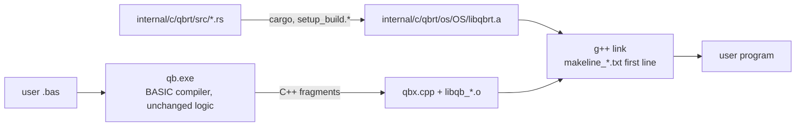

# Rust Port — Progress Log

> Project: `D:\QBNex-Rust` (git branch `rust-port`, cloned from `D:\QBNex` at `545b859`).
> The original `D:\QBNex` is **not modified** by the port. Remote `legacy-local` points at it.
> Strategy: Revision 2 in [`port-plan.md`](port-plan.md) — the BASIC compiler stays, the C++ runtime is replaced subsystem by subsystem with the Rust crate `qbrt`.

## Status (2026-11-09)

| Phase | Status | Evidence |
| --- | --- | --- |
| R0 Oracle + CI | **done (local), CI unverified** | `conformance/` runner + 25 cases (19 golden, 6 xfail); smoke + conformance + unit + differential steps in `.github/workflows/{push,pull_request}.yml` |
| R1 `qbrt` foundation + MBF slice | **done (Windows), Linux/macOS unverified** | `internal/c/qbrt`; `libqb.cpp` includes `qbrt.h` instead of `msbin.cpp`; exhaustive differential test 0 mismatches |
| R2 Leaf numeric code | **done (Windows)** | TDD + differential + legacy deleted for rounding (`qbr*`, `fpu_reinit`), RND/RANDOMIZE, VAL, STR$ number formatting (all `qbs_str` overloads), TIMER arithmetic. `libqb.cpp` is ~600 lines shorter |
| R3–R4 | pending | — |
| R5 Software graphics | **done (Windows)** | `qbrt/src/gfx/*`: image registry + `img_struct`, palettes/fonts data, SCREEN mode decisions, COLOR/PALETTE, PSET/PRESET/POINT, LINE, CIRCLE, PAINT (color + tile), DRAW, VIEW/WINDOW/PMAP, GET/PUT, PCOPY, `_PUTIMAGE`, `_COPYIMAGE`/`_FREEIMAGE` storage, `_SETALPHA`, `_CLEARCOLOR`, `_RGB*`, `_PALETTECOLOR`, software `_MAPTRIANGLE`, built-in 8x8/8x14/8x16 text. Legacy C++ deleted, one-line shims left; `mtri*.cpp` moved to `tests/legacy` |
| R6–R10 | pending | — |

### Verified on Windows (MinGW-Builds g++ 15.2.0 ucrt, rustc 1.98.0)

- `cmake --build --preset windows-mingw-selfhost` builds `libqbrt.a`, `qb-stage0.exe` and `qb.exe` linked against Rust.
- `cargo test --workspace`: 48/48 pass; `cargo clippy --workspace --all-targets`: 0 warnings.
- `diff_msbin` (legacy `msbin.cpp` vs Rust, every 2³² single-precision bit pattern in both directions + 50M double samples + edge cases): **0 mismatches**.
- `diff_round` (legacy x87 `fistp` asm vs Rust, 30M random 80-bit/double/float inputs + specials): **0 mismatches**; a mutation run reports 138k mismatches, so the harness can fail.
- `diff_val` (legacy `func_val` with `__mingw_sscanf` vs Rust, 3M generated strings incl. hex/oct/bin, 60-digit mantissas, exponents to ±5000): **0 mismatches** outside the L-05 forms that Rust fixes on purpose.
- `diff_str` (legacy `qbs_str` with MinGW printf vs Rust, 5M iterations x 10 types: random bit patterns, decimals, integers of all widths): **0 mismatches**; 553k L-07/D-05 inputs skipped by design; mutation run reports 189k mismatches.
- `diff_timer` (legacy `func_timer` + x87 `qbr` vs Rust, 20M random tick/start/accuracy combinations incl. errors): **0 mismatches**; mutation run reports 121k mismatches.
- `conformance`: 30 cases — 23 passed, 7 xfail (known legacy defects), 0 failed; golden output from the unmodified legacy build, plus one hand-written `.deviation` case.
- `tests/*_smoke.cmd` (cli, diagnostics, warnings, labels, encoding, stdlib, audio): 7/7 pass.
- R5 `diff_gfx` (verbatim legacy graphics in `tests/legacy/gfx_*.inc` + `mtri*.cpp` vs Rust on twin images, 6000 rounds x 60 random ops over SCREEN 1/2/7-13, 256-color and 32-bit images, plus exhaustive SCREEN decisions, blend tables, built-in palettes/fonts, 4M x87 long-double loads for DRAW `VARPTR$`): **2,278,925 checks, 0 mismatches** (skipped by design: 1829 `_PUTIMAGE` D-06 cases, 3337 2-bit GET D-07 cases, 10830 SCREEN 0 D-08 layouts). The mutation run reports mismatches in every op.
- R5 framebuffer conformance: `QBNEX_FB_CAPTURE=<file>` makes the runtime record each `_DISPLAY` frame and the final graphics screen (pixels + palette); the runner hashes them (FNV-1a 64) into `<case>.fb`. Eight cases in `conformance/cases/graphics` (SCREEN 7/9/12/13/32, image ops, pages + DRAW, GET/PUT, SCREEN mode switches) are pixel-exact against the legacy oracle, plus the hand-written `get_2bit_partial` deviation case. Conformance total: 43 cases, 36 passed, 7 xfail, 0 failed (a full run occasionally times out one case under load; it passes on rerun).
- `cargo test --workspace`: 132/132 pass; `cargo clippy --workspace --all-targets`: 0 warnings.

### Not verified yet

- Linux and macOS builds (native-library lists for the Rust staticlib are taken from rustc docs, not run).
- GitHub Actions runs of the new CI steps.
- Docker images (Rust toolchain added, not built).
- 32-bit Windows (`i686-pc-windows-gnu` selected automatically, not built).

## Porting workflow (TDD, legacy C++ deleted)

Every subsystem goes through the same loop:

1. **RED** — Rust unit tests describing the behaviour (values captured from the legacy oracle or QBasic semantics); run them against a stub and watch them fail on assertions.
2. **GREEN** — minimal Rust implementation in `internal/c/qbrt/src/<module>.rs`.
3. **Differential** — a harness in `internal/c/qbrt/tests/diff_<module>.cpp` links the Rust code with a *verbatim copy* of the legacy C++ (`tests/legacy/*.inc`, test-only) and compares them on millions of inputs. A mutation run proves the harness can fail.
4. **Delete** — the legacy C++ is removed from `libqb.cpp` (no `#ifdef LEGACY` fallback); only a one-line shim with the old C++ signature stays, because generated code and `qbx.cpp` call it.
5. **Conformance** — new cases blessed from `.oracle`, then the whole corpus + smoke tests run against the Rust build.

Where the legacy behaviour is a clear defect against QBasic, the Rust code fixes it, the unit test asserts the QBasic result, and the conformance case carries a `.deviation` note with a hand-written golden file.

### What "remove all C/C++" can reach under D10

With the compiler kept in BASIC, it still **emits C++**, so `internal/c/qbx.cpp`, the generated fragments and a C++ compiler at user compile time remain. Everything else can go: `libqb.cpp` shrinks to shims and then disappears, and every library under `internal/c/parts` is replaced by Rust crates. Removing the last C++ needs a separate phase (proposed **R11**): change the BASIC compiler's emitter to generate Rust (or an IR the Rust runtime executes) instead of C++. That keeps D10 (compiler stays BASIC) but needs `rustc` instead of `g++` on the user's machine. Not started; needs approval.

## How the pieces fit



- `libqb.cpp` references Rust symbols, so **every** link needs `libqbrt.a`. It is on the first line of `internal/c/makeline_*.txt`, which both the bootstrap `qb-stage0` and the current compiler read at run time. That is the only way to reach the stage0 link, because stage0 is built from the frozen snapshot in `internal/source` (see L-00).
- Windows native libs are written `-l ws2_32` (with a space) on purpose: `PrepareWindowsBuildCommand$` strips every `-lws2_32` when sockets are unused.
- `libqbrt.stamp` is rewritten on each Rust build and is part of the native build-cache key (`linker.bas`), so cached executables are rebuilt after a runtime change.
- End users do not need cargo: release bundles copy `internal/`, which contains the prebuilt `libqbrt.a`.

## How to run

```bash
# Rust unit tests
cargo test --workspace
```

```bash
# Build compiler + runtime (Windows; needs internal/c/c_compiler = MinGW, and cargo)
cmake --preset windows-mingw && cmake --build --preset windows-mingw-selfhost
```

```bash
# Conformance against golden files
cargo run --release -p qbnex-conformance
```

```bash
# Re-capture golden output from the legacy oracle (only when adding cases)
git clone --branch main . .oracle
(cd .oracle && cmake --preset windows-mingw && cmake --build --preset windows-mingw-selfhost)
cargo run --release -p qbnex-conformance -- --qb .oracle/qb.exe --bless
```

Golden output must always come from the legacy C++ runtime (`.oracle`, gitignored), never from the Rust build.

Framebuffer goldens (`.fb`) need an oracle that can capture: clone `.oracle` to `.oracle-fb`, run `conformance/oracle/make_fb_oracle.sh .oracle-fb` (adds `fb_capture_legacy.inc` to its `libqb.cpp`), build it (on Windows under Git Bash: `env -u NoDefaultCurrentDirectoryInExePath cmake --build --preset windows-mingw-selfhost`), then bless with `--qb .oracle-fb/qb.exe`. `--fb-dump <dir>` writes the raw frames for inspection.

## Legacy defects found by the corpus

These reproduce on the unmodified legacy build. They are kept as `xfail` cases (the runner reports `XPASS` once one is fixed).

| ID | Defect | Case | Severity |
| --- | --- | --- | --- |
| L-00 | **Self-host fixpoint is broken.** `qb.exe` built from HEAD compiles `source/qbnex.bas` into a second-generation compiler that fails on hello world with `[E9999] Too many errors`. Builds only work because stage0 comes from the old snapshot in `internal/source`. Regenerating the snapshot from current source is therefore impossible until this is fixed. | manual (see progress log) | Critical |
| L-01 | A main-module `ON ERROR GOTO` handler label makes compilation fail with `Unknown statement 'END'` on a line past the end of the file (TopLevelRuntime lowering, `classes.bas`). Classic QB error handling does not compile. | `errors/*`, `binary/mbf_overflow` | High |
| L-02 | `PRINT a, b` (14-column zones) writes spaces forever when stdout is redirected. | `console/print_comma_redirected` | High |
| L-03 | `RESTORE <label>` never returns. | `data/restore_label` | High |
| L-04 | Relational operators inside `PRINT` (`PRINT a$ < "K"`) are rejected as `Unknown statement 'PRINT'`. | `strings/compare_in_print` | Medium |
| L-05 | `VAL` negates the exponent after normalising: `VAL("123E-2")` = `.000123`, `VAL("0.5E-1")` = `5`. **Fixed in Rust** (intentional deviation). | `strings/val_negative_exponent` (`.deviation`) | High |
| L-06 | `PRINT USING "#.##^^^^"` on a `_FLOAT` near 1E4932 prints `%0.118973149535723F+4984` and corrupts the heap (exit `0xC0000374`). | `strings/print_using_huge_exponent` | High |
| L-07 | `STR$` of a DOUBLE that needs more than 19 decimals (e.g. `1.234567890123456D-16`) builds a broken printf format and returns ` .0f`. **Fixed in Rust** (D-04). | `strings/str_many_decimals` (`.deviation`) | Medium |

Output quirks that are preserved bug-for-bug (golden files depend on them):

- `MKSMBF$(0)` yields MBF exponent 2 (`00 00 00 02`), not zero.
- Some DOUBLE values print with a trailing zero (`-2.50`, `3.141592653589790`).
- `MKDMBF$(-0#)` and tiny/huge doubles raise overflow (error 5).
- DOUBLE `STR$`/`PRINT` adds one decimal when there are two or more significant digits (` 42.0`, `-.250`, ` 123456789012345.59`, ` .33333333333333331`): legacy uses a buffer index as the digit count. Ported as is (`numfmt.rs`).
- `STR$` of infinity or NaN is ` 0`.
- Graphics code keeps legacy float handling: `qbr_float_to_long` on SINGLE coordinates, `cvttsd2si` saturation to `INT_MIN`, and C wrap-around in CIRCLE/LINE arithmetic.

Still C++ after R5 (on purpose): the `qbg_screen` orchestration (display lock, page table, surface lifetime), `func__newimage`/`_COPYIMAGE`/`_FREEIMAGE` handle bookkeeping, hardware images and the hardware `_PUTIMAGE`/`_MAPTRIANGLE` command queue, custom (TTF) fonts in `printchr`, and text-mode surfaces. They touch window/GL state that R8 replaces, or fonts owned by R7.

Intentional deviations (Rust differs from legacy on purpose):

| ID | Change | Why |
| --- | --- | --- |
| D-01 | `VAL` applies the sign to the written exponent (fixes L-05). | QBasic semantics; legacy result is wrong by powers of ten. |
| D-02 | Rounding is QBasic round-half-even on every CPU. Legacy non-x86 builds rounded half away from zero (`f+0.5` truncation). | One behaviour on all platforms, matching x86 and QBasic. |
| D-03 | `VAL` keeps 1000 significant digits exactly and treats further non-zero digits as "slightly more". Legacy overran a 256-byte buffer past 256 digits (undefined behaviour). | Defined behaviour; correctly rounded up to 1000 digits. |
| D-04 | `STR$` prints all decimals the legacy algorithm asks for, also beyond 19 (fixes L-07). | Legacy output was garbage from a malformed printf format. |
| D-05 | `STR$` of a non-finite SINGLE is ` 0`. Legacy read a stale static buffer (result depended on the previous call). | Defined result, same as DOUBLE. |
| D-06 | Stretched `_PUTIMAGE` skips source samples that fall outside the source image. Legacy skipped source clipping when the destination is one pixel wide or high and read past the source buffer. | Defined behaviour instead of reading foreign memory; results inside the source are unchanged. |
| D-07 | Graphics `GET` in 2-bit modes (SCREEN 1) checks the array size it really writes (ceil(w/4) bytes per row, legacy checked ceil(w/8) and overran the array) and stores the last partial byte of a row left-aligned (legacy stored a stale static byte, so `PUT` drew wrong pixels). | Memory safety and QBasic array layout; `graphics/get_2bit_partial` (`.deviation`). |
| D-08 | SCREEN 0 layout compares the font in the 40x25/80x25 granularity test (legacy `(f=(16+1))` / `(f=16)` assigned it). | Code defect; every WIDTH path already passes fonts 17/16, so no reachable output changes. |

## Next steps

1. R3 string engine (`qbs`): decide on L-00 first, because generated code touches `qbs` fields directly and stage0 is frozen.
2. Decide on L-00 (frozen `internal/source`) before R3; the string engine changes structs that generated code touches directly.
3. Grow the corpus per builtin group (`subs_functions.bas`), especially PRINT USING, file I/O and string functions, before R3/R4.
4. Run the new CI on GitHub to verify Linux/macOS builds of `libqbrt.a`.
